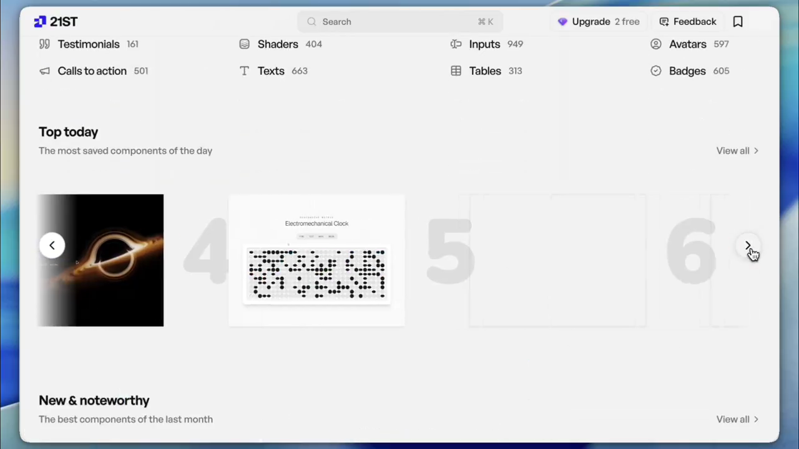
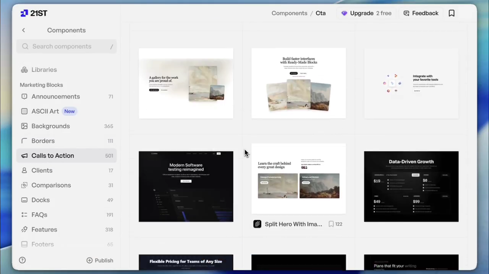
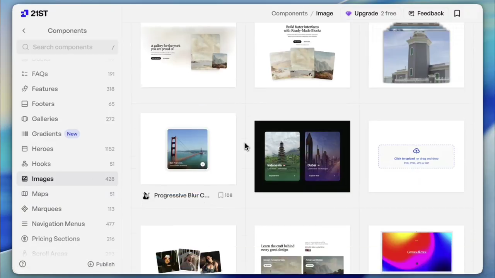
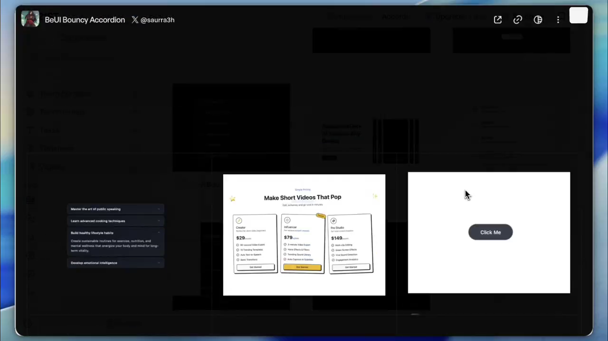
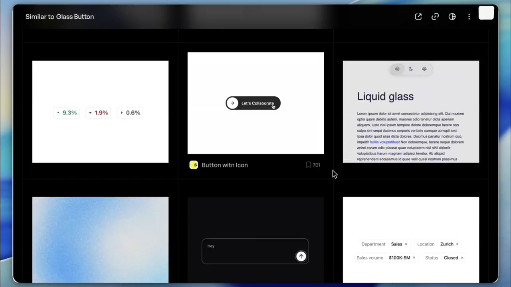

## 問題

探索大量 UI 範例時，使用者需要在快速掃描、詳細預覽和帶回專案之間切換，不能每看一個就失去原來的分類位置。

## 做法

*首頁以今日熱門與分類入口引導發現。*

*分類左欄旁顯示多種元件縮圖。*

*切換 Images 後仍使用同一瀏覽結構。*

*深色聚焦層把範例從背景網格分離。*

*另一組按鈕範例保留標題與上方操作。*

- 影片可見 21st 標誌，主畫面以左側元件分類與右側縮圖網格呈現；分類包含 Call to Action、Images、FAQ 等。
- 選取預覽後，畫面出現深色聚焦層，背景網格變暗；上方保留範例名稱與操作圖標，中間展示所選元件及相關例子。
- 原貼文說每個元素提供 Copy prompt，可貼進 Claude Code 或 Cursor。本次影格核對了發現與預覽結構，沒有執行複製或驗證生成結果。

## 為什麼有效（推論）

先在網格比較、再以覆蓋層聚焦，可能兼顧廣度與細節；可複用提示詞則有機會讓參考不只停留在收藏圖片。

## 借鑑要點

- **適合**：元件庫、設計素材庫及需要由範例開始的原型工作。
- **不適合**：把範例預覽誤當成已滿足產品需求，或沒有權限便直接移植素材。
- **移植時注意**：預覽提供退出並恢復分類／捲動位置；提示詞附依賴、授權與可及性注意事項，並保留生成後的產品驗證。

## 來源與核對範圍

- [VibeEverything 原文](https://x.com/VibeEverything/status/2088996874460303447)（發布：2026-08-16T14:30:41+00:00）。

已核對 X 公開原文的嵌入式 Tweet／NoteTweet 資料及本卡所列原始素材。`kind: concept` 表示本次僅確認公開展示／設計方法，沒有把示範等同正式上線或端到端驗證。
