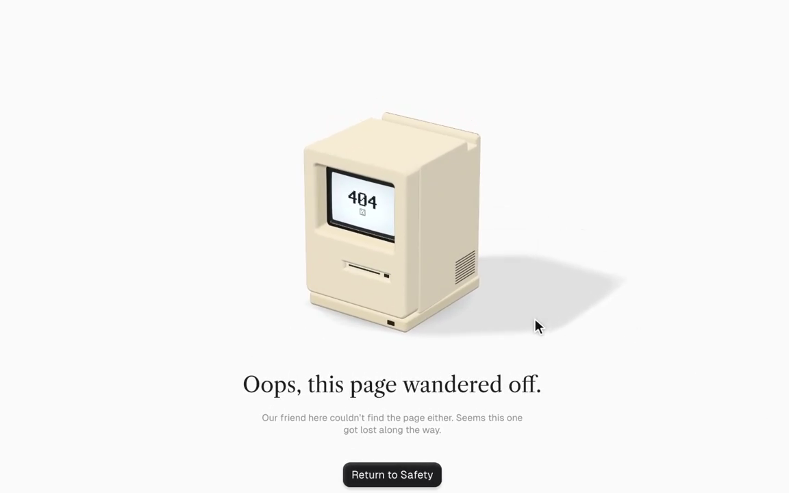
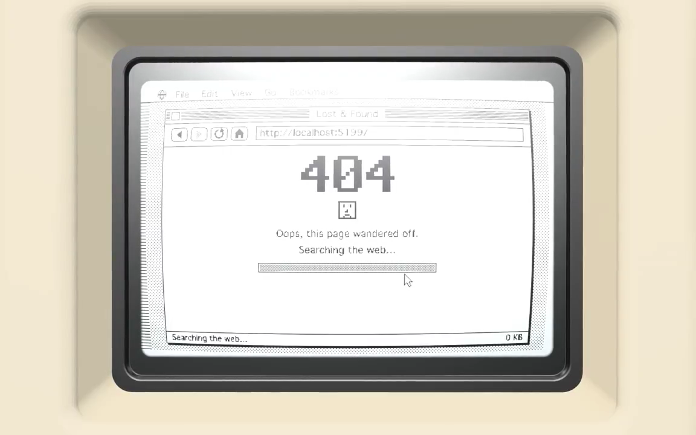
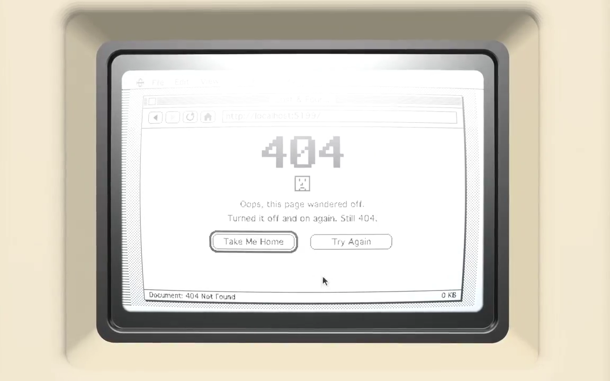
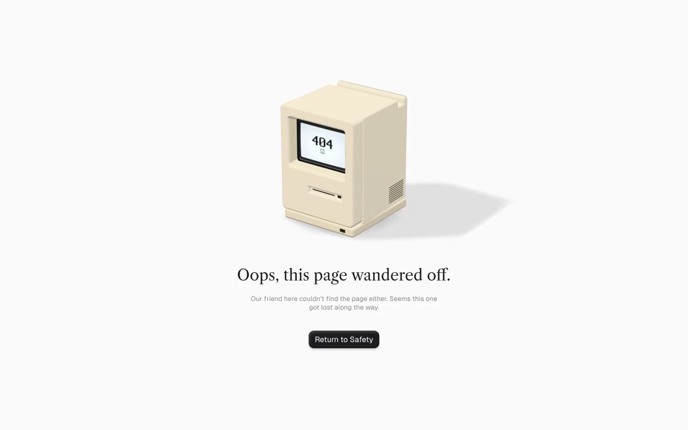

## 問題

抵達不存在的頁面時，使用者需要看懂失敗狀態並找到可離開的入口；品牌化的錯誤頁也必須保留這兩項資訊。

## 做法

*7.3 秒：白底中央是米色復古電腦，下方依序放錯誤標題、短說明與黑色 Return to Safety 按鈕。*

*21.9 秒：鏡頭靠近電腦螢幕，復古瀏覽器內顯示 404、Searching the web… 與進度條。*

*29.3 秒：搜尋狀態換成 Still 404 的說明，下方並列 Take Me Home 與 Try Again，前者有較厚外框。*

*36.6 秒：示範回到完整電腦與外層錯誤頁，Return to Safety 再次位於說明下方。*

- 外層頁面以大量留白聚焦單一電腦物件；電腦內的黑白瀏覽器延續同一個 404 主題，而不是換到不相關的動畫場景。
- 錄影順序為外層概覽 → 放大螢幕 → 搜尋中的文字與進度條 → 搜尋後仍失敗、出現返回與重試 → 回到外層。未從抽取影格確定是點擊、停留還是自動播放觸發縮放。
- 進度結束後仍明示 404，沒有呈現成功狀態；這是展示內容，不能據此判定執行了真實網路搜尋。

## 為什麼有效（推論）

- 讓趣味物件與錯誤訊息使用同一語彙，可能使品牌表達更連貫；返回與重試的不同外框則提供動作層級。
- 但深入螢幕才出現的操作會增加步驟，視覺趣味不代表恢復效率更高。示範沒有可用性數據。

## 借鑑要點

- **適合**：作品集、品牌網站的低風險 404 情境。
- **不適合**：付款、資料遺失或必須立即恢復工作的錯誤。
- **移植時注意**：讓返回入口在縮放前即可使用；重試需對應實際可重試的操作，不應假裝搜尋。提供跳過動畫、減少動態效果與鍵盤可操作的等價入口，並提高小字對比。

## 來源與核對範圍

- [Adi 原作](https://x.com/AdityaSur11/status/2121249224268394634)，發布於 2026-11-13T14:30:00+00:00。
- [Kubai 引用評論](https://x.com/Kubai087/status/2121517010995851474)，發布於 2026-11-14T08:14:05+00:00；Kubai 為轉介者，非原設計作者。
- 已核對官方 X SSR 的原帖、引用關係及 38.5 秒影片；卡內保留四張關鍵影格，未保留原始影片。僅確認示範，不代表正式上線或功能驗收。
