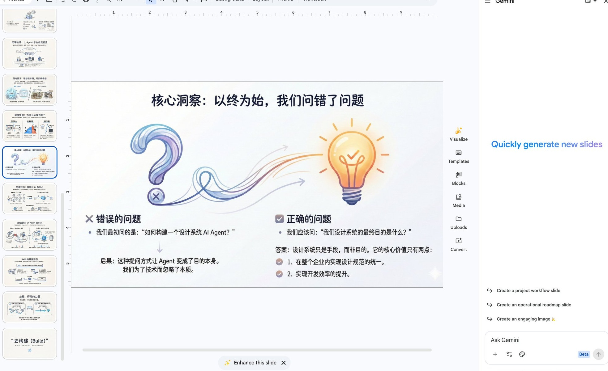
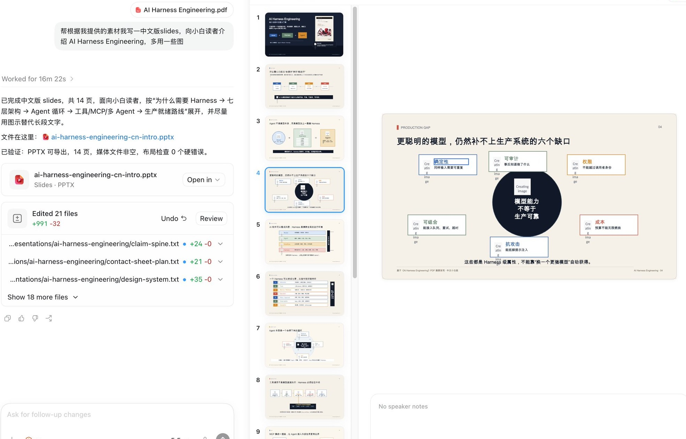

## 問題

同樣是製作投影片，主要由人編輯與主要交給 Agent 製作，應否共用相同版面？

## 做法

- 第一張 Google Slides 畫面把可編輯投影片放在中央，左側是頁面縮圖，右側 Gemini 面板提供輔助。
- 第二張 Codex 畫面把 Agent 對話放在左側主要工作區，右側顯示生成簡報的縮圖與預覽。
- 作者提出人主導時讓工具區居中、Agent 主導時讓對話成為主要入口。這是作者的設計判斷，不是所有 Agent 產品都適用的已證實規律。

*Google Slides 中央是投影片，AI 輔助面板在右側。*

*Codex 以對話指揮產出，旁邊保留簡報縮圖與預覽。*

## 為什麼有效（推論）

把高頻操作放到主要區域，可能減少在人編輯與指揮 Agent 之間切換焦點的成本。單張截圖不能證明哪種配置效率更高。

## 借鑑要點

- **適合**：需要在直接編輯與委派產出之間取捨的文件、簡報工具。
- **不適合**：把任何任務都強迫轉成聊天的產品。
- **移植時注意**：以實際操作頻率決定預設配置，允許預覽放大、編輯接管與錯誤回復；別把「對話在中間」當成 Agent 能力證據。

## 來源與核對範圍

- [原帖 2059666423538983242](https://x.com/dotey/status/2059666423538983242)：已核對 X 官方公開 HTML 內嵌的同 ID Tweet／NoteTweet 正文；發佈時間為 2026-05-27T16:01:56+00:00。
- 已下載並檢視原始媒體；影片僅保留關鍵影格，沒有保存原始影片。媒體出處與擷取時間見本目錄 `evidence.json`。
- 本卡只把貼文文字、附圖與錄影可確認的內容列為觀察；未執行產品驗收，效果解讀列為推論。
