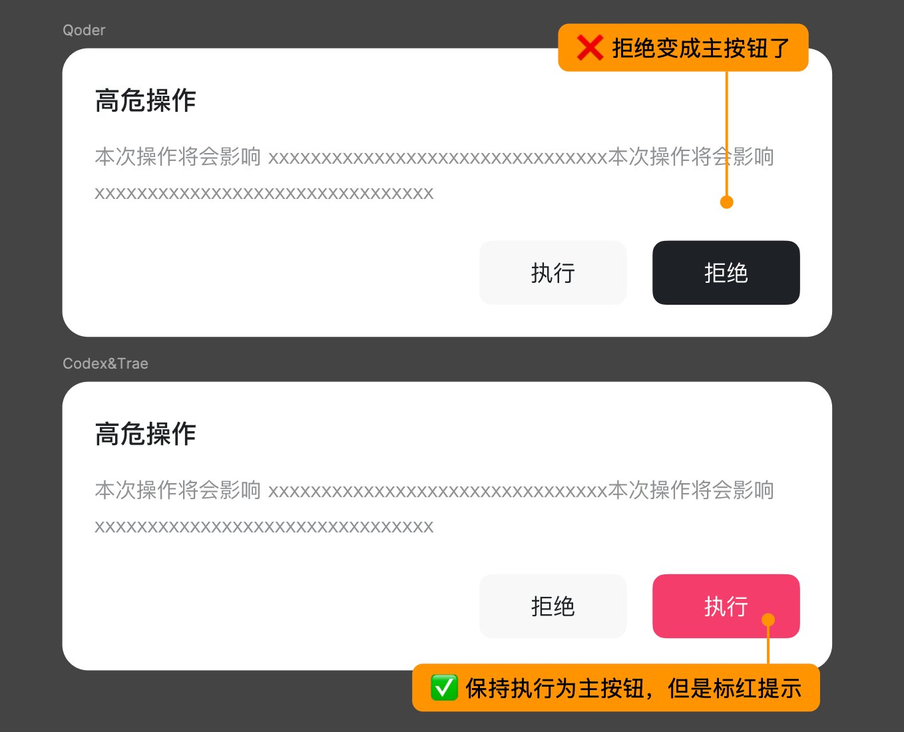

## 問題

使用者在反覆出現的執行／拒絕對話框裡，可能依位置與視覺強調快速按下；風險變化若連帶改變主次，容易混淆習慣。

## 做法

*作者手繪上方標 Qoder，深色主按鈕是拒絕；下方標 Codex & Trae，執行在右側以粉紅色凸顯。*

**附圖觀察**：兩個都是「高危操作」對話框，上方為執行／拒絕，下方為拒絕／執行；作者以註解批評前者讓拒絕成主按鈕，支持後者保持執行為主、以紅色標風險。正文口語寫 qodex，圖中實際寫 Qoder；因此不將本帖錯錄成圖示辨識案例。

這是作者明說「沒截圖、簡單畫」的比較稿，故列 concept，不據此聲稱正式產品一定如此。

## 為什麼有效（推論）

穩定的位置和明確風險標示可能幫助熟手辨識操作；但讓危險動作最醒目也可能增加誤按。作者偏好不等於安全性已驗證。

## 借鑑要點

- **適合**：審視反覆出現的 Agent 授權與危險操作確認。
- **不適合**：直接把「危險執行設為主按鈕」當所有場景的通則。
- **移植時注意**：用具體動詞說明操作對象與後果；驗證鍵盤預設焦點、Enter 行為與取消路徑，高風險操作可增加獨立確認。

## 來源與核對範圍

- [原帖 2062536809259892901](https://x.com/xin_pai88825/status/2062536809259892901)：已核對 X 官方公開頁面內嵌 Tweet／NoteTweet 快取。

- 本卡根據來源文字與已檢視媒體記錄，沒有執行產品功能驗收；作者成效宣稱不視為獨立測試。
