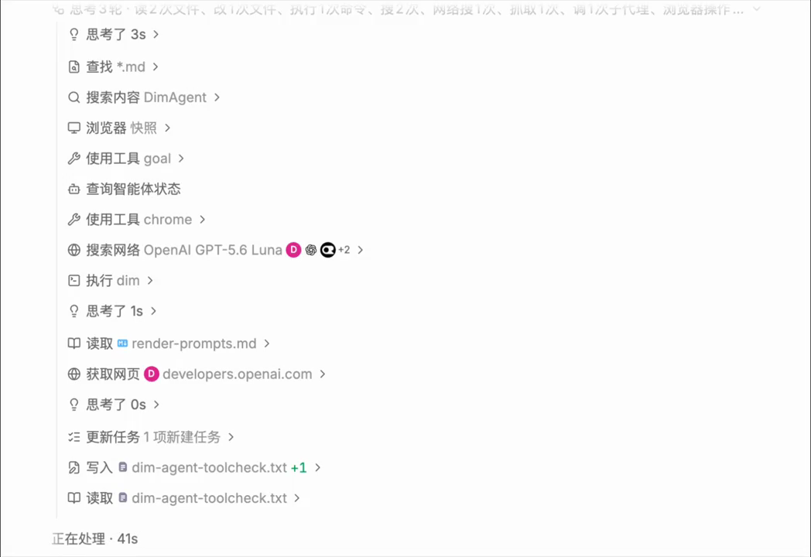
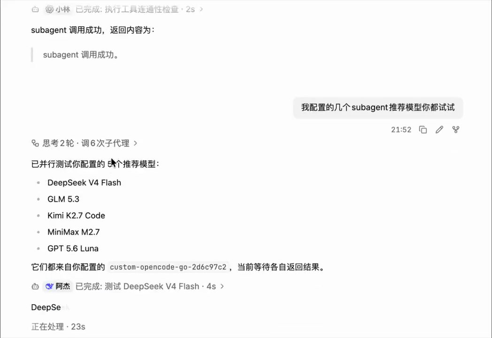
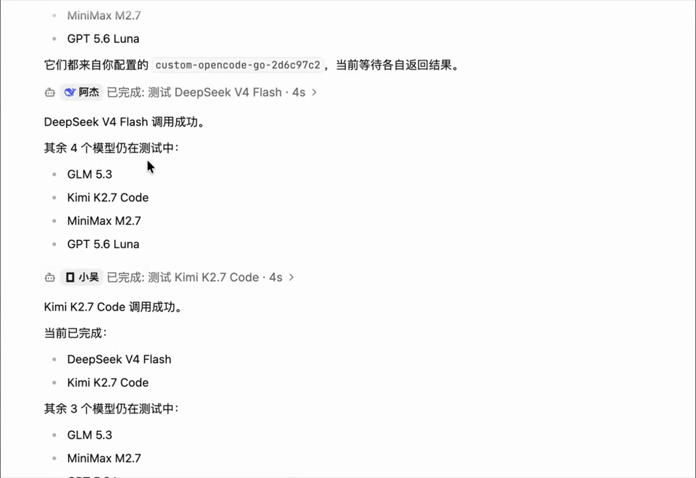

## 問題

Agent 連續讀檔、瀏覽、執行命令時，使用者難以分辨它正在工作、已完成哪一步，以及多個子任務是否仍在等待。

## 做法

*起始對話顯示工具測試與等待。*

*多種工具動作沿對話垂直累積。*

*子任務開始後，正文列出待完成項目。*

*不同子任務逐項完成，其他工作仍被列出。*

- 影片把工具動作插在對話正文之間，以小圖標、動作名稱與對象組成緊湊的一行；可見讀取檔案、執行命令與瀏覽網站等不同類型。
- 上方回覆不因工具執行而消失；後段以各模型／子任務名稱逐項回報完成，同時列出仍在處理的其他項目。
- 時序為提出工具測試要求 → 累積動作記錄 → 給出正文結果 → 追加子任務完成通知。靜態影格無法證明每個動作的成功狀態與實際後端行為。

## 為什麼有效（推論）

以使用者看得懂的動作摘要取代整段底層參數，可能降低等待的不確定性；逐項完成回報也能避免把第一個結果誤認為全部完成。這是介面推論，沒有可用的使用者研究。

## 借鑑要點

- **適合**：需要多工具、多子任務且執行時間不同的 Agent 對話。
- **不適合**：只有單步即時回答，或必須逐字稽核原始命令的場景。
- **移植時注意**：分別定義進行中、成功、失敗與取消；摘要旁保留詳細記錄入口。不要把「已呼叫」畫成「已完成」，並遮蔽命令中的憑證與私人路徑。

## 來源與核對範圍

- [ashfold 原文](https://x.com/ashfold/status/2094423801610306016)（發布：2026-08-31T13:55:21+00:00）。

已核對 X 公開原文的嵌入式 Tweet／NoteTweet 資料及本卡所列原始素材。`kind: concept` 表示本次僅確認公開展示／設計方法，沒有把示範等同正式上線或端到端驗證。
