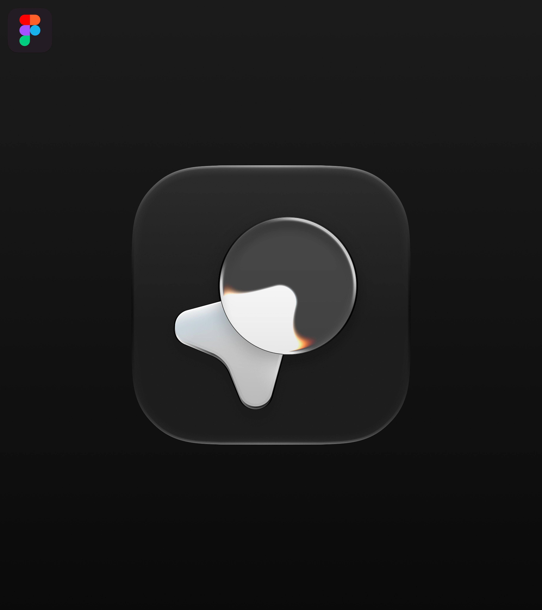
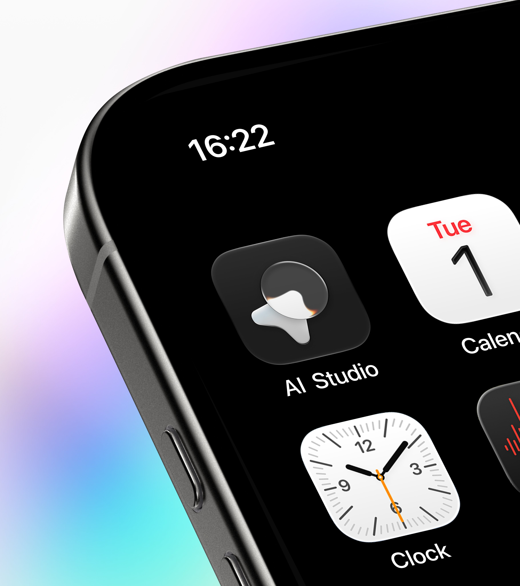
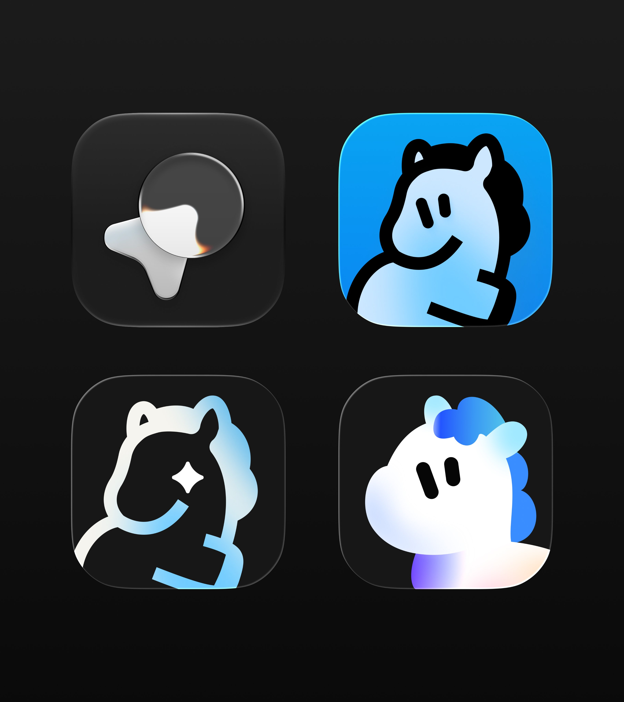
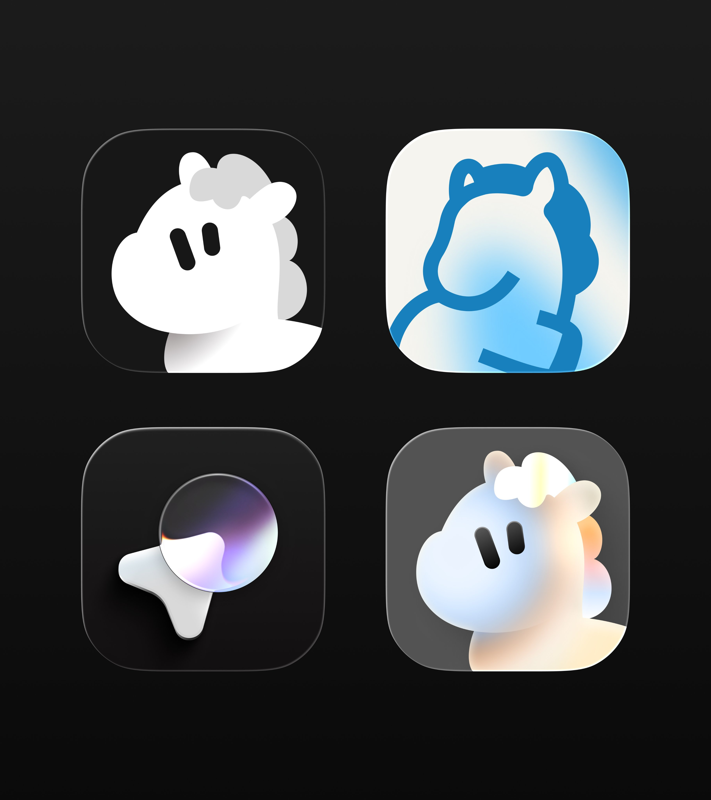
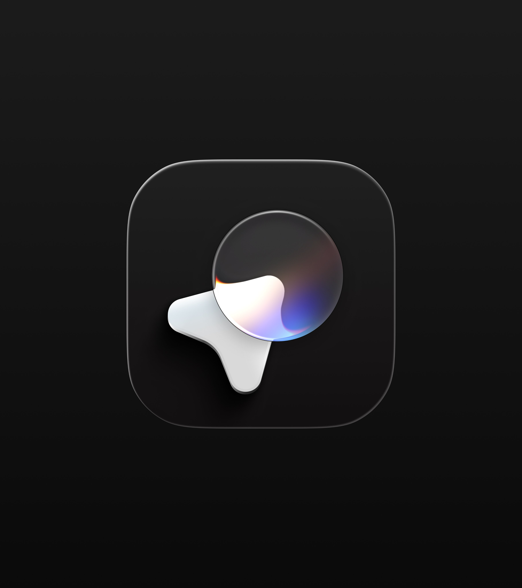

## 問題

AI 圖像與影片生成 App 的圖示若加入玻璃材質，仍需要讓主輪廓在小尺寸下成立。本例觀察如何把折射與色散集中在局部，而非用滿版彩虹代替形狀。

## 做法

[設計者原帖](https://x.com/Kubai087/status/2123458251861971238)發布於 2026-11-19 16:47:53 UTC，展示與 kemalcse 合作的 AI Studio 新版圖示及小馬探索方案。作者表示在 Figma 手工製作凹凸扭曲與色散，未使用 Icon Composer；這是作者對工具的陳述，不是本次檢查過圖層的結論。

作者的[直接回覆](https://x.com/Kubai087/status/2123458659216998763)連至 [AI Studio 的 App Store 頁](https://apps.apple.com/us/app/ai-video-generator-ai-studio/id6747102687)，可確認它是獨立的 iPhone／iPad 生成 App，並非 Google AI Studio。本卡以 concept 收錄這組設計展示：商店存在不能證明展示中的新圖示已發布，小馬方案也不當作已採用版本。

*深灰圓角方形中，白色圓潤形狀被右上方圓形材質層局部覆蓋；交界出現彎曲與暖色亮邊。*

- 白色主形位於中央偏下，圓形層偏右上；兩層交疊而非同心排列。
- 圓形內部的白色輪廓向內彎曲，外部輪廓仍伸出左側與下側；圓周細亮邊、底部陰影和外框高光共同交代層次。

*手機主畫面展示稿把 AI Studio 與 Calendar、Clock 並列，圖示下方保留 App 名稱。*

- 此圖提供相鄰系統圖示與名稱的比例參考；它是展示稿，不能作為安裝驗證。

*四個方案並排比較折射圖示、藍底粗黑線小馬、深底漸層輪廓小馬與白色立體小馬。*

*另一組四格圖比較平面白馬、淺底藍線馬、彩色折射圖示及帶粉彩光影的立體馬。*

- 小馬探索同時改變線條粗細、填色與立體光影；圖片沒有標示哪個小馬方案被採用，不據排列推定先後版本。

*同樣的圓形與白色主形結構中，圓形右下出現藍紫色帶，交疊處仍可見白色彎曲邊界。*

- 第五張比第一張有更明顯的藍紫色散；兩者是靜態圖，不推定會依手勢或光線動態變化。

## 為什麼有效（推論）

- 把材質集中在一個圓形區域，可能讓人同時讀到主形與折射，而不讓所有邊緣互相競爭。
- 深色底承托白色輪廓，彩色只出現在交界與局部圓面，可能保留主次層級；未提供小尺寸辨識或使用者測試數據。
- 以相同圓角外框比較抽象主形與小馬方案，有助於討論品牌輪廓和材質的取捨；不能由展示圖推斷選案理由或商業成效。

## 借鑑要點

- **適合**：單一 App 圖示、品牌標記的材質探索，需要兼顧簡單輪廓與局部光學細節時。
- **不適合**：密集工具列、小尺寸狀態圖示，或必須只靠形狀立即辨識的警示符號。
- **移植時注意**：先用單色確認輪廓，再疊一個局部折射區；以實際桌面尺寸和深淺背景檢查邊界，不能只看放大展示。自行調整輪廓與配色，不直接複製品牌圖形；沒有圖層證據時，不把漸層或混合模式猜測寫成作者製作步驟。
