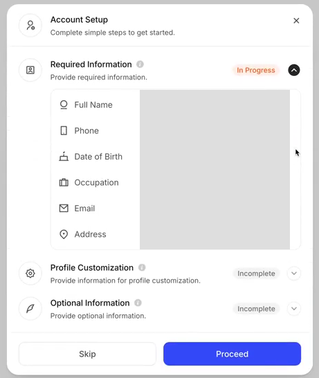
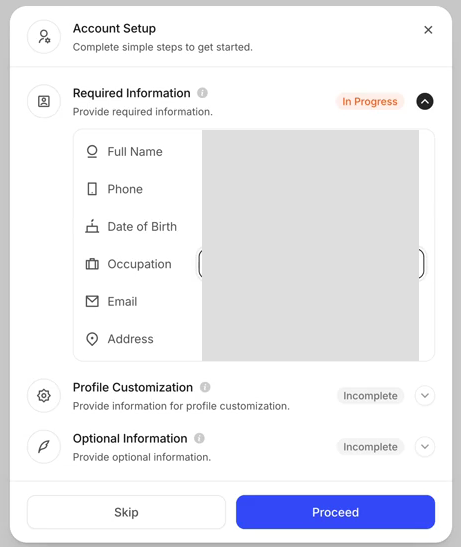
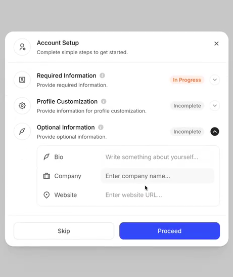

## 問題

帳戶初始化有必填、個人化與可選資訊；全部同時展開會拉長表單，也不易知道還剩哪一組沒完成。

## 做法

*初始狀態展開必填欄位，其他分組收合。*

*輸入欄位仍留在同一分組內；示範個資已遮蔽。*

*正在輸入 email，分組狀態仍顯示進行中；值已遮蔽。*

*後段改為展開可選資訊，底部主次操作保持一致。*

- 影片以 Account Setup 對話框承載三組內容：Required Information、Profile Customization、Optional Information，各組都有副說明和右側狀態。
- 最初展開必填資訊，欄位以圖標／標籤在左、值或輸入框在右排列；輸入過程保留 In Progress 狀態。
- 後段必填組收合，Optional Information 展開；底部 Skip 與高對比 Proceed 保留在對話框下方。
- 觸發是填寫與切換分組，變化是欄位區展開／收合，結束狀態仍可看見其他分組的名稱與狀態。影片未展示所有驗證錯誤或提交完成。

## 為什麼有效（推論）

分組讓使用者一次處理較少欄位；收合後留下狀態，可能減少「到底有沒有填完」的不確定性。必填與可選的語義也比單一進度條更具體。

## 借鑑要點

- **適合**：多組設定、帳戶建立及逐步補全檔案。
- **不適合**：只有兩三個欄位的短表單，或需同時比較多個欄位值的任務。
- **移植時注意**：不要讓 Skip 跳過不可省略的條件；狀態要根據有效值而非是否曾點開。鍵盤展開後移到首個欄位，錯誤摘要能重新打開對應組。

## 來源與核對範圍

- [ersadwork 原文](https://x.com/ersadwork/status/2062841141318320395)（發布：2026-06-05T10:17:08+00:00）。

已核對 X 公開原文的嵌入式 Tweet／NoteTweet 資料及本卡所列原始素材。`kind: concept` 表示本次僅確認公開展示／設計方法，沒有把示範等同正式上線或端到端驗證。
