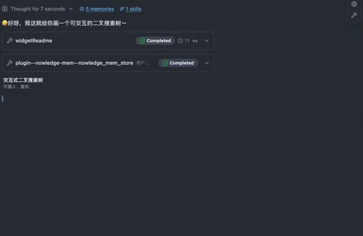
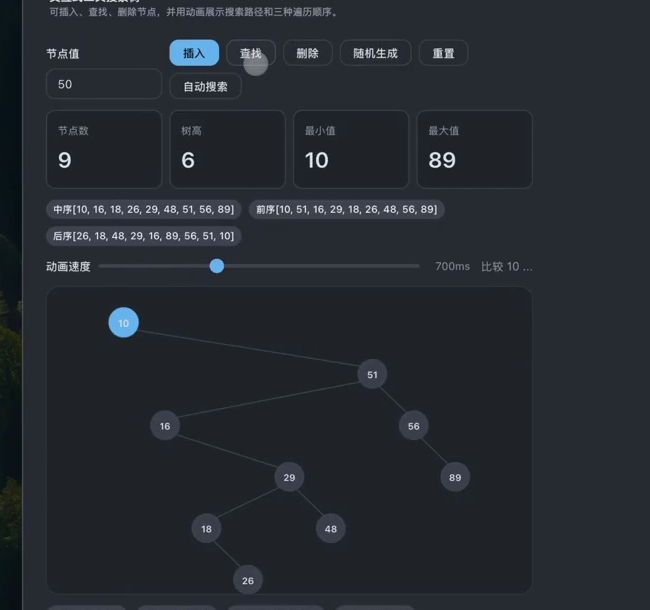
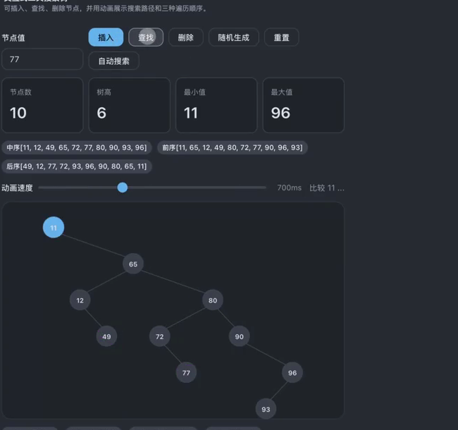

## 問題

Agent 解釋資料結構時，靜態文字難以呈現修改某個節點後的圖形關係。

## 做法

*約 15 秒：工具執行狀態已完成，對話中開始產生互動式內容文字。*

*約 45 秒：節點輸入、操作按鈕、統計卡與樹狀圖留在同一回答中。*

*65 秒：樹狀圖的節點值與統計更新，速度滑桿和走訪序列仍可見。*

影片從工具狀態與流式文字 → 同一對話中的二叉樹元件 → 不同節點狀態。元件包含輸入、插入／查找／刪除／隨機生成／重置按鈕、統計、走訪序列、速度滑桿與圖形。取樣可確認狀態差異，未逐項驗證每個按鈕或演算法正確性。

## 為什麼有效（推論）

把輸入、結果與圖形放在回答內，可能降低解釋與試驗之間的切換成本；這不是效率測試。

## 借鑑要點

- **適合**：需要將中間結果和操作脈絡一起保留的生成或教學工具。
- **不適合**：以動畫或局部取樣取代真實執行驗證。
- **移植時注意**：明示目前狀態、失敗與重試入口，讓鍵盤及讀屏可理解數值與圖形；為互動設定可驗證的操作契約。

## 來源與核對範圍

[作者原帖](https://x.com/yetone/status/2033111675256324301)（`2026-03-15T09:22:51+00:00`）。2026-11-27 核對完整公開原文及官方媒體；只保存三張影格，未保存原始影片。
歷史收藏線索 [yetone 評論 dynamic widgets](https://x.com/yetone/status/2106394380299022620) 直接連到本原帖；所引用的 Codex 討論屬另一上下文，本卡不推論產品起源、首創或兩者實作相同。圖片裁去使用者提示詞、桌面與不必要的標題列。
