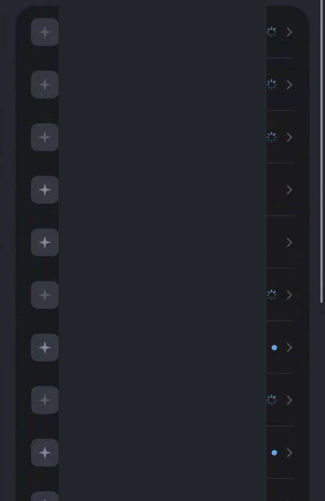
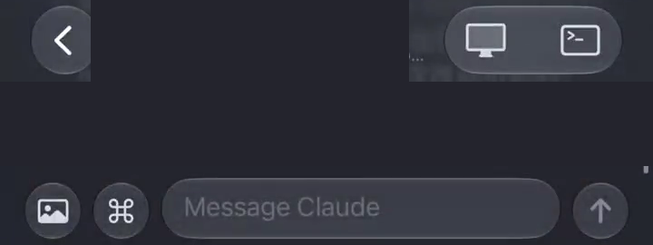
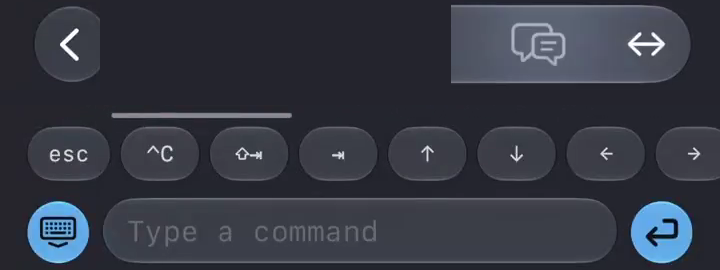

## 問題

在手機遠端控制桌面 Agent，使用者常需縮放桌面畫面才能讀寫內容；原作者表示希望用手機原生 GUI 改善此操作。

## 做法

本次恢復取得原帖完整 NoteTweet 與官方 53.984 秒影片，檢視 1、10、20、30、40、52 秒六張取樣，保留三張設計區。正文中的中繼伺服器、加密與區域網路自動切換是作者聲明，未經本庫測試。保留圖片遮去所有任務名稱、專案路徑、對話及終端內容；第二、三圖各將同一影格的頂部工具列與底部輸入區並排於上下，不是完整螢幕。

*10 秒：列表每列左側有圖示，右側以轉動樣式符號、藍點與箭頭提供狀態及進入入口；任務文字與路徑已遮除。*

*20 秒：原生對話頂部可見螢幕與終端入口，底部有圖片、快捷操作與 Message Claude 輸入；正文與專案標記已移除。*

*30 秒：終端視圖保留返回與對話切換圖示，下方放 Esc、控制鍵、方向鍵及獨立命令輸入。*

- 觸發：由專案內的 Agent 列表進入一則會話。
- 變化：影片先顯示適合手機寬度的對話與圖片，接著切到等寬文字的終端視圖；底部輸入從對話框變成命令欄與常用特殊鍵。
- 結束：之後回到原生對話，再回到 Agents 列表。影片可確認視圖切換，不足以證明底層狀態同步、圖示狀態語義或連線安全。

## 為什麼有效（推論）

- 讓閱讀回覆與操作終端各用適合的輸入方式，可能降低手機上縮放與找鍵的負擔。
- 把終端入口放在會話工具列，有助於進階操作後回到同一任務；仍需驗證切換時保留捲動位置與草稿。

## 借鑑要點

- **適合**：手機查看並介入遠端開發任務。
- **不適合**：直接把完整桌面縮成窄螢幕、卻不提供手機輸入與導航的工具。
- **移植時注意**：明示目前視圖與連線狀態；切換時保留任務上下文；另外設計斷線、輸入未送出及權限失敗的回復流程。
