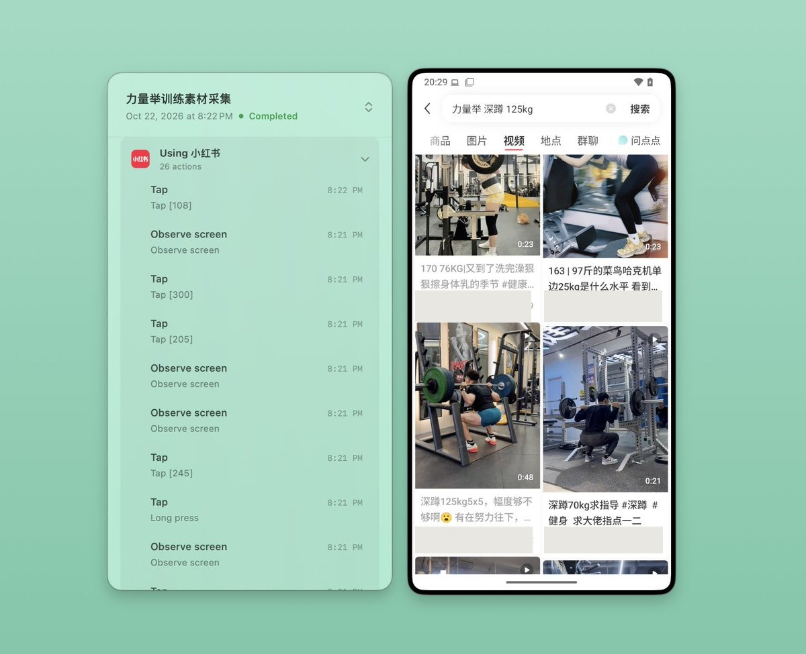

## 問題

代理操作 Android 時，使用者需要回看它看見什麼、在哪一步點了什麼，而不只看到最後結果。

## 做法

*左側依序排列觀察與點擊，右側顯示手機畫面。*

- 原圖把動作歷史面板與手機畫面並排；左側可見多筆 Observe screen 與 Tap 紀錄，右側保留當前手機內容；留存圖已遮去社群帳號與頭像。
- 作者明確介紹時間軸回顧，用於以 AI 的視角檢查觀察與點擊；熄屏使用與不干擾其他 App 是作者功能聲明，未在此實測。

## 為什麼有效（推論）

- 把動作與畫面放在同一視野，可能降低追查錯誤操作時在日誌和裝置間來回切換的成本。

## 借鑑要點

- **適合**：裝置代理、自動化操作紀錄與失敗診斷。
- **不適合**：只需一次簡單操作、沒有歷史追溯需求的入口。
- **移植時注意**：將觀察與動作分開命名並保留時間順序；預設遮蔽裝置上的私人內容。

## 來源與核實範圍

- [@1ittlecup 原帖](https://x.com/1ittlecup/status/2113244957305933920)；發表時間：2026-10-22T12:23:54+00:00。
- 依原帖文字與本次實際檢視的素材整理；未操作產品驗證功能。`date` 為收錄日期；原帖發表日期另記於 `published_at`。
