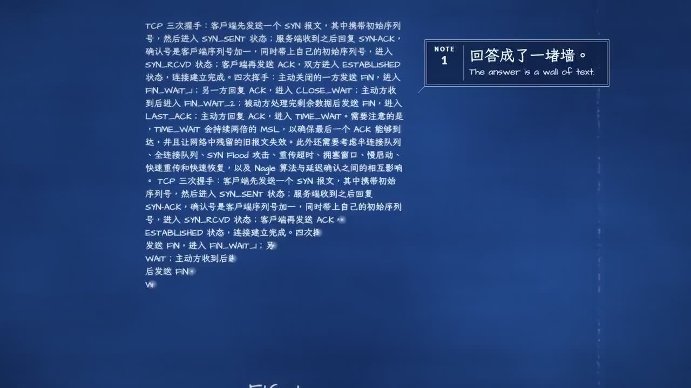
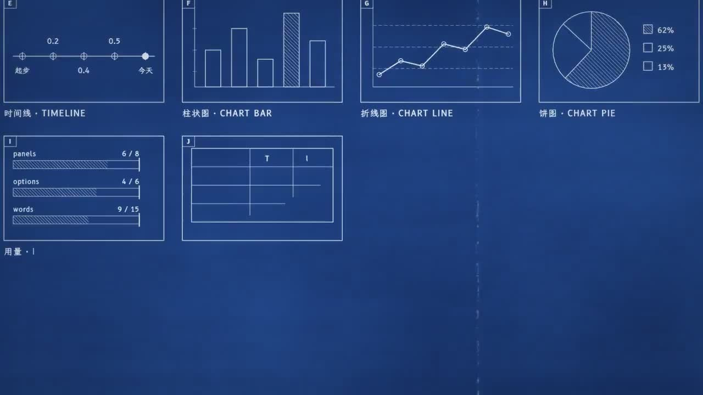
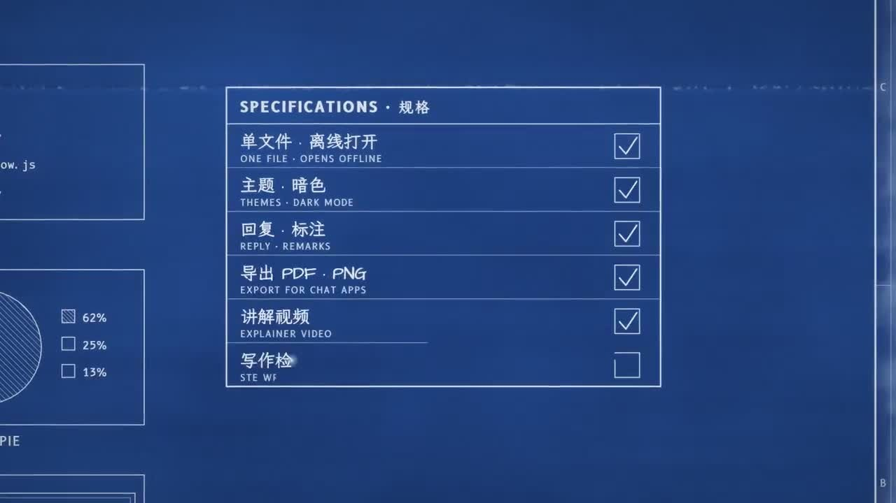
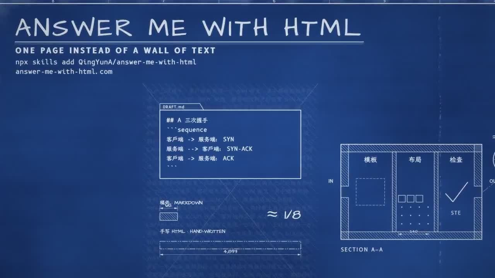

## 問題

長篇純文字回答包含流程、比較與數值時，讀者需要花時間自行整理關係。

## 做法

*影片先展示尚未結構化的長篇文字。*

*不同資料關係被拆成時間線、圖表與表格模組。*

*規格用可核對的清單單獨呈現。*

*結尾以單頁排列流程與比較區。*

- 原文說明輸入是 Markdown，再由 CLI 轉為 HTML；附片先展示一大段文字，再切換成藍圖風格的結構化版面。
- 影片依序展示流程箭頭、時間線、長條圖、折線圖、圓餅圖與規格核對清單，而不是將每段文字套上相同卡片。
- 結尾將流程區與比較區放入單頁；影片標示可離線打開、主題切換與 SVG 匯出等規格，這些是示範中的標籤，未實測。

## 為什麼有效（推論）

- 依資訊關係選擇圖形，可能使讀者更快找到比較、順序與比例。

## 借鑑要點

- **適合**：結構明確的分析回答、說明頁與摘要。
- **不適合**：資料不確定卻用精確圖表製造可信度的內容。
- **移植時注意**：先核對圖表資料與比較基準；讓文字來源仍可追溯，避免視覺化時丟掉限制條件。

## 來源與核實範圍

- [@CyanCloud77 原帖](https://x.com/CyanCloud77/status/2117532958202716255)；發表時間：2026-11-03T08:22:53+00:00。
- [作者專案](https://github.com/QingYunA/answer-me-with-html)。
- 依原帖文字與本次實際檢視的素材整理；未操作產品驗證功能。`date` 為收錄日期；原帖發表日期另記於 `published_at`。
