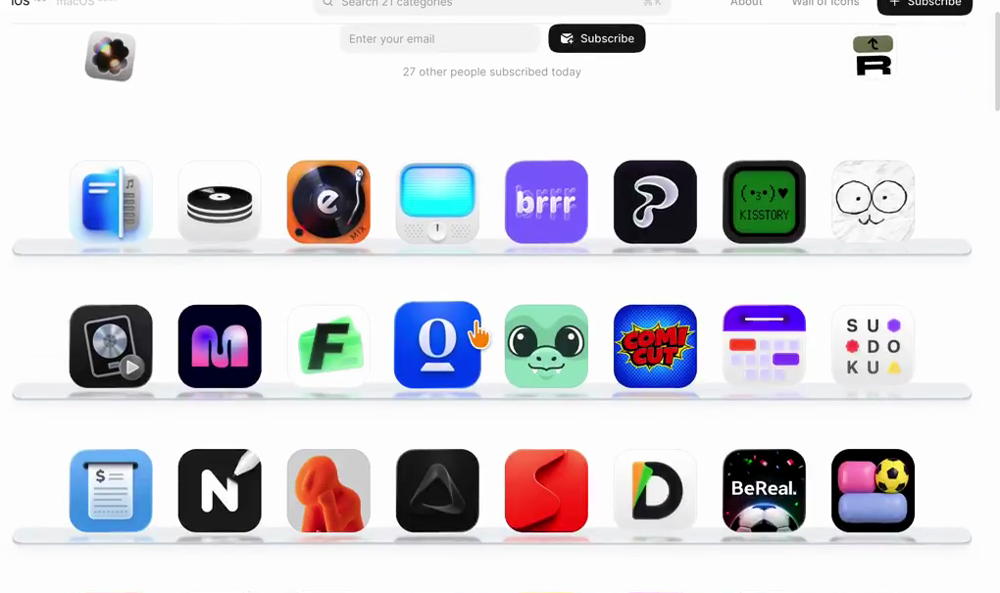
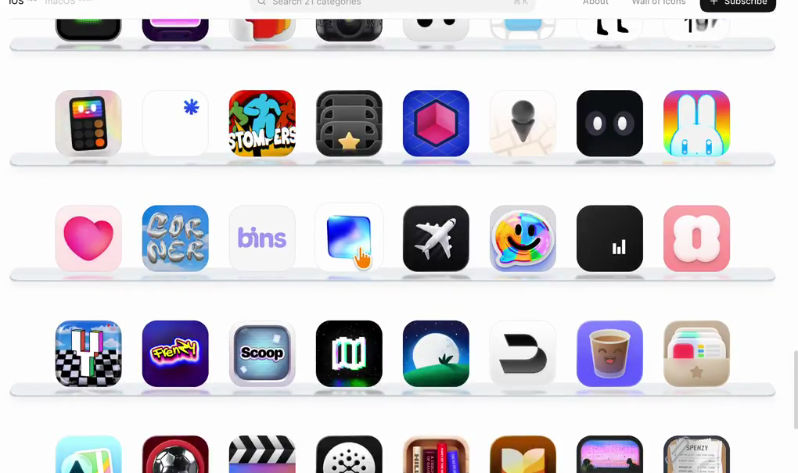
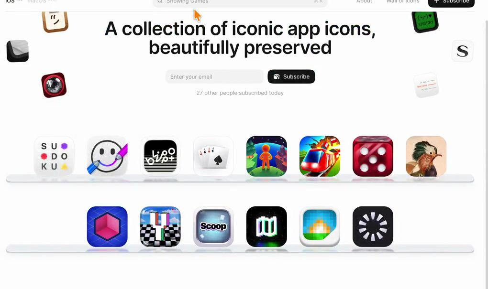
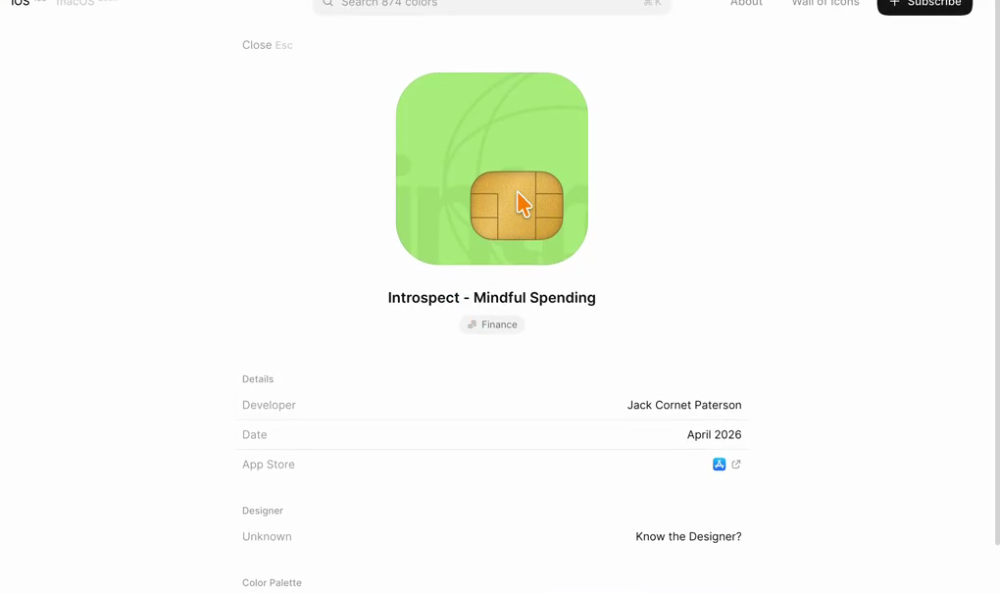
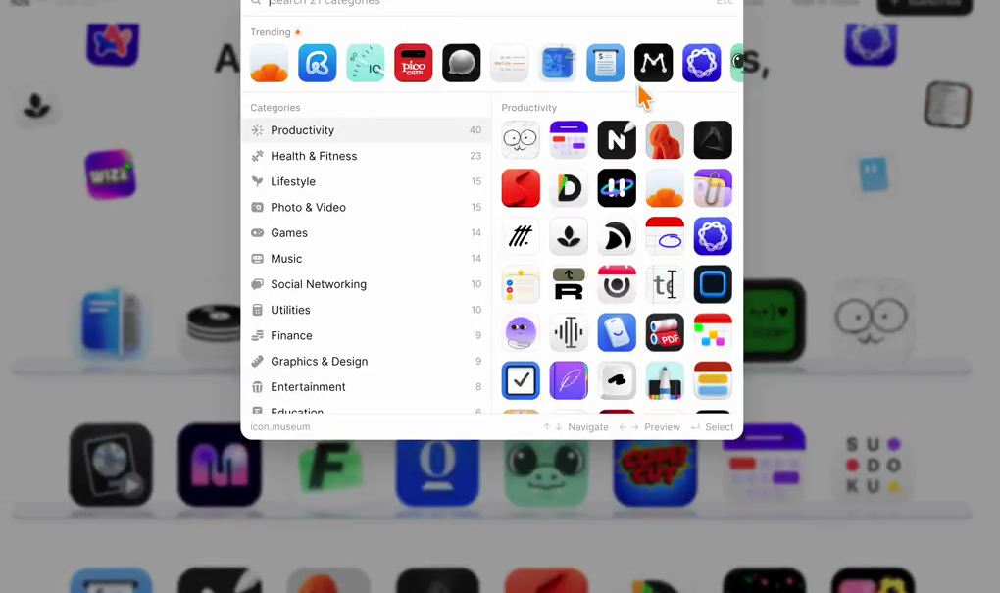

## 問題

參考 App 圖標時，單張大圖不足以比較系列輪廓與材質，也難追溯作品作者及同類圖標。

## 做法

*同一尺度的 App 圖標排列在多層基線上。*

*往下瀏覽仍維持層架節奏。*

*首頁以標題與部分圖標共同構圖。*

*作品詳情集中大圖、文字資料與色彩帶。*

*浮動索引使用分類與縮圖網格。*

- 影片首頁把大量圓角 App 圖標排成水平層架，圖標以近似尺度呈現，層架下的微陰影讓每排有共同基線。
- 點入單個作品後，中央以較大圖標作主體，下方列出作品與作者等資訊，並有色彩帶／色彩資料。
- 後段開啟一個浮動索引，左側是分類與數量，右側仍是小圖標網格；首頁背景被壓暗，保留回到原瀏覽環境的脈絡。
- 作者提到擬人化及品牌形象，這是其評價；本卡不把圖庫內作品解讀為作者本人設計，也沒有核對再使用授權。

## 為什麼有效（推論）

統一尺度與層架基線可讓視覺差異更容易比較；詳情頁補來源和色彩，有機會把純靈感瀏覽轉成可追溯的參考。

## 借鑑要點

- **適合**：圖標、封面及品牌素材參考圖庫。
- **不適合**：主要目的是搜尋精確功能符號，或把展示層架直接當成高密度管理清單。
- **移植時注意**：加入文字搜尋與清楚作者連結；鍵盤可開啟詳情並返回原位置。下載和參考用途分開說明，不能以可見圖片推定授權。

## 來源與核對範圍

- [xiaoerzhan 原文](https://x.com/xiaoerzhan/status/2068204579578417451)（發布：2026-06-20T05:29:31+00:00）。

已核對 X 公開原文的嵌入式 Tweet／NoteTweet 資料及本卡所列原始素材。`kind: concept` 表示本次僅確認公開展示／設計方法，沒有把示範等同正式上線或端到端驗證。
