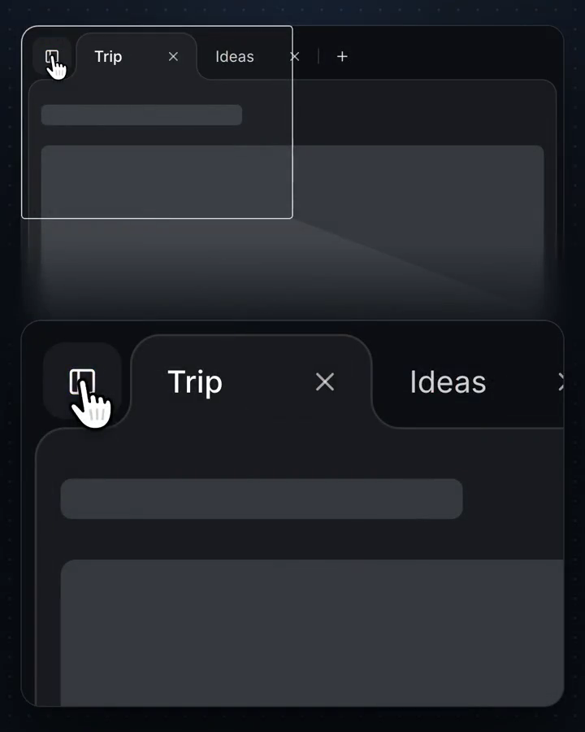
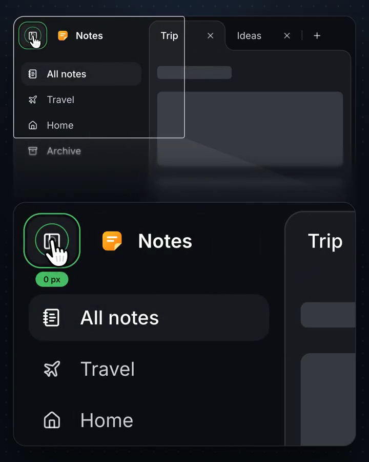
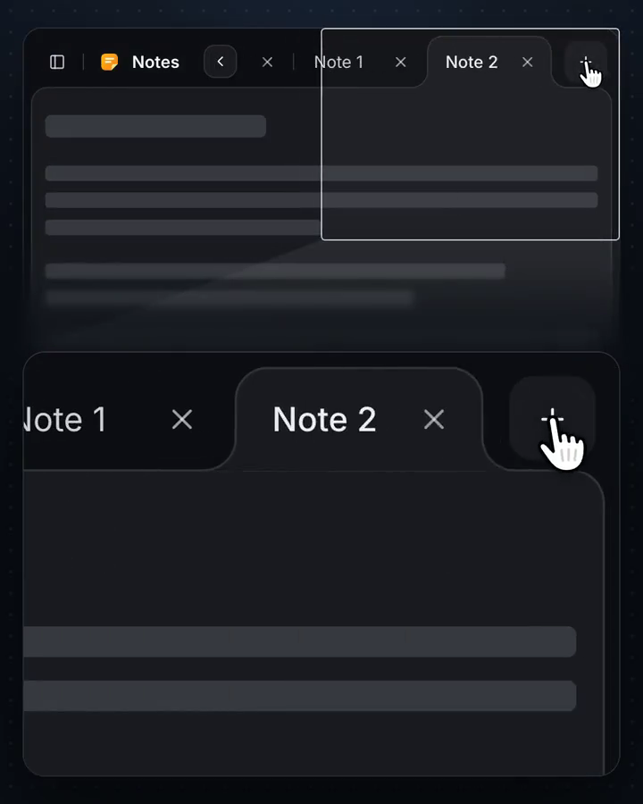
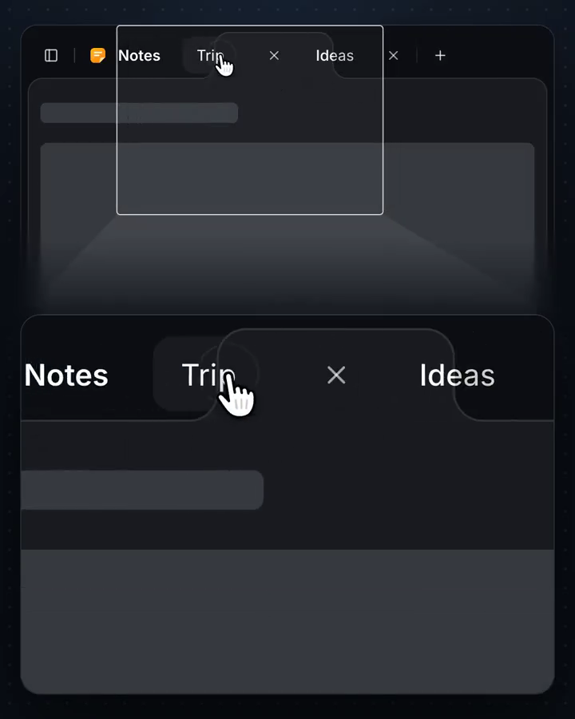

## 問題

側欄收合後，如果控制按鈕跟著移到另一個位置，使用者再次開啟時必須重新找目標；動態分頁也可能和側欄標題爭用頂部空間。

## 做法

- 深色工作區把側欄清單放左側，頂部相鄰排列 Notes 身分、Trip／Ideas 等可關閉分頁及新增入口。
- 作者先以放大區、軌跡線和慢放比較切換時的位移；中段對開關標出「0 px」，示範將開關留在左上同一位置，讓 Notes 標題與主內容分頁配合展開／收合。
- 觸發開關 → 左側 All notes／Travel／Home／Archive 清單出現或退場 → 主內容與分頁列跟著改變寬度；控制開關仍留在左上角。這是影片中的設計目標與可見狀態，未自行量測為零位移。
- 後段新增 Note 1／Note 2 分頁，游標再移向 Trip；每個分頁保留文字與關閉叉號，選中項以凸起的頁籤外形接到內容區。

*約 8 秒附近的取樣：左上保留側欄開關，Trip 與 Ideas 分頁接在其右側。*

*約 16 秒附近的取樣：側欄清單展開，放大示意在開關下方標記 0 px。*

*約 20 秒附近的取樣：內容分頁增加 Note 1、Note 2，新增入口仍在分頁列右側。*

*約 28 秒附近的取樣：游標指向 Trip，該處出現圓角底色；Ideas 仍保留接到內容區的凸起輪廓，不能由此影格確認 Trip 已完成選取。*

## 為什麼有效（推論）

固定反覆使用的開關位置，可能減少開關側欄時重新定位目標的成本；把側欄身分與文件分頁分開處理，也有助於維持兩者的層級。沒有使用者測試或量化效率證據。

## 借鑑要點

- **適合**：可收合側欄、同時開啟多份內容的桌面 Web 工作台。
- **不適合**：狹窄手機畫面仍原樣塞入整排文件分頁。
- **移植時注意**：先固定開關的命中區與焦點順序，再處理寬度動畫；補上分頁溢出、關閉選中分頁後的去向、鍵盤切換與降低動效規則。

## 來源與核對範圍

[作者原帖](https://x.com/diegohaz/status/2124186265461707055)官方公開頁內嵌資料附 39.783 秒影片。檢視每 2 秒共 20 張取樣，選存四張設計區影格；未保存原片。影片混用比較、放大與慢放，不將剪輯當成一次連續實際操作，也不把作者預告中的程式配方集視為已交付。
