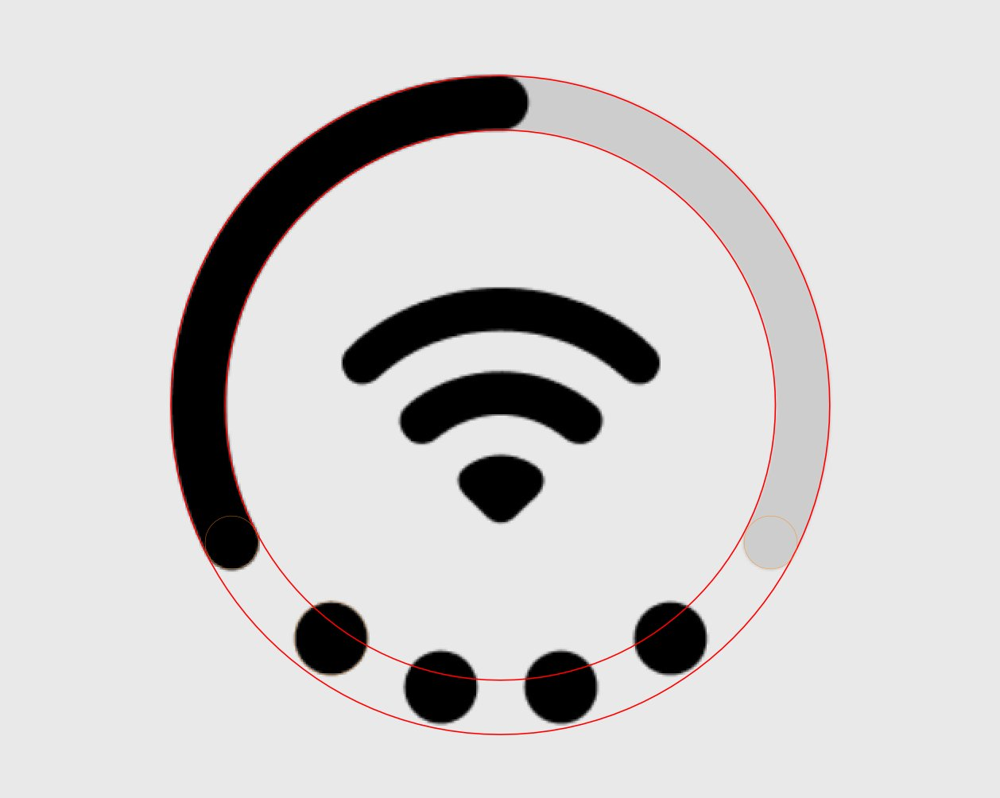
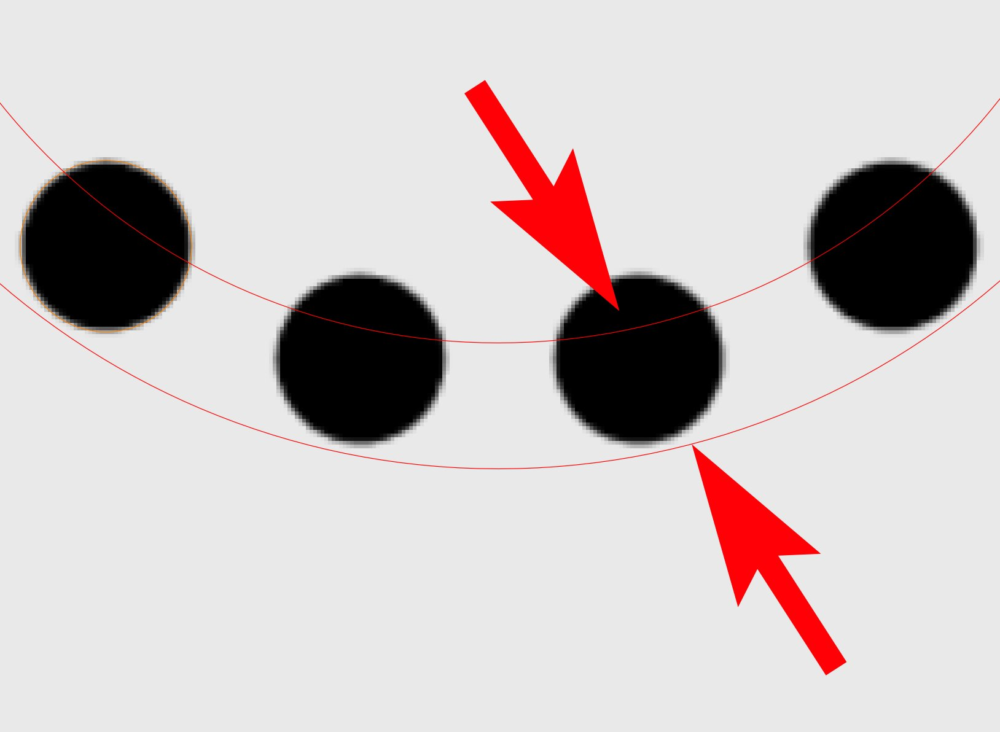
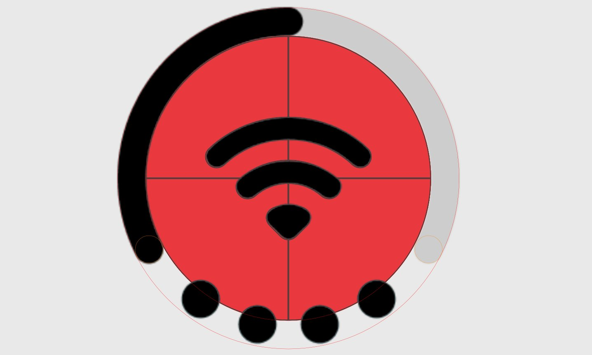
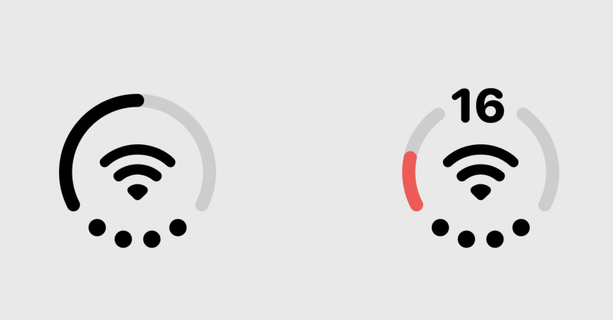
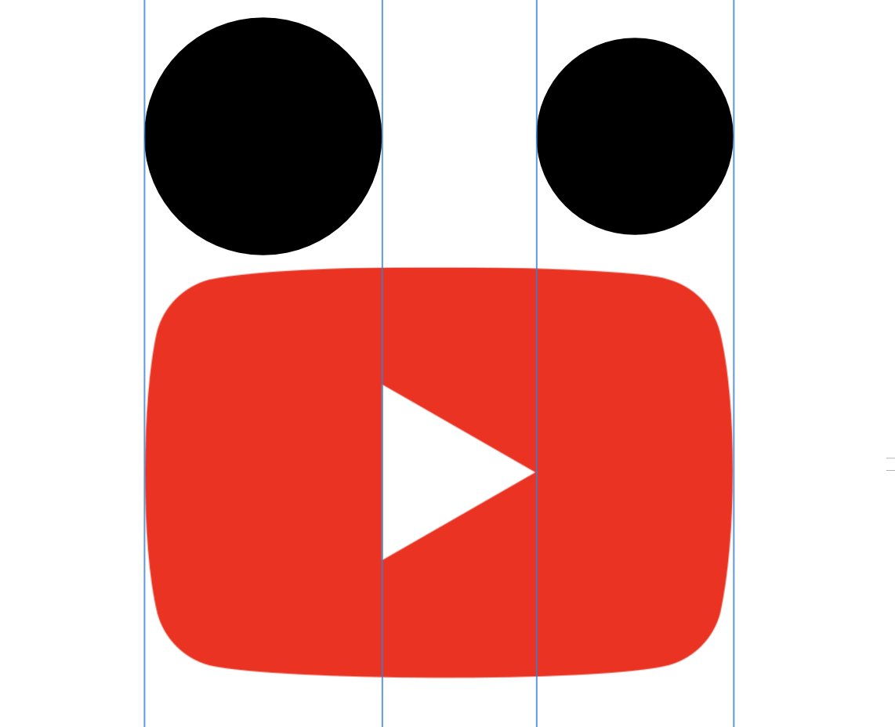
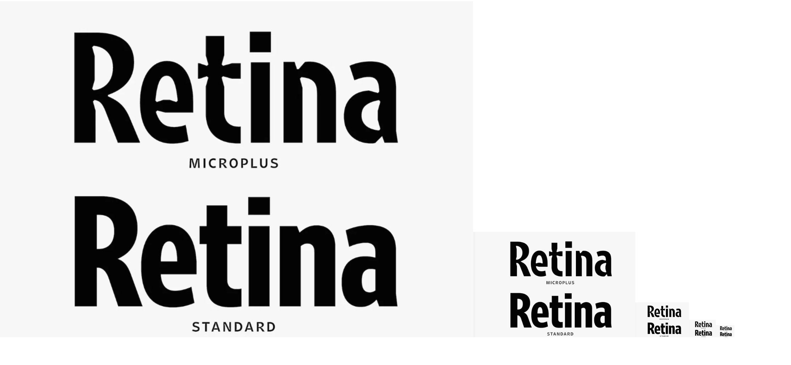

## 問題

把 Wi-Fi、外圍弧線、訊號點與數字組在同一圖標時，幾何等距不一定在小尺寸下看起來平衡。

## 做法

*外圈輔助線呈現四個圓點與弧線的相對位置。*

*放大圖指出圓點侵入內側的細節。*

*紅色區塊用來比較上下負空間。*

*無數字與數字 16 的狀態並排。*

*播放三角形以外框和輔助線討論視覺置中。*

*Retina 不同字形與縮小版本用於比較小尺寸補償。*

- 已讀取 @Sisymithus 的 X ArticleEntity 全文與原圖；文章以一組狀態圖標重繪圖為例，外圈下方有四個較粗圓點，中央是 Wi-Fi，另比較頂部加入 16 的版本。
- 圖中以細紅圓弧標出圓點與外圈的相對位置，又用紅色扇形顯示上下負空間；預設版與有數字版並排，讓新增元素的空間影響可被比較。
- 文章另以播放三角形和 Retina 字體示意光學校正，並承認黃金比例／Fibonacci 圓的拆解有後驗擬合成分。本卡沒有把作者的輔助線當成 Apple 官方設計原稿或設計師意圖。
- 同批 @Sukiea1008 推薦的是這篇文章，合併為同一來源流；其附圖是擷取文章的聊天記錄，不能提供獨立設計驗證。

## 為什麼有效（推論）

先看輪廓和負空間、再比較有無數字與實際顯示尺寸，可能比要求每個元素機械等距更接近視覺平衡。作者所說的補重量是分析假說，沒有 Apple 一手設計文件佐證；黃金比例也不是美感保證。

## 借鑑要點

- **適合**：複合狀態圖標、Logo 曲線、播放按鈕與小尺寸字形的視覺調整。
- **不適合**：用幾何疊圖反推品牌的真實創作過程，或用數學比例替代可讀性和辨識測試。
- **移植時注意**：保留無數字、長數字、不同訊號及深淺模式版本；以原尺寸與放大圖同時檢查。一次只改圓點大小或偏移量，再比較負空間，不照搬作者擬合的精確比例。

## 來源與核對範圍

- [Sisymithus 原文](https://x.com/Sisymithus/status/2099827668686659989)（發布：2026-09-15T11:48:23+00:00）。
- [合併來源 @Sukiea1008](https://x.com/Sukiea1008/status/2099911306338091289)（發布：2026-09-15T17:20:44+00:00）。
- 文章正文由同一原貼文 SSR 的 ArticleEntity／plain_text 取得；發布時間另見原文 metadata。

已核對 X 公開原文的嵌入式 Tweet／NoteTweet 資料及本卡所列原始素材。`kind: concept` 表示本次僅確認公開展示／設計方法，沒有把示範等同正式上線或端到端驗證。
