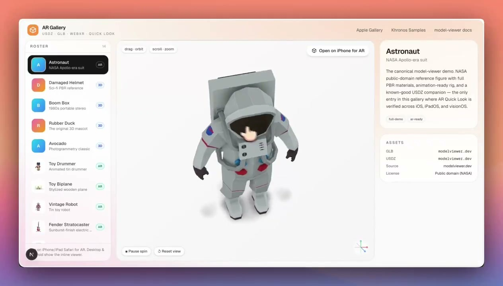
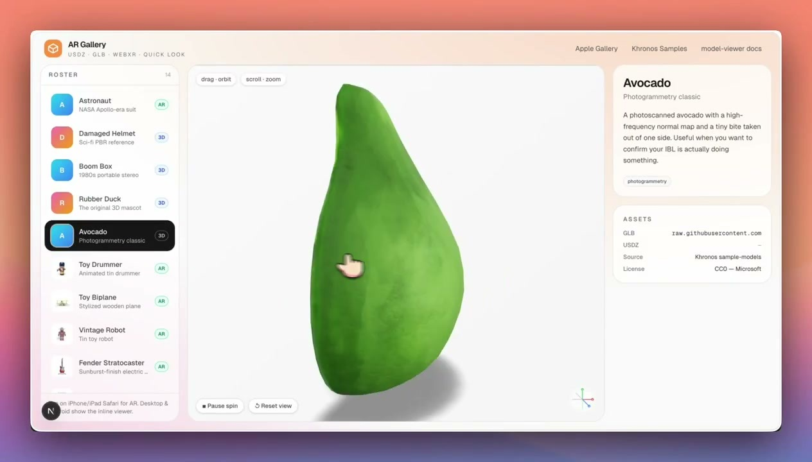
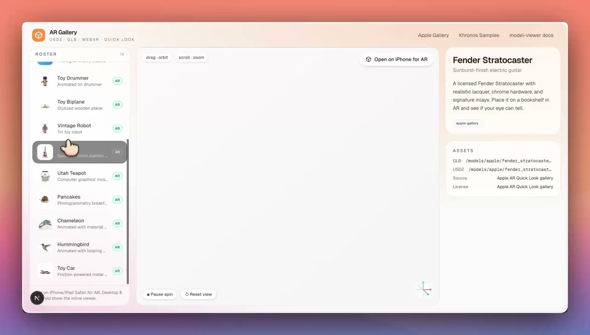
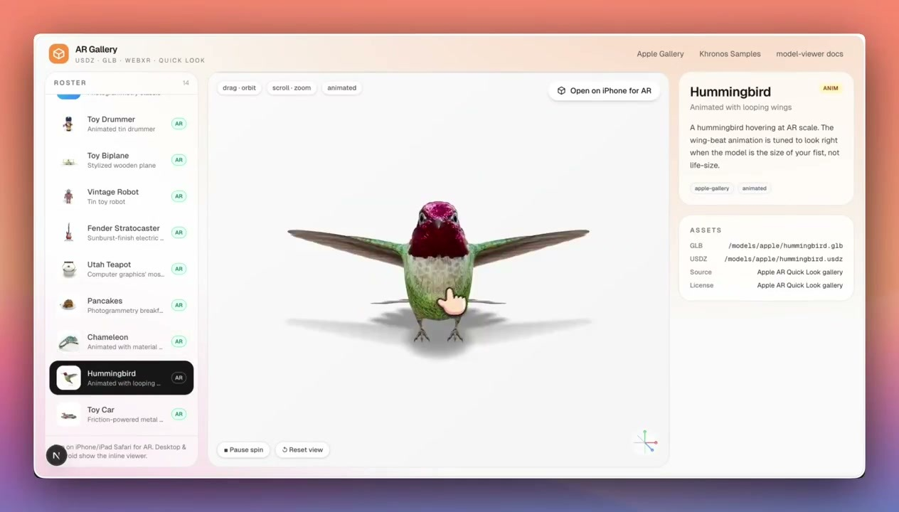

## 問題

挑選 3D 資產時，使用者需要同時比較模型外觀、來源資訊與可開啟的呈現方式。

## 做法

- 影片以左側 Roster、中間 3D 預覽、右側介紹與 Assets 的三欄佈局展示多個模型。左欄選中項目以深底區分。
- 切換 Astronaut、Avocado、Fender Stratocaster、Hummingbird 時，中央與右欄內容相應改變；片段中 Fender 狀態的中央是空白，不能視為每個模型都成功載入。
- 預覽下方有 Pause spin、Reset view；頂端可見 Open on iPhone for AR。作者文字說明使用開源模型及 Apple 模型庫，但本次未實測手機 AR。

*Astronaut 選中後在中央展示，右欄列出介紹與資產資訊。*

*Avocado 切換到同一預覽區，左側選中背景跟著改變。*

*Fender 被選中但中央仍空白，這是展示中的未完成狀態。*

*Hummingbird 出現在相同預覽位置，操作入口仍保留。*

## 為什麼有效（推論）

把挑選、操作與出處分開，可能讓使用者不用離開預覽就能評估資產；空白模型狀態也顯示需要獨立的載入與失敗回饋。

## 借鑑要點

- **適合**：3D 素材目錄、教學模型選擇與資產檢視器。
- **不適合**：必須保證科學或醫療精度的模型認證。
- **移植時注意**：保留授權與來源；模型載入要有進度、重試和相容性訊息。AR 入口須針對裝置能力檢查。

## 來源與核對範圍

- [原帖 2053643773192839516](https://x.com/berryxia/status/2053643773192839516)：已核對 X 官方公開 HTML 內嵌的同 ID Tweet／NoteTweet 正文；發佈時間為 2026-05-11T01:10:05+00:00。
- 已下載並檢視原始媒體；影片僅保留關鍵影格，沒有保存原始影片。媒體出處與擷取時間見本目錄 `evidence.json`。
- 本卡只把貼文文字、附圖與錄影可確認的內容列為觀察；未執行產品驗收，效果解讀列為推論。
