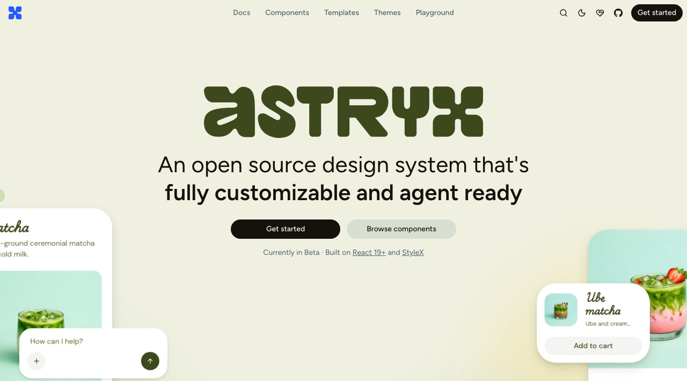
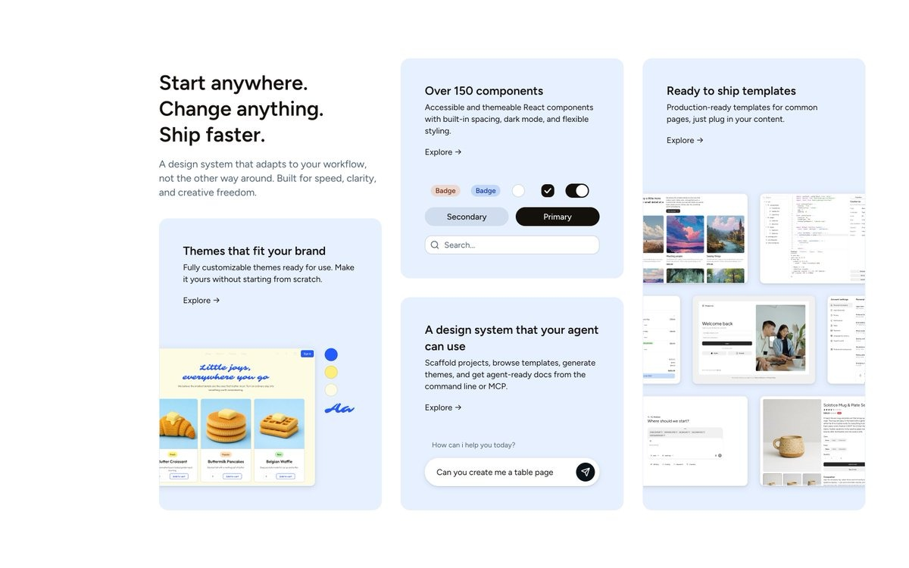

## 問題

多個頁面與代理分別搭建 UI 時，元件、品牌樣式與文件可能逐漸偏離。

## 做法

*官方首屏分開列出元件、模板與主題入口；已裁去範例使用者資料。*

- 已核對 Meta 官方倉庫：Astryx 把主題寫成 CSS custom property 覆寫，元件可透過 className 接入既有樣式。
- 官方 README 列出 typography、color、layout、accessibility 基礎與共通命名、prop、composition 規範；也提供表格頁、詳情頁、表單精靈等模式。
- 實際官網首屏將 Docs、Components、Templates、Themes、Playground 分為不同入口；主要區域提供 Get started 與 Browse components。
- 元件數量與支援範圍是官方說明；本次沒有安裝或驗證每個元件的可及性。

*較早分享以多張功能卡示意主題與元件組合能力，屬宣傳示例。*

補充來源：[@bozhou_ai 分享](https://x.com/bozhou_ai/status/2072584666037760350)（2026-07-02）。該帖另提及深度定制時匯出元件原始碼；未在本次執行匯出驗收。

## 為什麼有效（推論）

- 把品牌差異集中到主題、行為差異留在元件組合，可能減少為了換色而複製整套元件。

## 借鑑要點

- **適合**：多頁產品、共用設計系統與品牌變體。
- **不適合**：只需要一個小元件卻引入超出專案需求的完整系統。
- **移植時注意**：先選擇基礎 token 和互動規範，再驗證明暗模式、焦點及鍵盤操作；官網示例不代表你的覆寫仍符合可及性。

## 來源與核實範圍

- [@awe0_io 原帖](https://x.com/awe0_io/status/2119354093458395284)；發表時間：2026-11-08T08:59:26+00:00。
- [Meta 官方倉庫](https://github.com/meta/astryx)。
- [Astryx 官網](https://astryx.atmeta.com/)。
- 依原帖文字與本次實際檢視的素材整理；未操作產品驗證功能。`date` 為收錄日期；原帖發表日期另記於 `published_at`。
