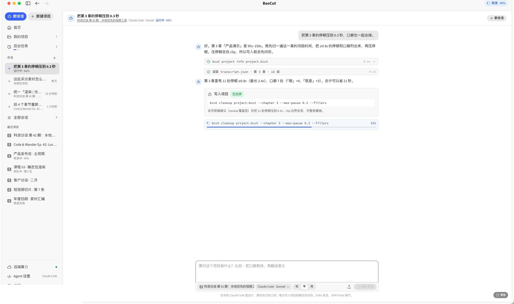
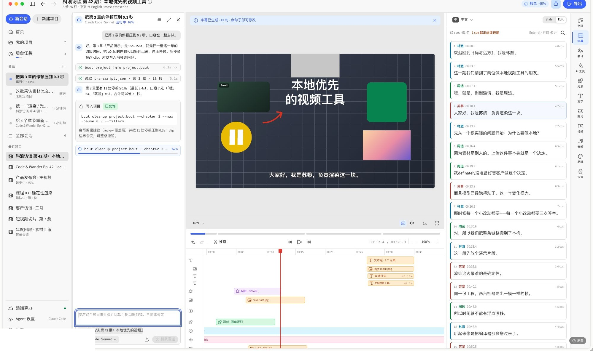
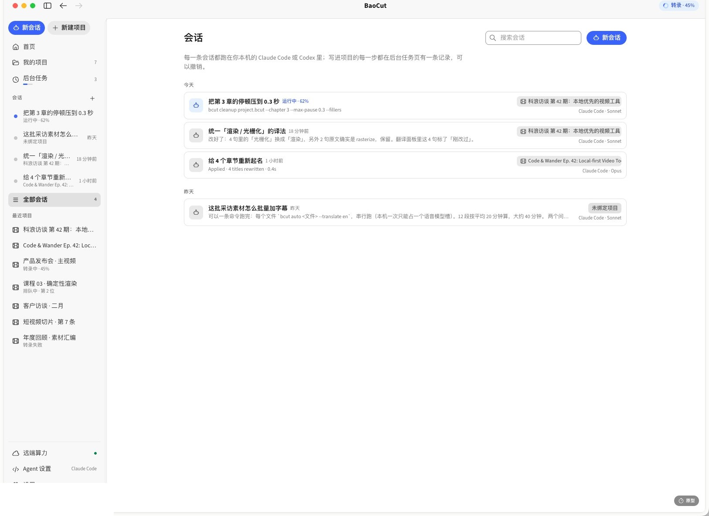

## 問題

影片剪輯工具加入 Agent 後，如何讓新會話、歷史專案與字幕等具體工作入口彼此可達？

## 做法

- 作者明確說這是 BaoCut v2 的原型調整；要求把 Agent 提到左側主入口，左側保留歷史會話與最近專案，移除右側 Agent 分頁。
- 圖二呈現以對話為主的工作頁，左欄保留會話和專案；圖三切到剪輯工作區，中間是影片預覽與時間軸，右欄列出字幕。
- 圖四是會話清單，頂部有搜尋與新增入口；作者仍要保留原本透過 API 呼叫的翻譯能力，並串接翻譯和字幕位置的入口。

*對話為主的原型保留左側會話與最近專案。*

*剪輯頁中央是預覽與時間軸，右側是字幕，左欄入口保持一致。*

*會話清單提供搜尋、新增與可返回的歷史項目。*

## 為什麼有效（推論）

把 Agent 與專案索引放在固定側欄，可能讓從委派返回剪輯的路徑更一致；這不表示 CLI、API 與專案狀態已實際整合。

## 借鑑要點

- **適合**：同時提供 Agent 和直接操作的媒體編輯工具。
- **不適合**：沒有明確專案脈絡、只需一次問答的聊天工具。
- **移植時注意**：明確顯示會話作用中的專案和執行工具；字幕修改需有預覽、採用與回復，原型不能當作已交付功能。

## 來源與核對範圍

- [原帖 2094981274741911985](https://x.com/dotey/status/2094981274741911985)：已核對 X 官方公開 HTML 內嵌的同 ID Tweet／NoteTweet 正文；發佈時間為 2026-09-02T02:50:33+00:00。
- 已下載並檢視原始媒體；影片僅保留關鍵影格，沒有保存原始影片。媒體出處與擷取時間見本目錄 `evidence.json`。
- 本卡只把貼文文字、附圖與錄影可確認的內容列為觀察；未執行產品驗收，效果解讀列為推論。
