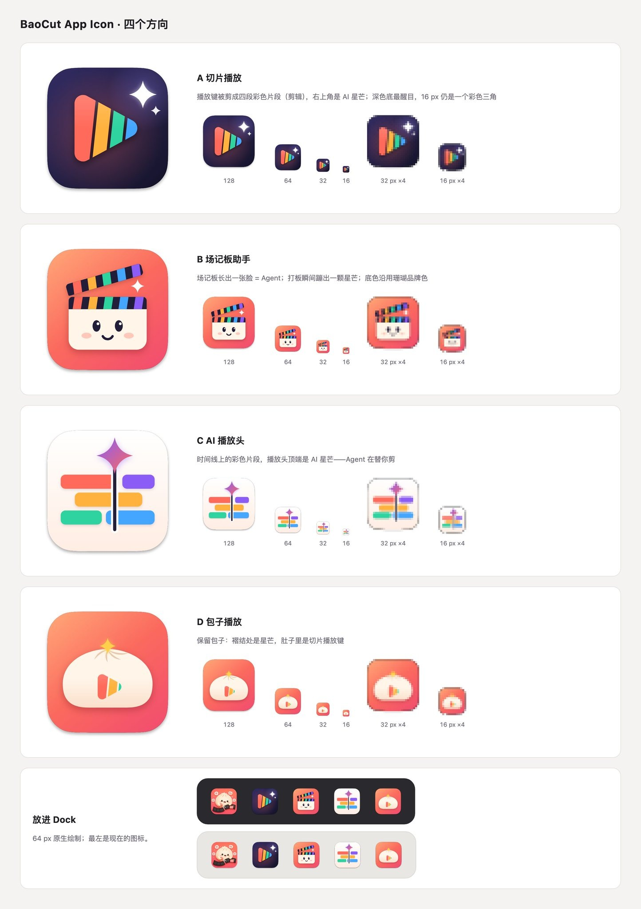
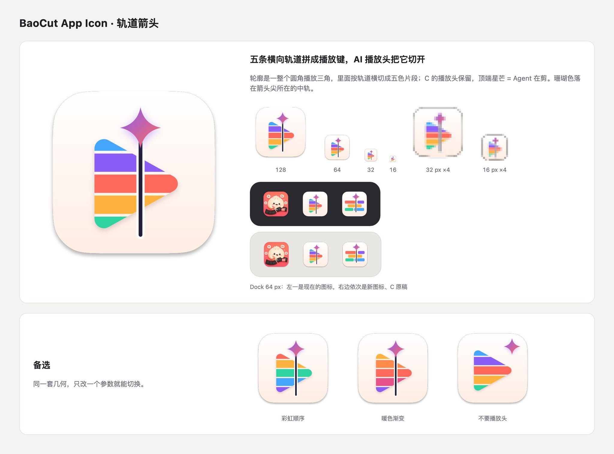
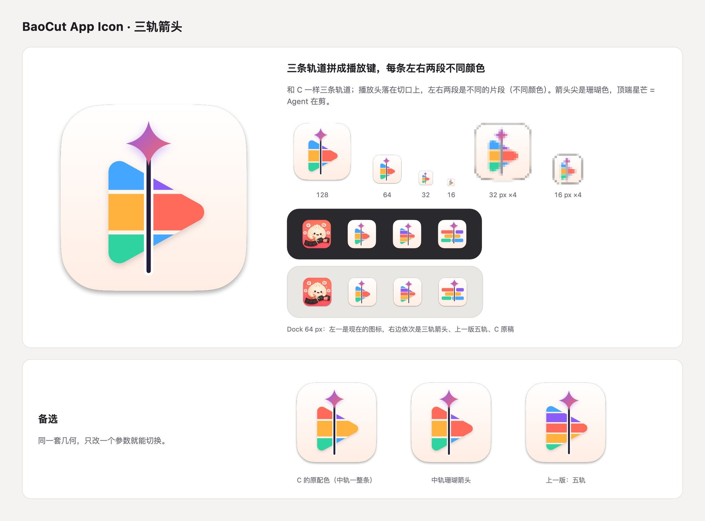
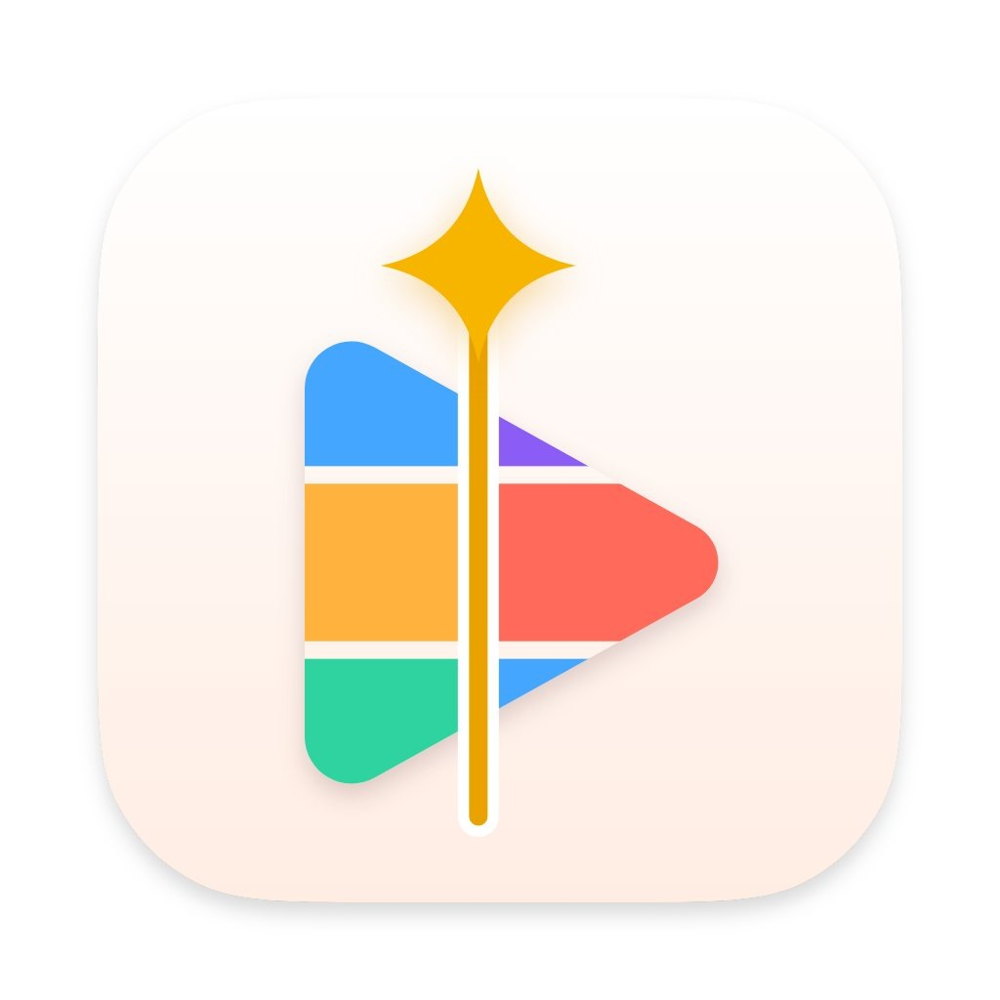

## 問題

結合影片剪輯與 AI 的 App 圖標，如何比較方向並避免只在大圖中好看？

## 做法

- 第一張比較四種方向，每個方向旁邊都有縮小尺寸與 Dock 情境；後續集中到彩色播放形狀加星芒的構圖。
- 後續方案把彩色區塊排列成右向播放形狀，以直線和星芒串起上下輪廓；下方保留同一方向的變體比較。
- 作者敘述使用 JavaScript + Canvas 繪製並反覆要求調整；本次僅核對圖像，不把 Canvas 產出稱為向量圖，也不驗證其模型品質比較。

*四種圖標方向各帶小尺寸與 Dock 預覽。*

*選定方向後比較星芒位置、彩色區塊與背景。*

*另一輪縮減色塊的構圖保留相同尺寸比較。*

*大圖顯示彩色播放符號與垂直星芒的關係。*

## 為什麼有效（推論）

先選意象再看小尺寸與鄰近圖標，可能減少在單張大圖上過度打磨的偏差。

## 借鑑要點

- **適合**：App 圖標候選方案與品牌語義探索。
- **不適合**：直接把大幅插圖縮成工具列操作符號。
- **移植時注意**：檢查 16、32、實際 Dock 尺寸的色塊分離與星芒識別；最終需依平台輸出格式和遮罩重驗。

## 來源與核對範圍

- [原帖 2104107699583463686](https://x.com/dotey/status/2104107699583463686)：已核對 X 官方公開 HTML 內嵌的同 ID Tweet／NoteTweet 正文；發佈時間為 2026-09-27T07:15:42+00:00。
- 已下載並檢視原始媒體；影片僅保留關鍵影格，沒有保存原始影片。媒體出處與擷取時間見本目錄 `evidence.json`。
- 本卡只把貼文文字、附圖與錄影可確認的內容列為觀察；未執行產品驗收，效果解讀列為推論。
