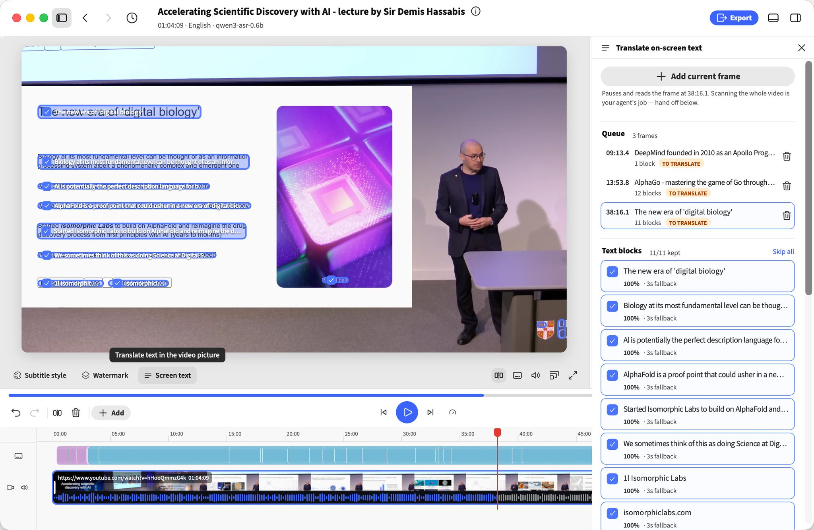
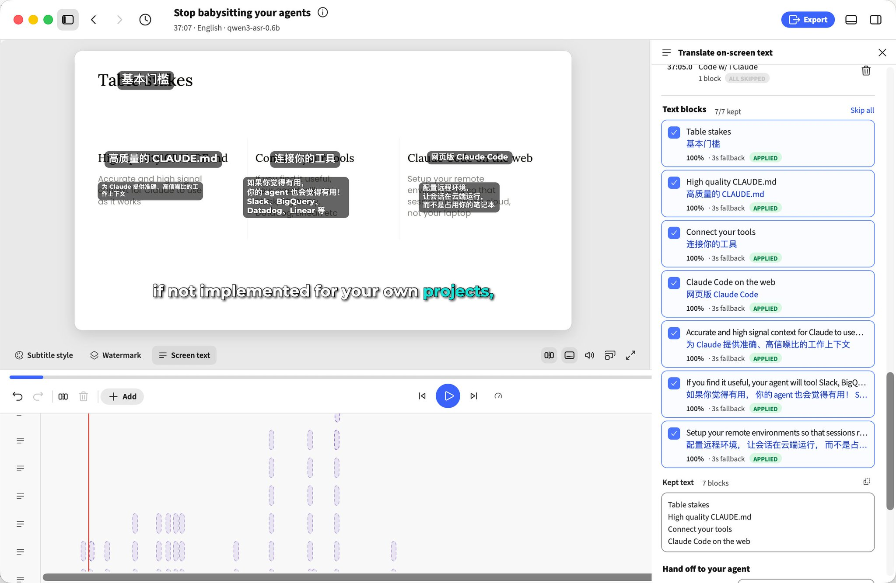
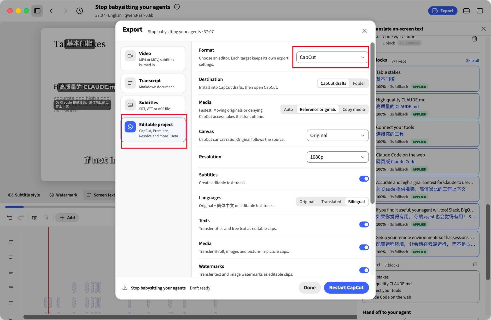
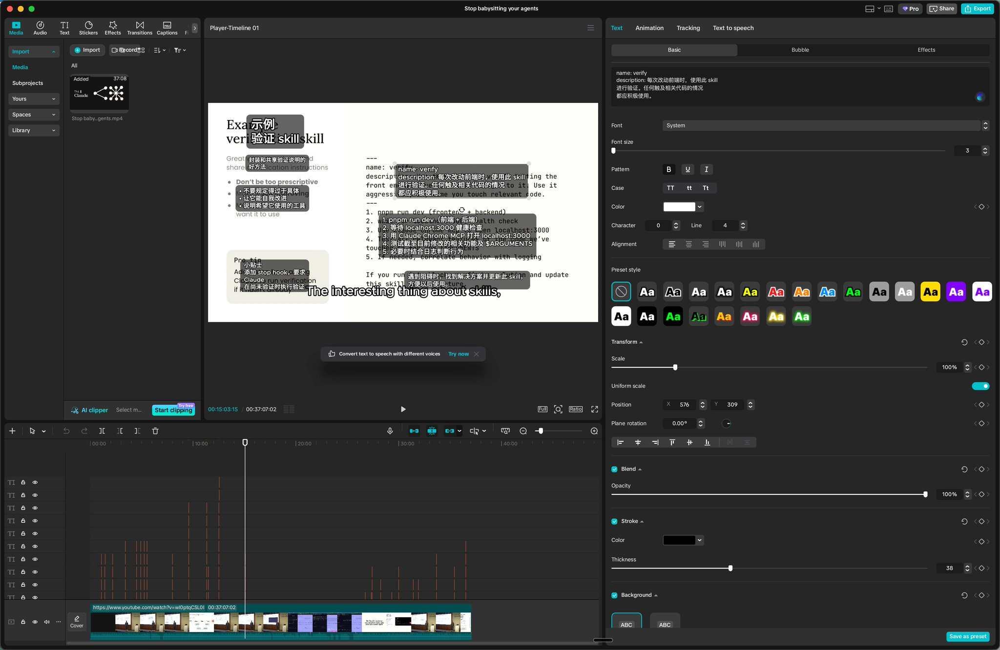

## 問題

影片畫面中的文字翻譯若只燒錄成成品，使用者難以逐塊修正，也無法在熟悉的剪輯器接著調整。

## 做法

*預覽以藍框標出畫面文字，右欄列 Queue 與 Text blocks。*

*每個文字區塊可勾選，列表提供原文、處理狀態與 Skip all，選中區塊在預覽中對應顯示。*

*Export 對話框選 Editable project 與 CapCut，並列字幕、文字、媒體等交付選項。*

*另一張附圖在 CapCut 顯示文字層、樣式面板與時間線，作為二次處理展示。*

**附圖觀察**：畫面偵測 → 在區塊列表核對／略過 → 翻譯文字回到預覽 → 匯出可編輯專案；各步驟是不同靜態截圖，不能當成完整執行紀錄。右側清單保留文字塊與狀態，匯出將 Video、Transcript、Subtitles、Editable project 分開。

**作者說明**：可由 Agent 自動操作，輸出能交給剪映／CapCut 二次處理。本次未執行 Agent。另篇跨平台貼文的四張圖確認同產品持續探索預覽、逐字稿與時間線佈局；該篇重點是技術遷移，不把三個 PoC 的生成模型優劣當 UI 成效。為避免重複，同產品兩則合在本卡。

## 為什麼有效（推論）

偵測結果逐塊可見，可能讓錯誤有明確修正位置；可編輯交付則讓人保有最後調整空間。

## 借鑑要點

- **適合**：需逐項覆核與下游編輯的 OCR、字幕及影片本地化。
- **不適合**：要求零覆核、且不能接受文字位置或翻譯錯誤的直接發布。
- **移植時注意**：顯示原文與譯文、低信心項目及未處理狀態；匯出前檢查字型、素材路徑、時間對齊與可逆性。

## 來源與核對範圍

- [原帖 2080770347977113983](https://x.com/dotey/status/2080770347977113983)：已核對官方 syndication 回應的 ID、正文與四張附圖。
- [原帖 2087783863741256149](https://x.com/dotey/status/2087783863741256149)：已核對 X 官方公開頁面內嵌 Tweet／NoteTweet 快取。

- 本卡根據來源文字與已檢視媒體記錄，沒有執行產品功能驗收；作者成效宣稱不視為獨立測試。
