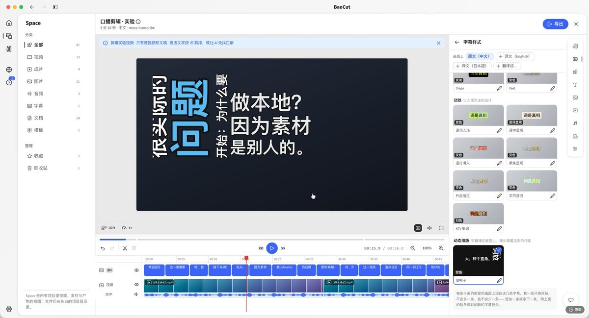
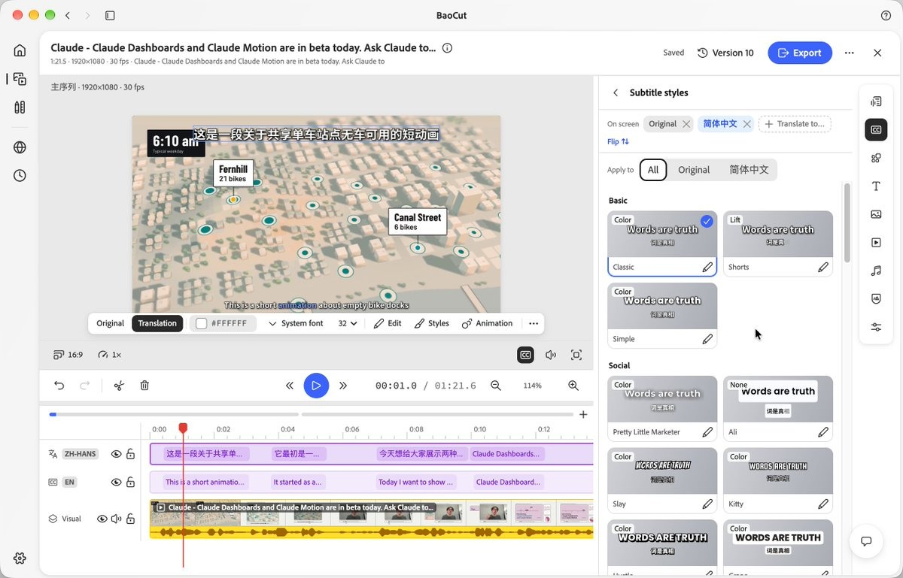

## 問題

剪輯者需要在同一時間點比較字幕樣式，而樣式縮圖與真正影片上的文字位置可能不一致。

## 做法

*成品以中央影片、右側字幕樣式和底部時間軸形成編輯工作區。*

*另一張編輯畫面保留同樣分區，右側樣式縮圖可直接比較。*

- 原帖的實作圖把影片預覽置中、字幕樣式雙欄列表放右側、字幕片段與影片／音軌放在底部時間軸；樣式縮圖有名稱、類型與編輯圖示。
- 作者先讓 Agent 完成技術方案，再以高保真原型確認 UI 與互動，定稿後才實作；原帖附有方案文件、原型與成品截圖。
- 作者人工驗收時發現字幕樣式預覽文字太靠上，回報並要求修正。這是原文明確記錄的問題與修正要求，不等於本次已驗證修正版。
- 另一來源用同產品畫面說明先引入設計系統以保持視覺一致；此處只作為相同編輯流程的補充，不新增重複卡。

## 為什麼有效（推論）

- 在同一影片與時間點切換樣式，可把差異集中在文字表現；高保真原型則可能提早暴露位置與比例問題。

## 借鑑要點

- **適合**：字幕、文字版型與可視化樣式編輯器。
- **不適合**：只檢查靜態縮圖就認定所有片段、語言與動畫都正確的驗收。
- **移植時注意**：驗收短字、長句、多語與動畫狀態；同時核對縮圖及主預覽的基線與裁切。保留需求、原型、實作和人工驗收各自的證據。

## 來源與核實範圍

- [@dotey 原帖](https://x.com/dotey/status/2108663149301846497)；發表時間：2026-10-09T20:57:26+00:00。
- [@dotey 原帖](https://x.com/dotey/status/2112598829870575718)；發表時間：2026-10-20T17:36:25+00:00。
- [作者開源專案](https://github.com/JimLiu/baocut)。
- 依原帖文字與本次實際檢視的素材整理；未操作產品驗證功能。`date` 為收錄日期；原帖發表日期另記於 `published_at`。
