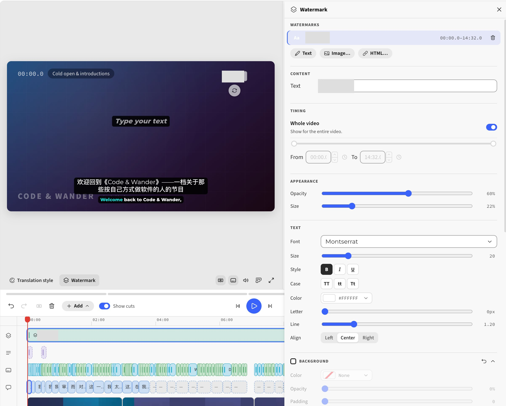

## 問題

影片浮水印同時涉及內容、位置、透明度和生效時間；若只提供屬性表單，使用者很難判斷它對畫面的實際影響。

## 做法

*裁切後保留影片畫布、浮水印屬性與時間軌道；示範帳號文字已遮蔽。*

- 作者把附圖明確稱為高保真可互動原型，並描述先提需求、反覆修整原型，再實作程式碼的流程。本卡不把原型算成正式產品驗證。
- 主畫布顯示被選取的浮水印與控制把手；右側 Watermark 面板依序列出水印清單、Text／Image／HTML 類型、內容、Timing、Appearance 與文字設定。
- Whole video 開關與起訖時間欄位放在同一區；底部另有獨立水印軌道，選取樣式與右側清單相呼應。
- 透明度、大小及字體控制仍與預覽同屏。畫面可確認這些控制存在，不能從靜態圖推定每個設定都已連動或匯出。

## 為什麼有效（推論）

同時保留空間位置、時間位置和屬性，有機會減少在多個視窗來回切換的記憶負擔；一個清楚的選取狀態則能幫助辨識目前修改哪個水印。

## 借鑑要點

- **適合**：字幕、水印、貼紙及其他有時間範圍的影片覆蓋物。
- **不適合**：僅輸出單張圖片、不需要時間軸的簡單編輯器。
- **移植時注意**：全片模式與自訂區間必須有明確互斥規則；提供數字輸入與復原，並測試越界、重疊、多水印及匯出後的位置一致性。

## 來源與核對範圍

- [dotey 原文](https://x.com/dotey/status/2078388657979838830)（發布：2026-07-18T07:57:25+00:00）。

已核對 X 公開原文的嵌入式 Tweet／NoteTweet 資料及本卡所列原始素材。`kind: concept` 表示本次僅確認公開展示／設計方法，沒有把示範等同正式上線或端到端驗證。
