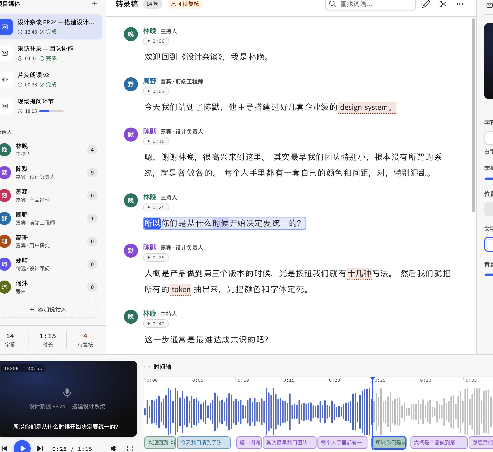
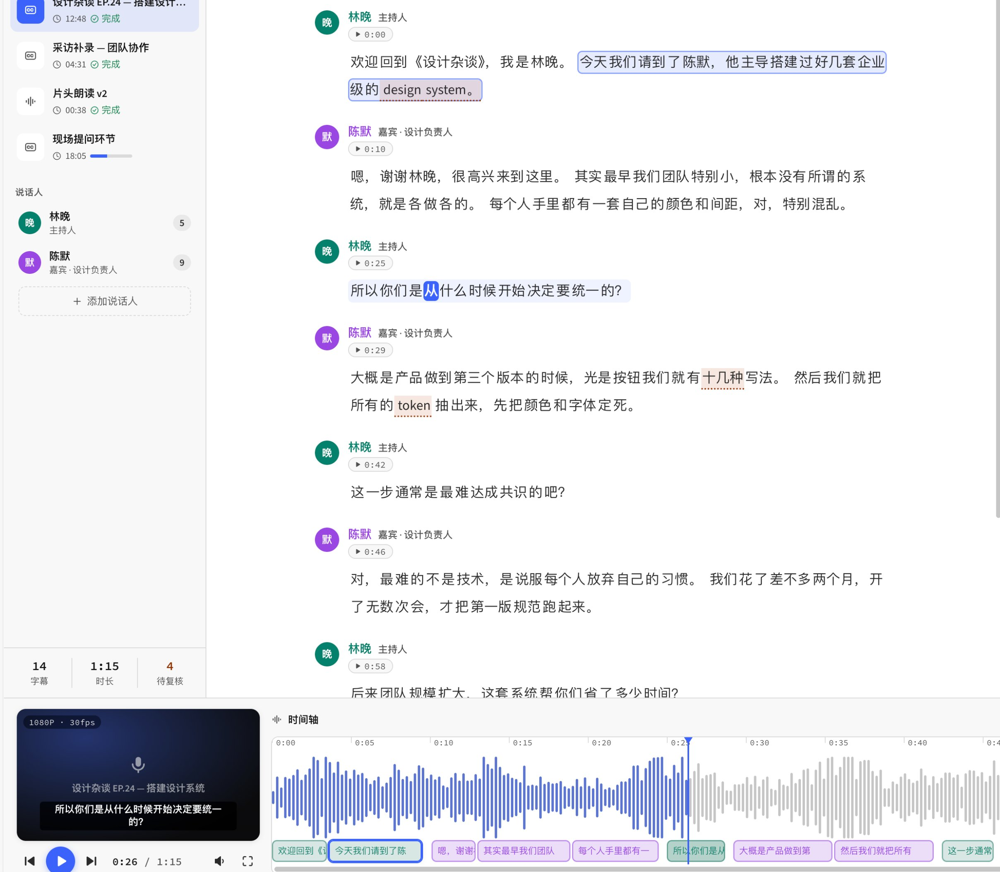
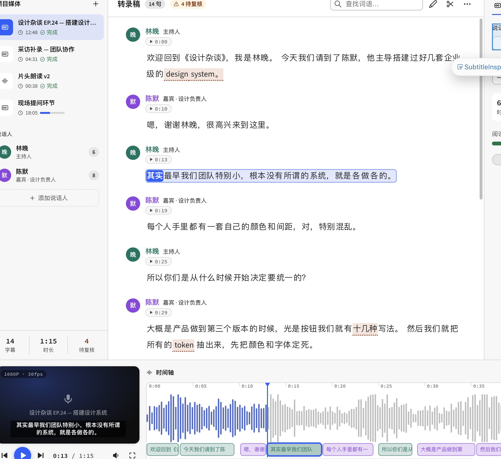

## 問題

同一產品反覆產生新畫面時，若每次從空白風格開始，轉錄、預覽與設定面板容易失去一致性。

## 做法

*逐字稿、播放器與波形在同一工作區中並排。*

*另一狀態維持轉錄內容與預覽的分區。*

*右側設定與底部時間軸延續相同選取視覺。*

- 作者明確說明支援匯入 Design System，並在新建專案時以提問讓使用者選擇已匯入的系統；這是原貼文中的工作流程說明，圖片沒有完整展示匯入對話。
- 附圖的本地工作區同時包含左側 Agent 討論、中央逐段轉錄內容、下方波形／時間軸與右側預覽或設定；不同畫面延續同一種藍色選取及細分隔線。
- 後一張為程式碼與設計資料的並排檢視。本卡僅保存介面局部，沒有把程式碼截圖當成匯入成功的執行證據。

## 為什麼有效（推論）

先選既有系統再修改具體畫面，可能讓字級、控制樣式與選取色較容易沿用；把原型留在可反覆預覽的工作區，也便於持續比對。

## 借鑑要點

- **適合**：已有品牌／元件規範，需要多輪修改的 AI 原型工作。
- **不適合**：尚未確定使用情境就過早鎖定視覺系統，或把匯入當成自動符合所有規範。
- **移植時注意**：列出已匯入系統名稱、版本及適用產品；原型另檢查空狀態、錯誤和窄螢幕。對話中的選擇應持久化，避免下一輪改稿遺失。

## 來源與核對範圍

- [dotey 原文](https://x.com/dotey/status/2064182459718091202)（發布：2026-06-09T03:07:03+00:00）。

已核對 X 公開原文的嵌入式 Tweet／NoteTweet 資料及本卡所列原始素材。`kind: concept` 表示本次僅確認公開展示／設計方法，沒有把示範等同正式上線或端到端驗證。
