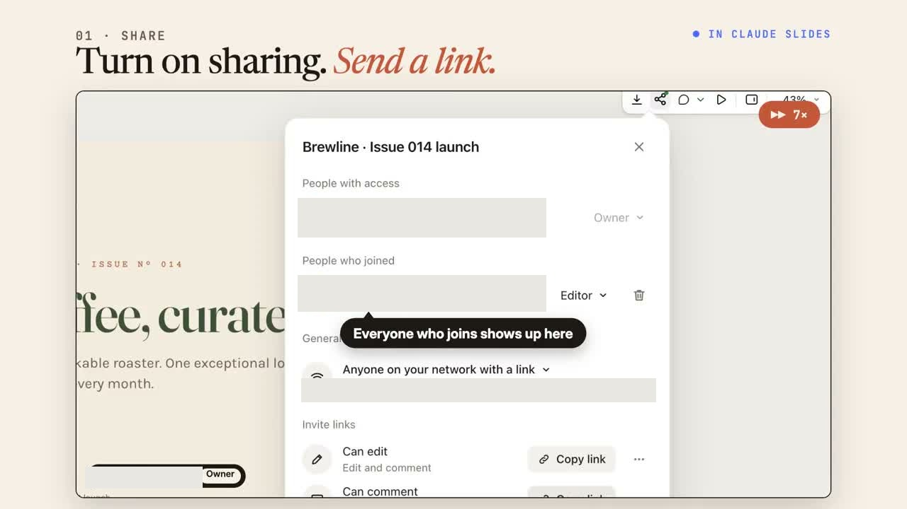
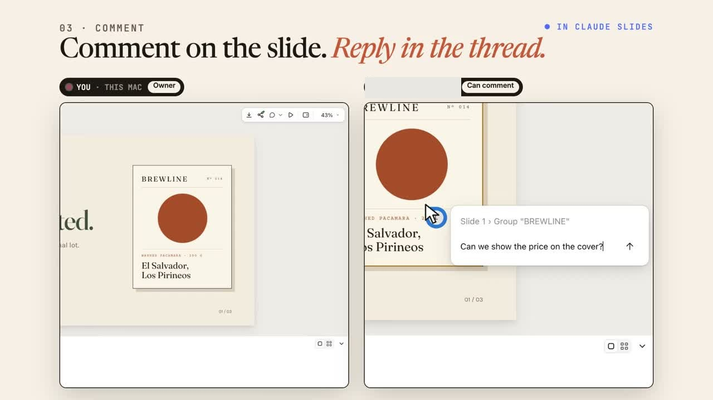
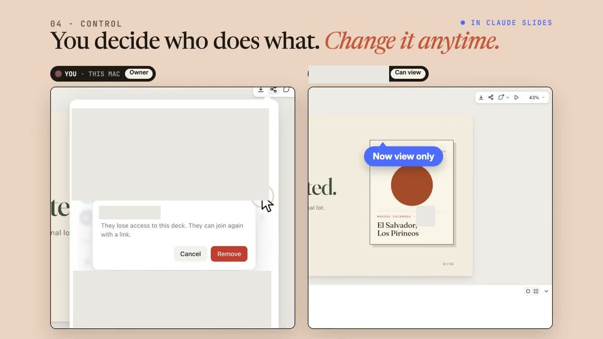

## 問題

同事需要審閱或直接修改本機設計稿，分享者也需要控制誰能看、留言或編輯。

## 做法

*分享框保留角色與複製連結入口；帳號及內網位址已遮蔽。*

*留言框指向投影片物件，文字保留所在頁面與群組資訊。*

*權限改為只讀後，接收端顯示 Now view only，移除前另行確認。*

- 示範從分享入口打開對話框，列出擁有者、已加入成員與角色；下方提供分享連結與 Copy link。
- 影片接著展示兩個並排的設計稿視窗：在投影片物件旁輸入留言，保留 Slide 與 Group 的位置脈絡。
- 後段將參與者改為只讀，另一側即出現 Now view only；移除成員前有確認框。這是宣傳示範的步驟，未驗證跨機同步或安全性。
- 作者文字列出只讀、評論、編輯三級權限；另一則回覆補充同事可評論或直接修改。

## 為什麼有效（推論）

- 先選角色再分享，可使存取範圍成為可見決策；就地留言則把意見與物件連起來。

## 借鑑要點

- **適合**：本機原型與小型團隊審稿。
- **不適合**：需要對外長期公開或完整組織權限治理的協作。
- **移植時注意**：角色變更後同步更新接收者的可操作狀態；不要只改分享者一側的選單。素材已遮去帳號、頭像與內網位址。

## 來源與核實範圍

- [@dotey 原帖](https://x.com/dotey/status/2116623097839149231)；發表時間：2026-10-31T20:07:26+00:00。
- [@dotey 原帖](https://x.com/dotey/status/2118371023871770799)；發表時間：2026-11-05T15:53:04+00:00。
- 依原帖文字與本次實際檢視的素材整理；未操作產品驗證功能。`date` 為收錄日期；原帖發表日期另記於 `published_at`。
