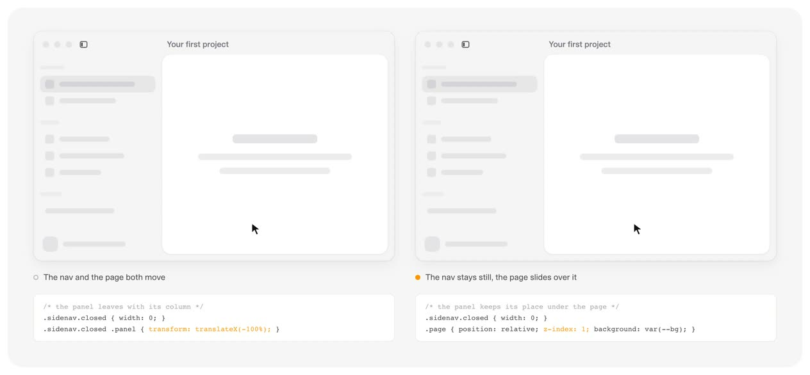
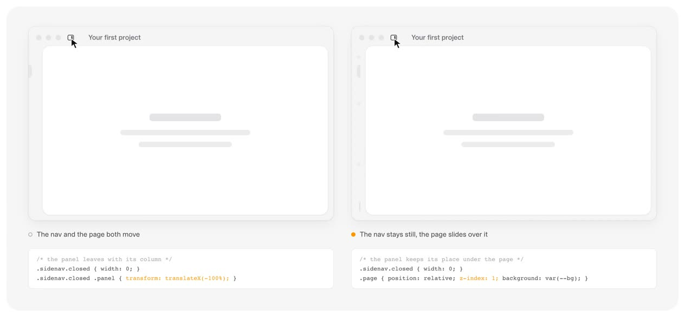
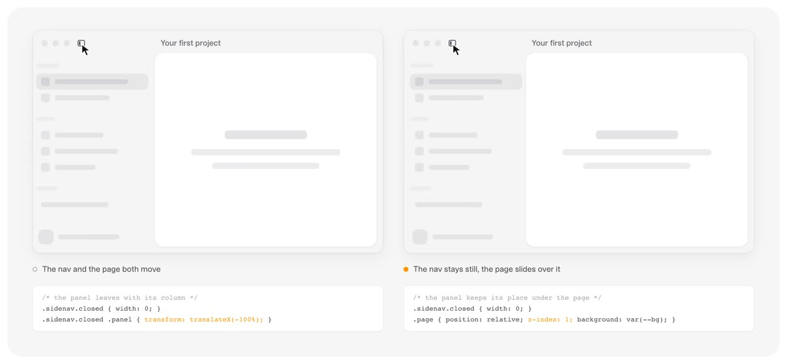
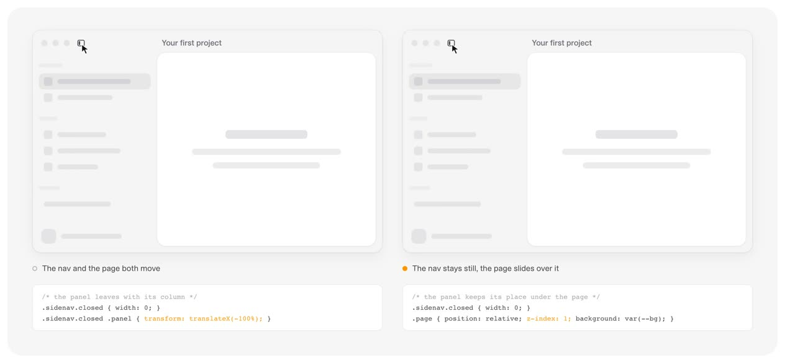

## 問題

可收合側邊導覽與內容頁同時橫移時，兩層介面的相對運動可能分散注意。如何讓收合仍交代選單的位置，同時建立內容頁覆蓋選單的空間關係？

## 做法

- 示範把兩個相同的淺色工作區並排：左邊標示選單與頁面一起移動，右邊標示選單保持原位、頁面滑過其上；兩邊都有頂部側欄開關、灰色占位清單與白色圓角內容頁。
- 觸發頂部側欄開關 → 左側選單橫移退場；右側以內容頁橫向移動遮住原位選單 → 收合後內容頁占據原本選單區域。再次展開時反向露出選單。這是影片對照的設計意圖與取樣狀態，未量測速度、曲線或位移量。
- 畫面程式片段將兩種方案的 `.sidenav.closed` 都設為 `width: 0`；左側額外讓 `.panel` 做 `translateX(-100%)`，右側則替 `.page` 設相對定位、`z-index: 1` 與背景色。這僅是可見片段，不能視為可直接運作的完整元件。

*0 秒：兩邊都展開側欄，白色內容頁位於清單右側。*

*2 秒：兩邊都已收合，內容頁向左擴展；此靜態終點本身不能證明選單移動路徑。*

*5 秒：兩邊側欄重新展開，清單和內容頁恢復並排。*

*7 秒：兩邊仍可見展開的側欄與占位清單；此張取樣未顯示右側內容頁覆蓋選單的差異。*

## 為什麼有效（推論）

讓選單作為下層不動、內容頁作為上層滑動，可能比兩者同時平移更容易讀出遮蓋關係。原作者說這樣感覺較順，Kubai 也偏好後者；兩者均為主觀評價，沒有可用性或效能測量。

## 借鑑要點

- **適合**：有明確內容頁與可收合側欄的桌面 Web 工作區，尤其希望用遮蓋表達層級時。
- **不適合**：必須同時閱讀選單和正文的持續對照任務，或將此示範直接當成手機抽屜的完整互動規格。
- **移植時注意**：內容頁需要能遮住下層的背景；同時處理隱藏選單的指標命中、Tab 順序與輔助技術可見性。補上快速反覆切換、中途反向及減少動態效果的行為，再驗證實際流暢度。

## 來源與核對範圍

- [Batuhan 原帖](https://x.com/batukrskl/status/2126094700218294448)：官方公開頁全文與影片資料已讀，原始發布時間為 **2026-11-26 23:24:12 UTC**；附一段 12.633 秒影片。這是介面動效示範，未證實正式上線，故記為 concept。
- [Kubai 引用帖](https://x.com/Kubai087/status/2126237506362622019)：**2026-11-27 08:51:39 UTC**，比較推拉式與滑蓋式並偏好後者；引用日期不作為原始發布日期。
- 相關但不同來源：[App shell 固定側欄開關](../app-shell-stable-sidebar-toggle/case.md)著重開關定位與動態分頁，本卡著重選單與內容頁的相對運動，不合併為同一產品流程。
- 已檢視 0–8 秒逐秒取樣與 1.6 秒補充取樣，選存 0、2、5、7 秒四張；未逐格審閱全部 12.633 秒，不能據此還原完整運動軌跡。素材以影片遠端取樣取得，未另存原片；保留畫面僅含示意工作區、占位內容與比較說明，不含社群帳戶介面或完整提示詞。
