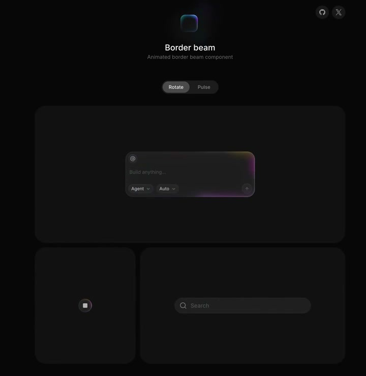
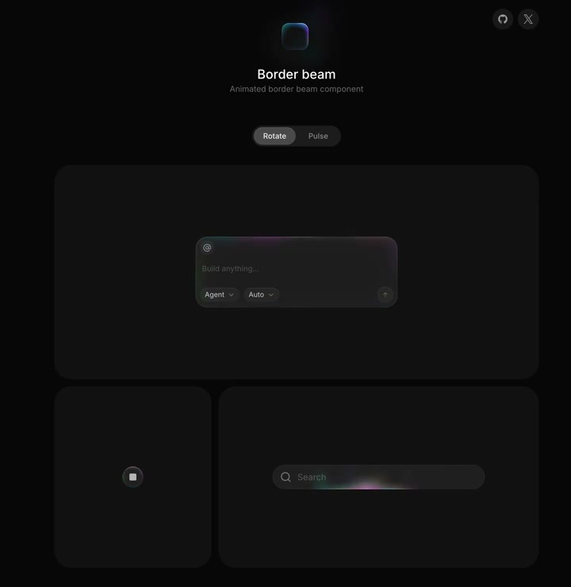
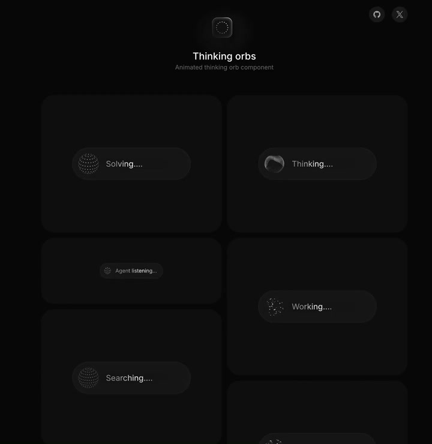
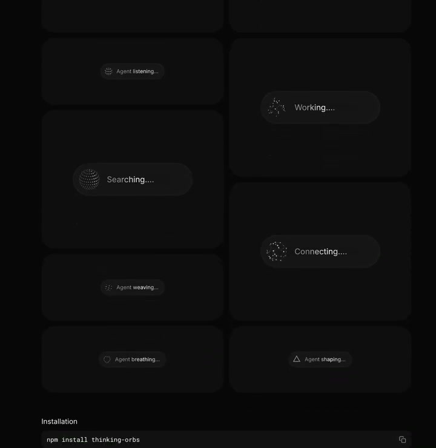

## 問題

AI 任務需要等待時，如何讓局部輸入和不同處理狀態保持可見，而不把整頁變成載入畫面？

## 做法

- 影片前半的 Border beam 以微弱光束沿圓角輸入框邊緣移動，下方另示範小控制項和搜尋框；外形與文字區域仍保持固定。
- 後半的 Thinking orbs 用不同線條／粒子球體搭配 Solving、Thinking、Working、Searching、Connecting 等文字，放在各自圓角容器內。
- 觸發在錄影中沒有完整呈現：可觀察的是等待狀態持續變化，最後仍停在示例畫廊，沒有任務完成、取消或失敗結果。

*光束位於圓角輸入框邊界，內容區保持可讀。*

*光束移動到另一位置，下方搜尋框也有局部動態。*

*球體與 Solving、Thinking 等動詞一同呈現。*

*後段展示 Working、Searching 和 Connecting，仍沒有完成結果。*

## 為什麼有效（推論）

把動態限制在邊界或小型球體，可能保留主要文字閱讀區；動詞提供狀態線索，但只有接上真實任務階段才有資訊價值。

## 借鑑要點

- **適合**：短時 AI 處理、搜尋和輸入框周邊的局部回饋。
- **不適合**：用無限旋轉掩蓋卡住、斷線或沒有進度的長任務。
- **移植時注意**：必須有取消、逾時、錯誤和完成狀態；不能用裝飾球體假造真實處理階段，並提供靜態替代與足夠對比。

## 來源與核對範圍

- [原帖 2084559578440847706](https://x.com/ZaynHao/status/2084559578440847706)：已核對 X 官方公開 HTML 內嵌的同 ID Tweet／NoteTweet 正文；發佈時間為 2026-08-04T08:38:27+00:00。
- 已下載並檢視原始媒體；影片僅保留關鍵影格，沒有保存原始影片。媒體出處與擷取時間見本目錄 `evidence.json`。
- 本卡只把貼文文字、附圖與錄影可確認的內容列為觀察；未執行產品驗收，效果解讀列為推論。
