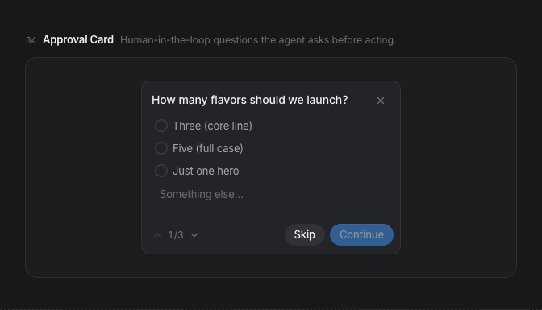
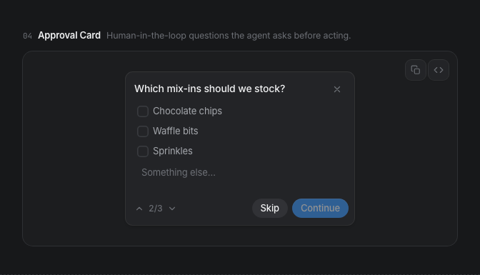
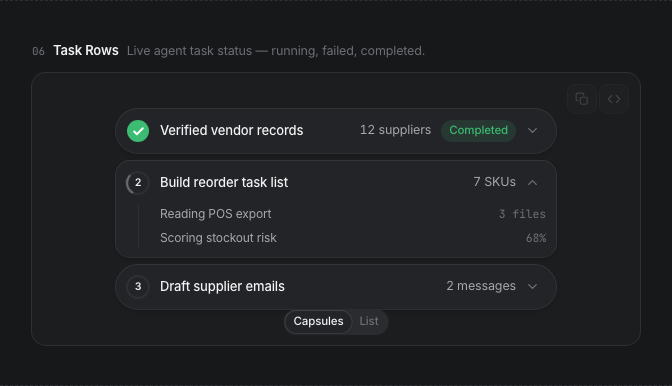

## 問題

Agent 需要連續確認選項、呈現執行狀態時，如何避免所有資訊擠成長篇對話？

## 做法

- 官網以左側元件目錄、右側獨立樣本區陳列 AI 介面構件；每區有名稱與短說明。
- Approval Card 在固定容器內一次呈現一題：選項、自由輸入、題數、Skip 和 Continue；選擇首題選項後按 Continue，第二題進入同一張卡，題數變為 2/3。
- Task Rows 把任務分成獨立膠囊列，各有標題與數量；完成列以綠色勾與 Completed 區分，其餘保留編號。圖片是示範資料，不代表實際任務已執行。

*確認卡首題顯示單選、自訂輸入與1/3進度。*

*繼續後在同一卡片呈現第二題與2/3進度。*

*任務列以勾選、狀態標記和編號區分示範進度。*

## 為什麼有效（推論）

單題確認可能降低一次要處理的選擇量；短任務列則讓完成、待辦資訊更容易掃讀。這不構成效率或成功率證據。

## 借鑑要點

- **適合**：Agent 前置澄清、分步配置、任務摘要。
- **不適合**：把三題問答誤當作高風險操作的明確授權；用示範狀態冒充真實執行。
- **移植時注意**：接入真正的狀態資料，提供錯誤／重試、返回修改與鍵盤操作；必要時將可平行回答的問題合併。

## 來源與核對範圍

- [Kubai 推薦帖](https://x.com/Kubai087/status/2124830898269085699)：官方同 ID 正文確認指向本站，發表時間見上方（不是網站上線日期）。
- [Beautiful UI 官網](https://www.beautifului.dev/)：頁面標示 Built by Turbo；2026-11-24 以無登入 Chromium 讀取並操作首題至第二題，保存元件區截圖。只核對這段示範，不推定元件可直接安裝、商用或已接入真實 Agent。
