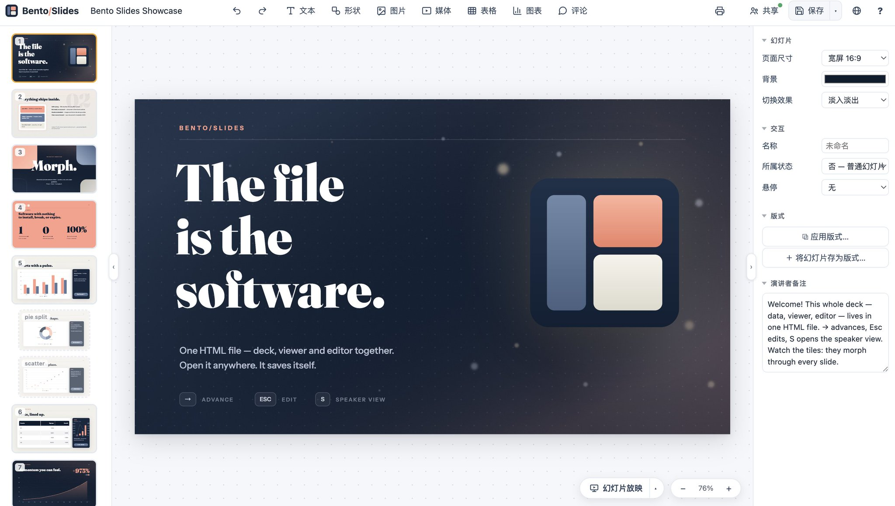

## 問題

分享簡報常把「可看成品」和「可繼續編輯」拆成不同檔案與工具，收件者得先確認自己拿到哪一種。

## 做法

*原帖附圖：左側頁面縮圖、中央畫布、右側屬性與講者備註，上方有評論、分享、保存。*

**附圖觀察**：編輯器沿用縮圖—畫布—屬性欄的分工；畫布下有播放與縮放，首頁直接提示方向鍵前進、Esc 編輯與 S 講者視圖。頂部把分享、保存與內容工具分開排列。

**來源範圍**：[官方入口](https://bento.page/slides/)的 HTML 已取得，頁面標記 generator 為 bento-slides。附圖和頁內說明以單一 HTML 同載內容、播放器與編輯器為重點。發文者另描述加密協作及離線精確合併；本次未取得可核驗的操作過程，不把安全性與衝突合併當已證實能力。

## 為什麼有效（推論）

同一份交付物帶有閱讀與編輯入口，可能減少格式交接；持續可見的分享和保存也能區別共同工作與本機落盤。

## 借鑑要點

- **適合**：可攜式文件、展示稿與輕量編輯工具。
- **不適合**：把檔案傳送等同存取撤銷，或未驗證就依賴它處理敏感多人協作。
- **移植時注意**：顯示保存位置與離線／連線狀態；分享前說清副本、版本與權限關係，另驗證衝突恢復。

## 來源與核對範圍

- [原帖 2080288142817419657](https://x.com/vikingmute/status/2080288142817419657)：已核對 X 官方公開頁面內嵌 Tweet／NoteTweet 快取。

- 本卡根據來源文字與已檢視媒體記錄，沒有執行產品功能驗收；作者成效宣稱不視為獨立測試。
