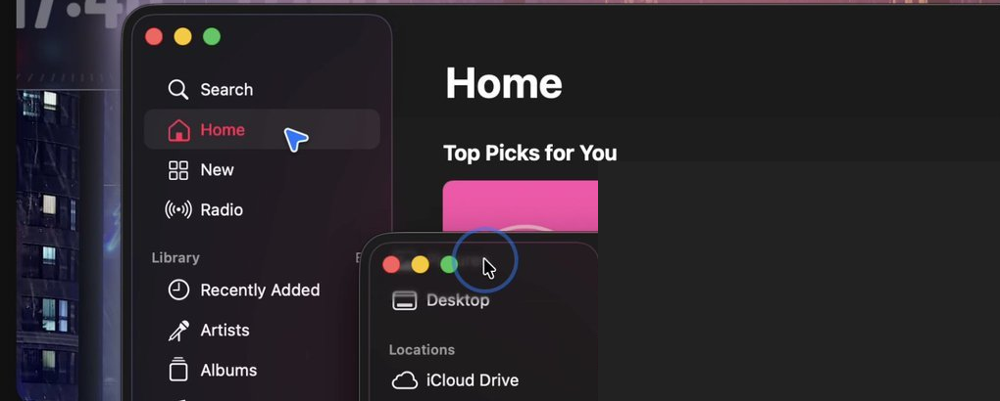
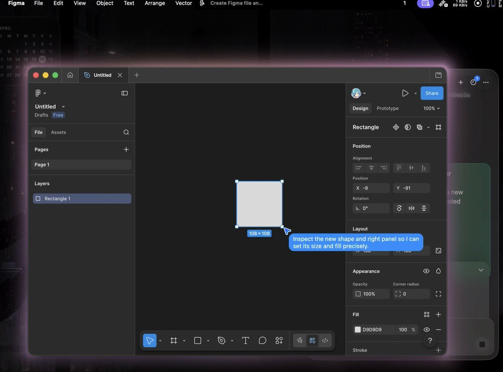

## 問題

電腦操作 Agent 若直接搶走游標與視窗焦點，使用者就難以同時完成自己的工作，也不易辨識正在被操作的目標。

## 做法

*裁切並遮蔽 Finder 個人資訊後，保留雙游標與視窗重疊關係。*

*目標視窗以發光外框標示，內部物件仍可見。*

- 這筆回覆只給連結；已沿原連結讀取 @bridge_surf 的 2057416247319618039 ArticleEntity 全文，而非用回覆文字補猜內容。
- 文章第一張圖在 Apple Music 背景視窗顯示一個藍色游標，前方 Finder 視窗附近另有系統游標；第二張以發光外框標出 Agent 的目標工作視窗，窗內保留可見的圖形與說明。
- 作者說第二個游標只是視覺表達，真正關鍵是背景事件不打斷前景；文中也明確提醒依賴底層視窗行為，並非所有 App 都適用。這些為作者技術說明，本次沒有執行或驗證。

## 為什麼有效（推論）

用不同游標或目標外框表示 Agent 的作用範圍，可能讓使用者在不交出前景工作的情況下掌握進度；但畫面標記必須與實際輸入目標一致才有意義。

## 借鑑要點

- **適合**：桌面 Agent、背景執行與人機並行工作的設計探索。
- **不適合**：未驗證事件隔離卻宣稱永不搶焦點，或讓 Agent 在使用者不知情的視窗執行有外部後果的操作。
- **移植時注意**：持續顯示目標應用與任務狀態，提供暫停與接管；先測試不同 App／視窗／系統版本的焦點衝突。虛擬游標不能替代實際操作與錯誤的可觀測性。

## 來源與核對範圍

- [hwwaanng 原文](https://x.com/hwwaanng/status/2093847115621597478)（發布：2026-08-29T23:43:48+00:00）。
- [Bridge 原始文章](https://x.com/bridge_surf/status/2057416247319618039)，已讀 ArticleEntity 全文與圖片。

已核對 X 公開原文的嵌入式 Tweet／NoteTweet 資料及本卡所列原始素材。`kind: concept` 表示本次僅確認公開展示／設計方法，沒有把示範等同正式上線或端到端驗證。

### 需求背景補充

[@buaaxhm 的提問](https://x.com/buaaxhm/status/2093708168434237481)描述自己在不同桌面 Agent 中感受到操作占用差異。此為已核對的使用者文字觀察，不作為版本能力或事件隔離機制的驗證；併入本卡作為人機並行需求背景。
