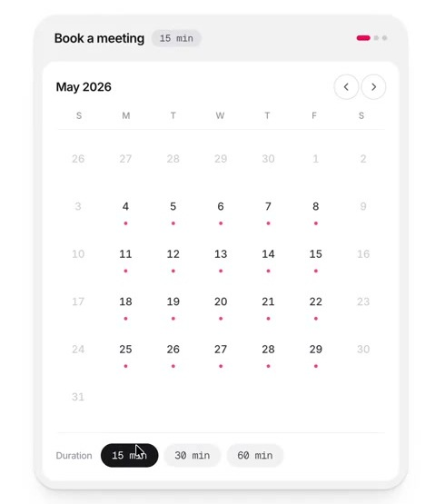
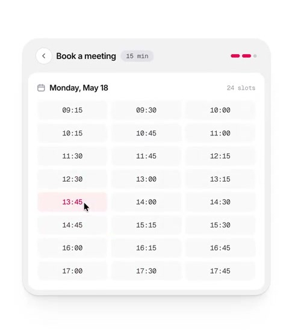
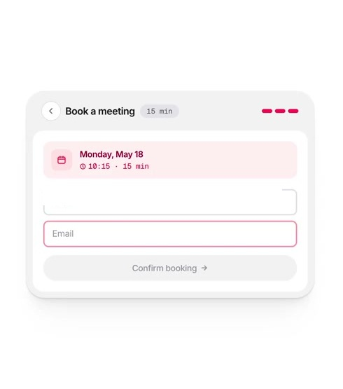
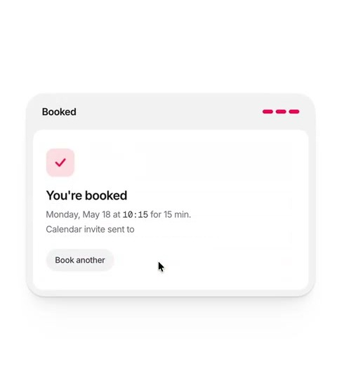

## 問題

預約時如何避免一次呈現整月日期、所有時段和聯絡表單，卻仍讓使用者知道進度？

## 做法

- 同一圓角容器先呈現月曆與 15／30／60 分鐘時長選擇；可預約日期下方有粉色標記。
- 選日期後容器改為時段網格，頂部保留日期與時長；選定時間以粉色背景凸顯，接著只展示姓名、Email 和 Confirm booking。
- 最後同一容器變為 Booked 狀態，顯示勾號、日期時間與 Book another；頂部短進度線隨步驟增加。這是 Paper／Motion 製作的動態概念，非實際寄送確認信證據。

*第一步是日期與會議時長，標記提示可選日期。*

*第二步只列當日可用時段，選中項帶粉色背景。*

*聯絡資料步驟保留日期時間摘要，下方是確認按鈕。*

*完成狀態沿用同一容器，提供再次預約入口。*

## 為什麼有效（推論）

每一步只要求一種決定，且讓已選日期時間留在摘要中，可能降低表單負荷並避免失去脈絡。

## 借鑑要點

- **適合**：短時通話、諮詢或單一資源的預約流程。
- **不適合**：多參與者、多資源或複雜週期預約。
- **移植時注意**：返回上一步要保留已填資料；時區、可預約狀態競爭與提交失敗需另外設計。素材中的姓名與電子郵件已遮除。

## 來源與核對範圍

- [原帖 2063265944844288449](https://x.com/jeetnirnejak/status/2063265944844288449)：已核對 X 官方公開 HTML 內嵌的同 ID Tweet／NoteTweet 正文；發佈時間為 2026-06-06T14:25:09+00:00。
- 已下載並檢視原始媒體；影片僅保留關鍵影格，沒有保存原始影片。媒體出處與擷取時間見本目錄 `evidence.json`。
- 本卡只把貼文文字、附圖與錄影可確認的內容列為觀察；未執行產品驗收，效果解讀列為推論。
