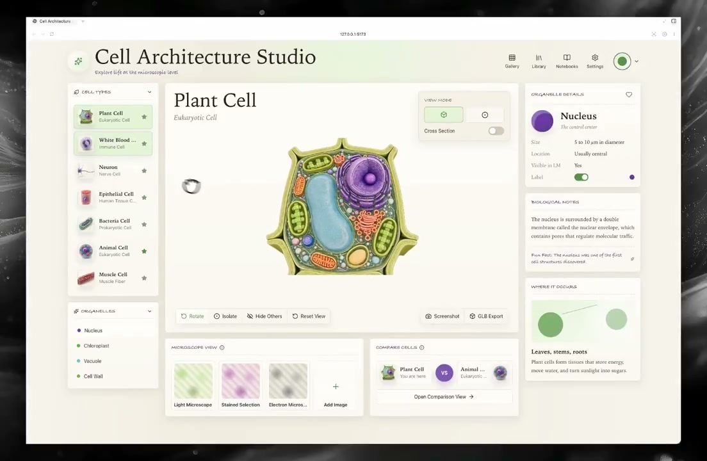
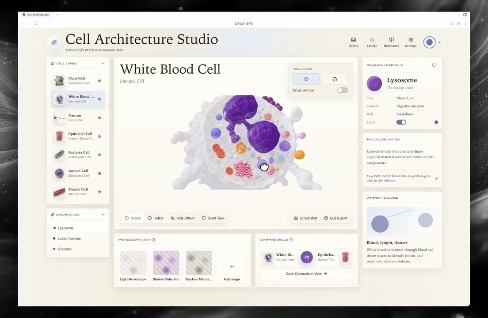
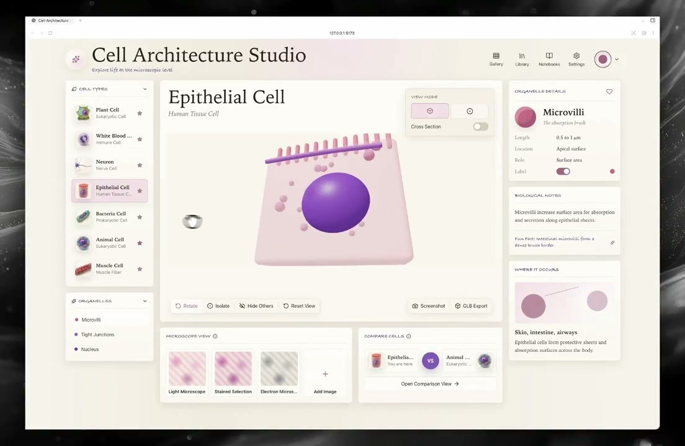
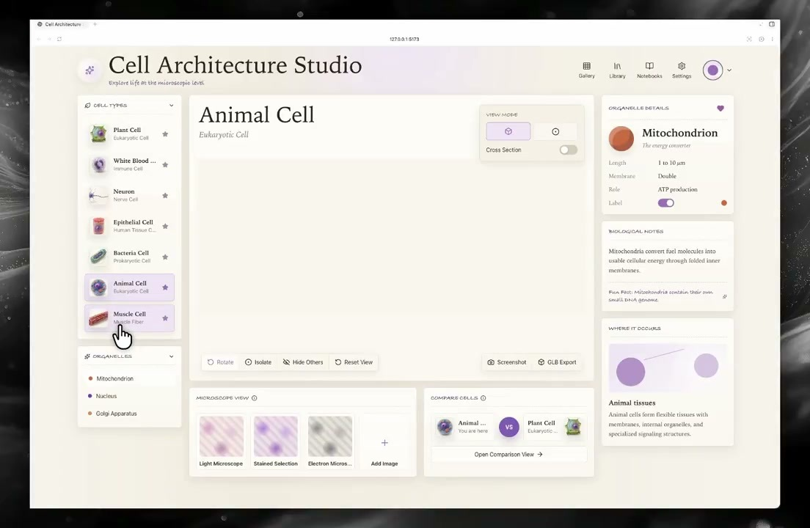

## 問題

細胞教學畫面如何在選擇種類、旋轉模型和閱讀細胞器說明之間維持上下文？

## 做法

- 左欄按細胞種類列清單，中央是目前細胞的大幅模型，右欄上方顯示細胞器資料，下方有組織／器官系統資訊。
- 底部另設顯微圖像與 Compare Cells；中央模型區下方保留旋轉、隔離和 Reset view 等操作，右上小面板提供視圖模式與 Cross Section。
- 錄影先顯示 Plant Cell，再切換 White Blood Cell，後續部分細胞呈現較簡化模型或中央空白。作者明說只完成前兩個 3D 效果，其餘尚未替換，不能整體視為完成品。

*Plant Cell 搭配中央模型、右側細胞器說明和底部比較區。*

*White Blood Cell 切換後沿用相同區域分工。*

*後段 Epithelial Cell 使用較簡化外形，完成度與前兩者不同。*

*Animal Cell 狀態下中央空白，不能當成完整功能證據。*

## 為什麼有效（推論）

以固定區域分開對象、模型和說明，可能讓切換細胞時仍知道去何處找相同資訊；明顯的未完成狀態也需要獨立表達。

## 借鑑要點

- **適合**：互動教材和多物件結構探索原型。
- **不適合**：不允許模型與說明出錯的正式生物學評量。
- **移植時注意**：標示模型精度與已完成種類；模型和細胞器說明需校驗對應，另提供文字和靜態圖替代。

## 來源與核對範圍

- [原帖 2053421848046538981](https://x.com/LufzzLiz/status/2053421848046538981)：已核對 X 官方公開 HTML 內嵌的同 ID Tweet／NoteTweet 正文；發佈時間為 2026-05-10T10:28:13+00:00。
- 已下載並檢視原始媒體；影片僅保留關鍵影格，沒有保存原始影片。媒體出處與擷取時間見本目錄 `evidence.json`。
- 本卡只把貼文文字、附圖與錄影可確認的內容列為觀察；未執行產品驗收，效果解讀列為推論。
