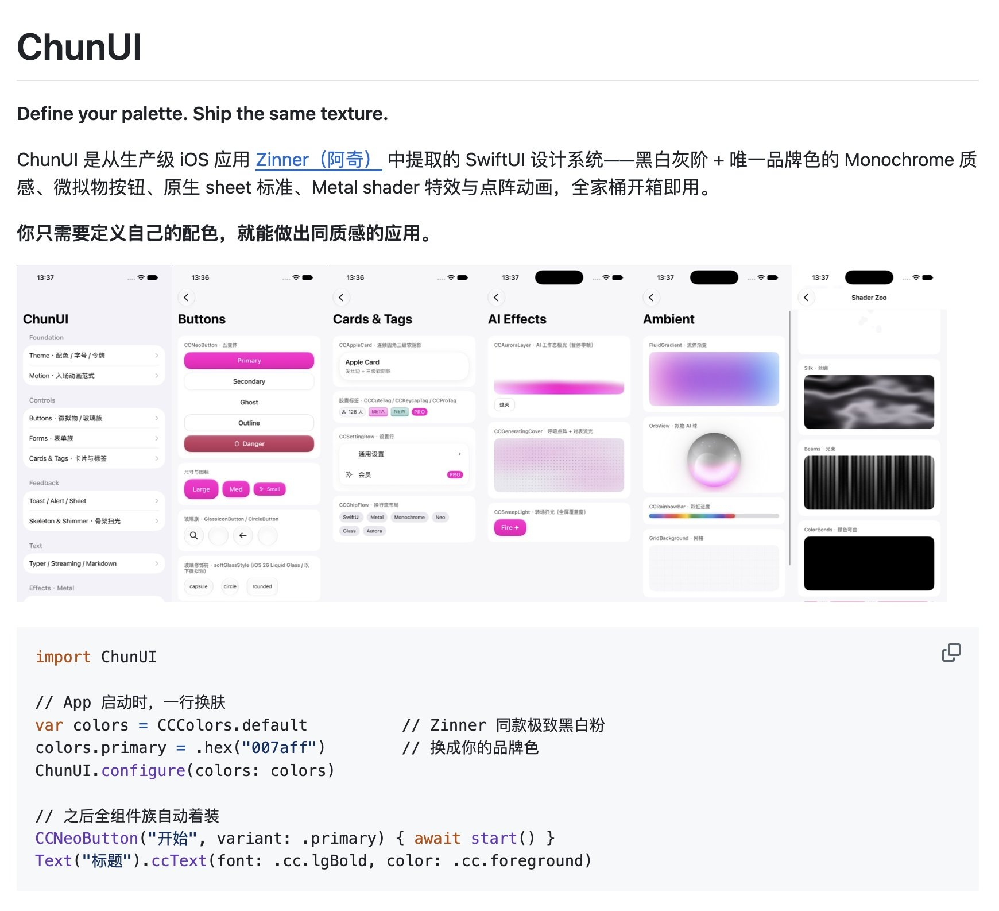
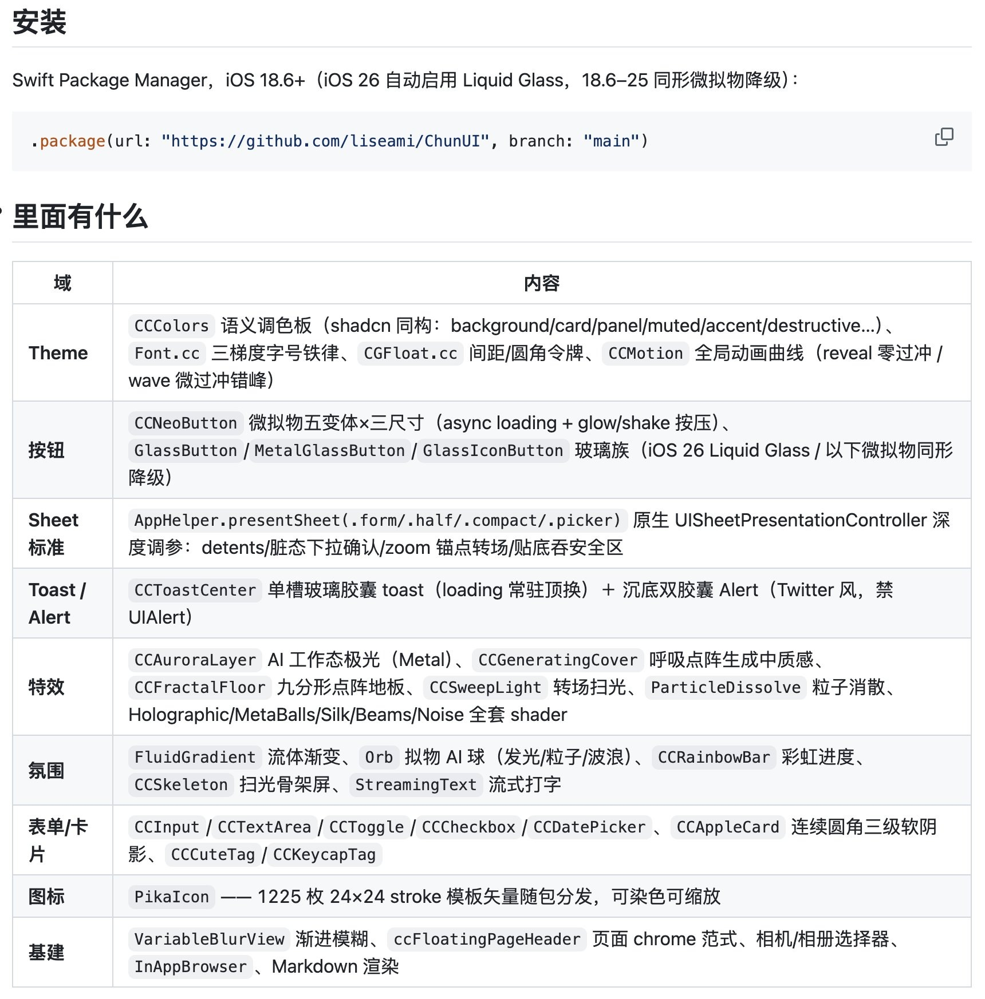

## 問題

開發者評估 iOS 元件庫時，光看一個首頁很難知道按鈕狀態、主題與效果覆蓋範圍。

## 做法

- 第一張圖將 Buttons、Cards & Tags、AI Effects、Ambient 等多個手機示例橫向並排，使用共同的粉紫色主題。
- 下方程式片段先設定主色，再以同一按鈕元件示範 async 動作；第二張圖以表格對照 Theme、按鈕、Sheet、Toast / Alert 等類別及內容。
- 示例把靜態元件、處理效果與環境裝飾分開命名；這是公開介紹頁中的能力展示，不等於每個效果都經過實機驗證。

*同一主題下並排展示按鈕、卡片、AI 效果和 Ambient 類別。*

*能力表把主題、互動元件與基礎設施逐列列出。*

## 為什麼有效（推論）

用示例和能力清單互相對照，可能讓採用者較容易辨別「風格」與「功能覆蓋」的差異。

## 借鑑要點

- **適合**：需要統一主題且會反覆組裝元件的 SwiftUI 專案。
- **不適合**：以大量動畫取代資訊層級的工具介面。
- **移植時注意**：逐一驗證 disabled、loading、錯誤、Dynamic Type 與減少動態效果；TestFlight 宣傳不構成本次支付或訂閱測試。

## 來源與核對範圍

- [原帖 2088123773023367480](https://x.com/chunxiangai/status/2088123773023367480)：已核對 X 官方公開 HTML 內嵌的同 ID Tweet／NoteTweet 正文；發佈時間為 2026-08-14T04:41:17+00:00。
- 已下載並檢視原始媒體；影片僅保留關鍵影格，沒有保存原始影片。媒體出處與擷取時間見本目錄 `evidence.json`。
- 本卡只把貼文文字、附圖與錄影可確認的內容列為觀察；未執行產品驗收，效果解讀列為推論。
