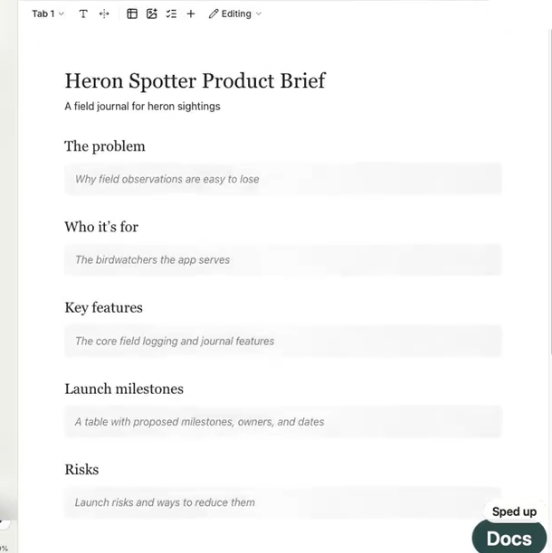
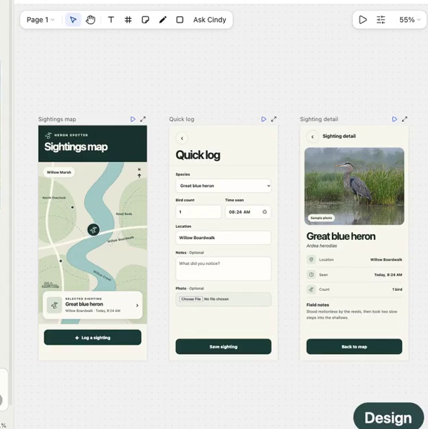
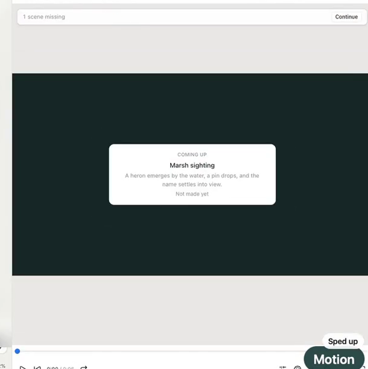

## 問題

Agent 生成不同類型成果後，使用者需要進入適合該成果的編輯面，而非只收到聊天文字。

## 做法

*8 秒：文件成果以可編輯正文、工具列與段落結構呈現。*

*90 秒：設計成果在畫布中並排地圖、記錄表單與詳情頁，保留縮放和工具列。*

*170 秒：動效面保留時間控制，但預覽明示「1 scene missing」「Not made yet」。*

同一段預告示範由文件工具列與正文 → 並排設計畫布 → 動效編輯面；最後取樣仍顯示缺一個場景，並非完成的播放結果。保存影格只保留成果區，裁去聊天、帳戶與 URL；三張展示不同成果編輯面，不能據此宣稱可無損互轉。原文用「即將集成」，因此列 concept。

## 為什麼有效（推論）

讓成果以相應編輯器承接，可能讓審查由描述轉為具體段落、頁面與播放結果。

## 借鑑要點

- **適合**：多種成果共用 Agent 工作區。
- **不適合**：僅需純文字回覆、或不能提供清楚成果歸屬的工具。
- **移植時注意**：明示成果名稱、保存狀態與版本；驗證編輯回寫、權限及播放控制，不把預告當已上線功能。

## 來源與核對範圍

[宝玉 (@dotey) 原帖](https://x.com/dotey/status/2125813177317196196)，發布：`2026-11-26T04:45:31+00:00`。2026-11-27 核對官方 X 頁內嵌完整文字及媒體；各影片保留三張影格，未保存原始影片。
