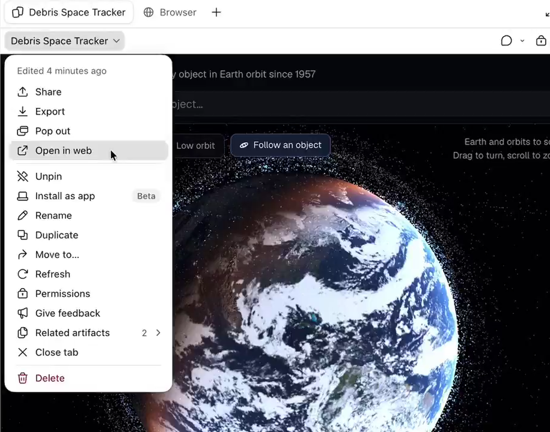
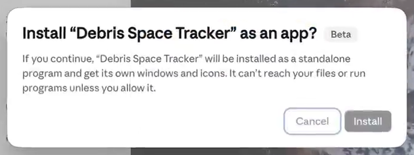
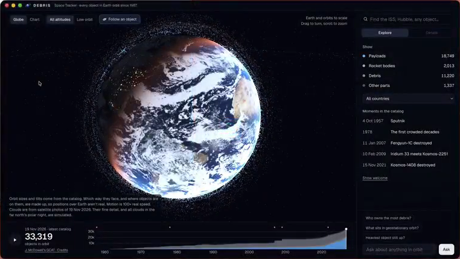

## 問題

使用者希望把對話裡反覆使用的 artifact 帶到桌面，並在安裝前理解它和一般內容預覽的能力差異。

## 做法

官方貼文及同串補充將此功能描述為 Claude Desktop 全方案 beta，Enterprise 需由 owner 啟用。Mac、Windows 的支援範圍是官方文字陳述；本次影片展示 macOS，未安裝驗證。

*3 秒：artifact 標題選單把 Install as app 與 Beta 標記放在開啟、匯出等內容操作之間；已裁去對話提示文字。*

*4 秒：確認框用 artifact 名稱說明安裝目標，交代獨立視窗、圖示與存取限制，底部並列 Cancel 和 Install。*

*10 秒：同一地球追蹤介面出現在具有獨立視窗控制的桌面視窗；只保留應用區。*

- 觸發：展開 artifact 名稱旁選單，選擇 Install as app；入口有 Beta 標記。
- 變化：背景變暗，對話框標題重複目標名稱；正文說明將有自己的視窗與圖示，未經允許不能存取檔案或執行程式。這是可見文案，不是本庫驗證的隔離保證。
- 結束：影片出現獨立視窗，保留原先的地球介面與控制。官方另稱可在允許後使用通知、選單列項目與連接器；本片段未展示各項授權。

## 為什麼有效（推論）

- 把安裝放回目前 artifact 的選單，可讓使用者直接辨認安裝對象。
- 在確認時先交代視窗與存取範圍，可能有助於建立對桌面能力的預期；不能由示範推定安全性或完成率。

## 借鑑要點

- **適合**：把文件、儀表板或生成工具升級為反覆使用的桌面入口。
- **不適合**：未提供持續運行能力卻把捷徑稱為完整桌面應用。
- **移植時注意**：確認框重複物件名稱；分清安裝與後續權限授予；補上失敗、移除及拒絕授權的狀態。

- [官方補充回覆](https://x.com/ClaudeDevs/status/2125315493771059685)：直接回覆主帖，補充各方案beta及Enterprise擁有者啟用條件；僅記錄作者當時說明，沒有驗證帳戶權限。
