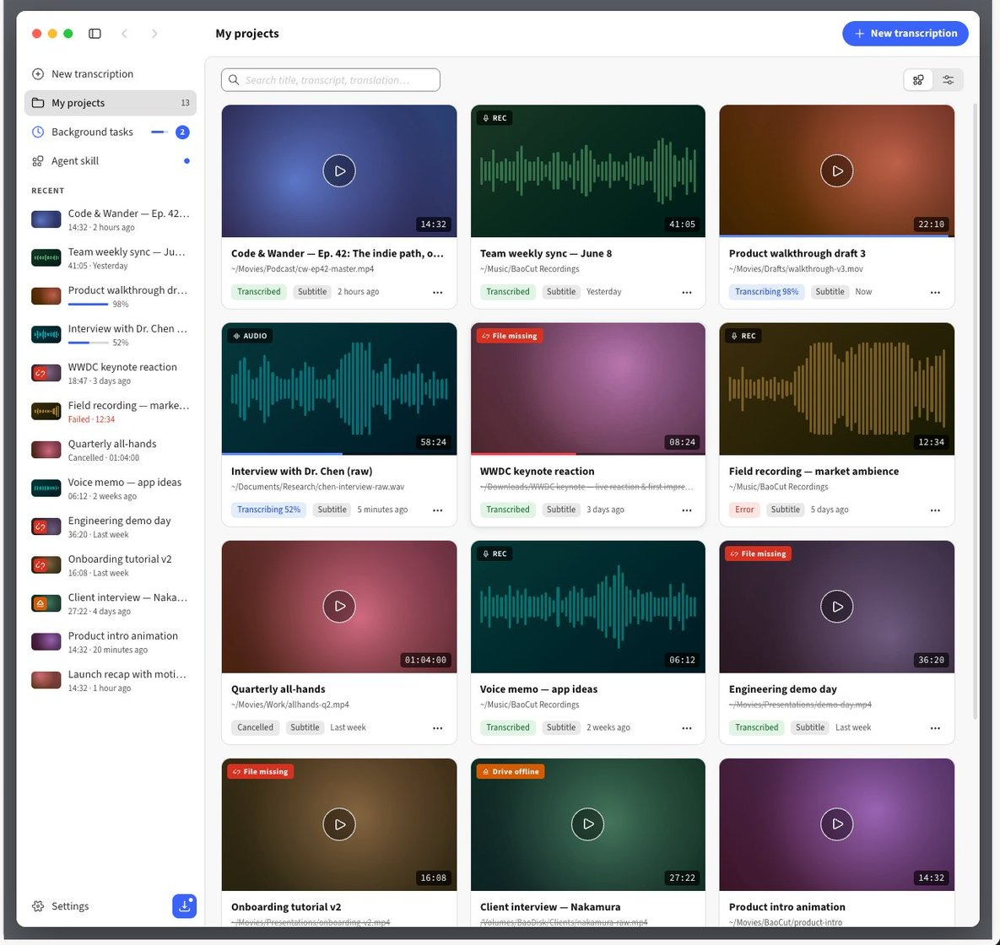

## 問題

靜態畫面無法驗證操作之後的狀態，也容易與後續實作脫節。

## 做法

- 原帖以社交客戶端說明原型需處理多種 Timeline、文字與媒體內容、按讚變色、刪除後移除列表項目，以及進入詳情返回後維持狀態。
- 先規劃資料結構與狀態，再用模擬資料構建可操作介面；原帖提到 React、CSS、JSON 與 data.jsx。
- 同批補充帖描述先打磨原型，存到本地；新增功能先改原型、確認後才改產品。透過 git diff 比較設計變化。
- 後續補充明確建議：在 Claude Design 完成一輪設計後，匯出 HTML 到本地，交給 Claude Code 當一般網頁維護。這裡記錄交接方式，不將作者的 Token 節省說法當成實測。

### 已檢視的素材

*補充帖的 BaoCut 原型：專案網格配左側導覽，縮圖與處理狀態各自有位置。*

## 為什麼有效（推論）

有狀態原型可較早暴露返回、刪除與跨頁聯動的缺口；差異資料可能減少交接時漏掉操作行為。

## 借鑑要點

- **適合**：需要驗證跨頁狀態的產品探索。
- **不適合**：把模擬原型當成已通過真實資料與權限驗收。
- **移植時注意**：在原型中列清哪些是假資料；實作仍須驗證載入、錯誤、權限與資料持久化。

## 來源與核實

- [原帖](https://x.com/dotey/status/2065874894563463660)：已取得 X 公開頁面內嵌原始 Tweet / NoteTweet 資料，按相同 status ID 核對正文。
- 本卡的「做法」依原帖文字與已檢視素材撰寫；沒有執行產品功能驗收，效果解讀列為推論。
- [同批補充：原型先行與 git diff](https://x.com/dotey/status/2086144247388905833)。

- [dotey：匯出 HTML 後在本地維護](https://x.com/dotey/status/2108574361443504625)（2026-10-09；已核對官方文字）。
- [geekplux：設計後交由 Claude Code 實作](https://x.com/geekplux/status/2108012773535891818)（已核對官方文字，作為同流程補充）。
