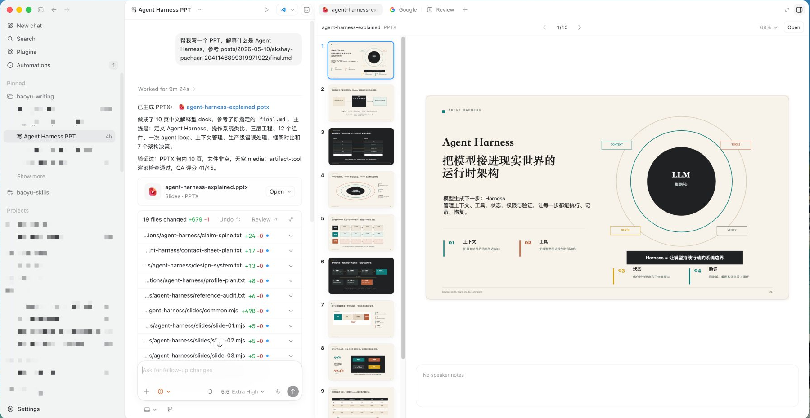

## 問題

Agent 產出檔案後，使用者需要一邊核對對話要求，一邊看成果；頻繁切出到外部程式容易丟失任務上下文。

## 做法

*原帖截圖：左欄是專案／會話，中欄是對話與變更清單，右欄以縮圖與大畫面預覽 PPTX。*

**截圖觀察**：專案導覽、對話、成果各占一欄；中欄檔案卡有 Open，變更清單有 Review；右欄頂部是多個工作頁籤，預覽內另有頁碼與縮放。右側面積大於對話欄，適合核對完整成果。

**作者觀點**：dotey 將三欄收斂解讀為 Agent 產品方向，並推測插件會補足二次編輯。本卡只收錄截圖可見的工作區；「最優解」、競品比較與未來商業模式不是介面驗證結果。

## 為什麼有效（推論）

成果與要求同時可見，可能減少視窗來回切換；頁籤則讓同一任務的不同工作物保有固定入口。單張截圖不能證明右側支援直接編輯。

## 借鑑要點

- **適合**：需要查看檔案、預覽與變更的桌面 Agent。
- **不適合**：螢幕狹窄、只需短文字問答的流程。
- **移植時注意**：允許收合導覽與調整欄寬；將「預覽」「編輯」「審查」分清楚，不暗示看得見就能修改。

## 來源與核對範圍

- [原帖 2053940091970580736](https://x.com/dotey/status/2053940091970580736)：已核對 X 官方公開頁面內嵌 Tweet／NoteTweet 快取。

- 本卡根據來源文字與已檢視媒體記錄，沒有執行產品功能驗收；作者成效宣稱不視為獨立測試。
