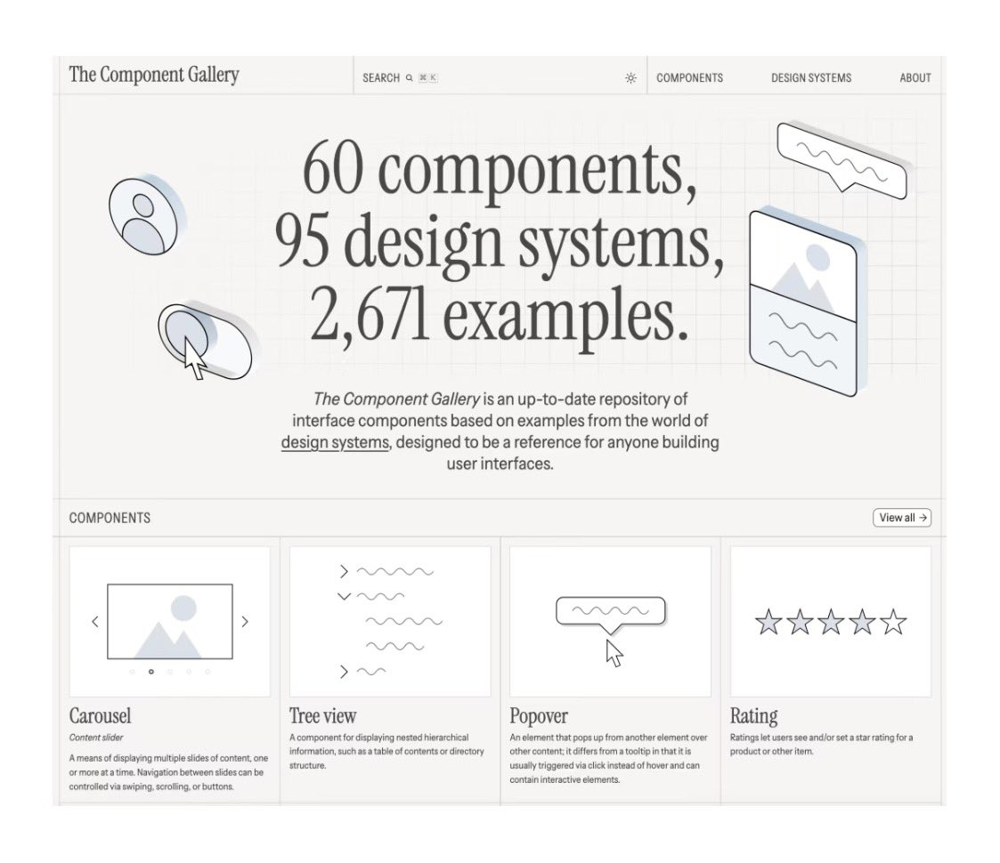

## 問題

討論 Dialog、Popover 或其他元件時，僅說「彈窗」容易把不同互動模式混在一起；找範例也需要一個共同的名稱入口。

## 做法

*首屏摘要規模，下方元件卡片以名稱和示意圖建立可搜尋入口。*

- 原圖是 Component Gallery 首頁，首屏用大字顯示元件、設計系統與範例的數量；下方 Components 區將每種元件做成圖示預覽、名稱與說明卡片。
- 同一排可以看到 Carousel、Timeline、Popover 等具名元件；抽象的元件概念與簡化視覺示意放在同一張卡片。
- 貼文提供 component.gallery 原始網址，並把正確命名作為與 AI 溝通的建議。圖片只能核實當時的索引呈現，數量不是現行庫存承諾。

## 為什麼有效（推論）

名稱加上形狀示意，可讓不熟悉專業詞彙的人先從外觀對照，再取得可搜尋的標準名稱；跨系統參考也有機會減少只照抄單一套件的限制。

## 借鑑要點

- **適合**：設計系統索引、元件文件、需求描述時的術語對照。
- **不適合**：把所有浮層統一稱為同一元件，或只看外觀便決定鍵盤／焦點行為。
- **移植時注意**：卡片補上「何時用、何時不用」及可及性契約；搜尋同時支援在地用語與英文別名。名稱相同的元件仍須比較關閉、焦點和定位規則。

## 來源與核對範圍

- [chunxiangai 原文](https://x.com/chunxiangai/status/2099799518011343144)（發布：2026-09-15T09:56:32+00:00）。

已核對 X 公開原文的嵌入式 Tweet／NoteTweet 資料及本卡所列原始素材。`kind: concept` 表示本次僅確認公開展示／設計方法，沒有把示範等同正式上線或端到端驗證。
