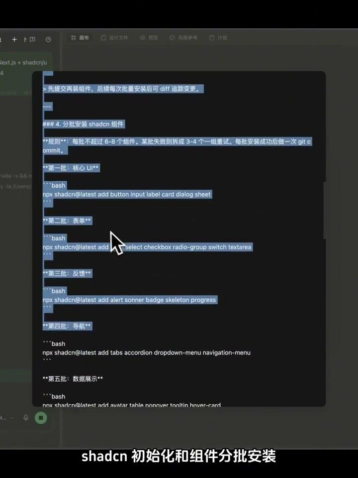
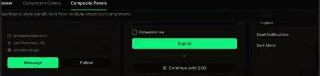
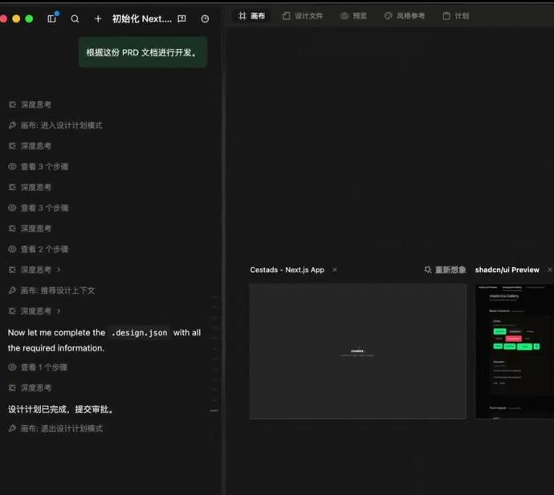

## 問題

單一按鈕換色成功，不代表由多個元件組成的面板已一致套用主題。

## 做法

- 原帖影片先展示準備規則，再檢視 Component Gallery 與 Composite Panels。複合面板包含登入、成員、指標等組合，而非只展示孤立控件。
- 影片字幕指出部分圖表沒有切換主題色，畫面可見主操作採綠色但指標仍保留其他色。這是檢查時發現的差異，不能直接斷言全部是錯誤，語義色可能需要保留。
- 後段回到實際工作台，將規則延伸到產品畫面。

### 已檢視素材

*檢視設計規則，為元件統一外觀提供依據。*

*複合面板中主要按鈕已換色，影片字幕提醒部分圖表仍未切換。*

*回到實際產品工作區檢查設計系統的套用情境。*

## 為什麼有效（推論）

在複合情境查主題傳播，可能提早找出只修改基礎控件卻遺漏圖表、狀態和巢狀面板的問題。

## 借鑑要點

- **適合**：元件庫換膚和主題回歸檢查。
- **不適合**：把所有警告、成功和資料系列顏色一律替換為品牌色。
- **移植時注意**：先分清品牌色與語義色，再逐項檢查繼承；同時驗證深色模式對比。

## 來源與核實

- [原帖](https://x.com/xin_pai88825/status/2064199368941748323)；原始資料已核對 ID，本文不代表產品實機驗收。
