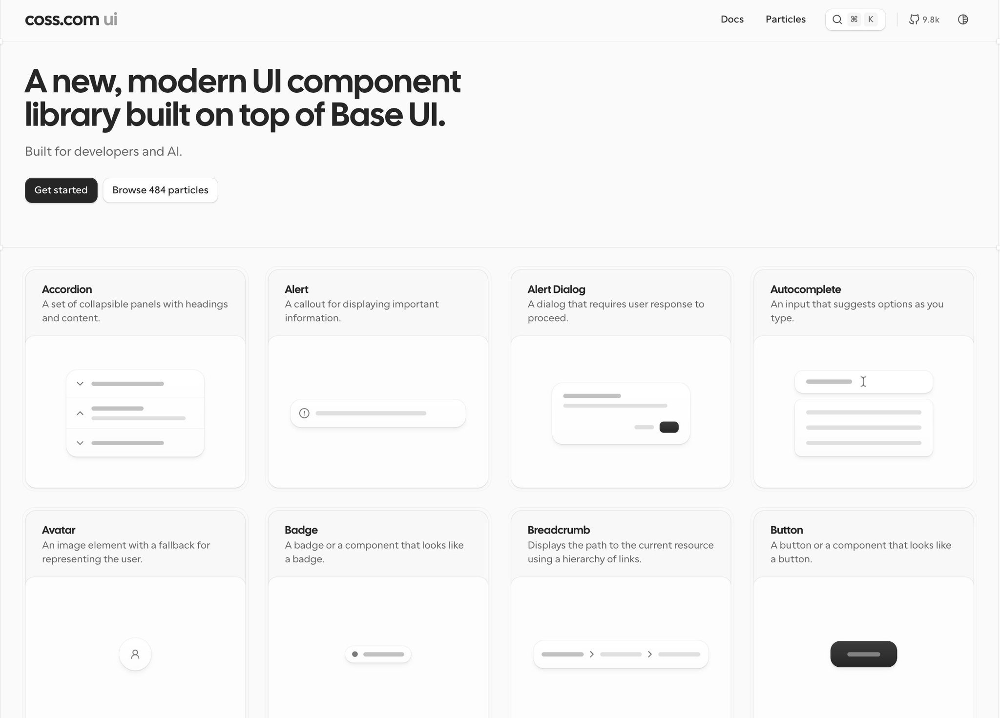
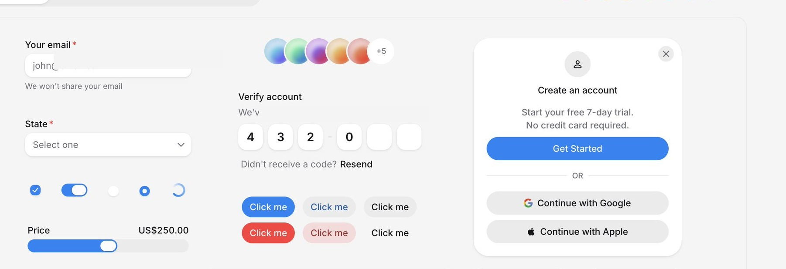

## 問題

選擇元件庫時，如何從共同的輸入、驗證與回饋元件比較，而不只看首頁氣氛？

## 做法

- COSS UI 圖把 Accordion、Alert、Alert Dialog、Autocomplete 等分成規則卡片，每張包含元件名、簡短用途與小型預覽。
- HeroUI 圖在同一展示區放入 Email、State 選擇、驗證碼、開關、滑桿和註冊卡；頂部以多個色點提供主題探索線索。
- 兩圖都是公開元件展示，不是同一介面的改版比較。作者偏好 COSS 是個人判斷，本次沒有套件或可及性測試。

*COSS 以元件名稱和用途組成規則目錄。*

*HeroUI 並列驗證碼、開關、滑桿和註冊入口，可比較主題表達。*

## 為什麼有效（推論）

對照相同任務的元件，可能比用單一「高級感」評語更容易選出適合密度與品牌的系統。

## 借鑑要點

- **適合**：元件庫選型、視覺方向和表單狀態盤點。
- **不適合**：僅依外觀決定底層可及性或複雜互動能力。
- **移植時注意**：先列必需元件和狀態，再檢查錯誤、焦點、長文與主題對比；示例中的人物與聯絡資料已去除。

## 來源與核對範圍

- [原帖 2061979261637181775](https://x.com/vikingmute/status/2061979261637181775)：已核對 X 官方公開 HTML 內嵌的同 ID Tweet／NoteTweet 正文；發佈時間為 2026-06-03T01:12:20+00:00。
- 已下載並檢視原始媒體；影片僅保留關鍵影格，沒有保存原始影片。媒體出處與擷取時間見本目錄 `evidence.json`。
- 本卡只把貼文文字、附圖與錄影可確認的內容列為觀察；未執行產品驗收，效果解讀列為推論。
