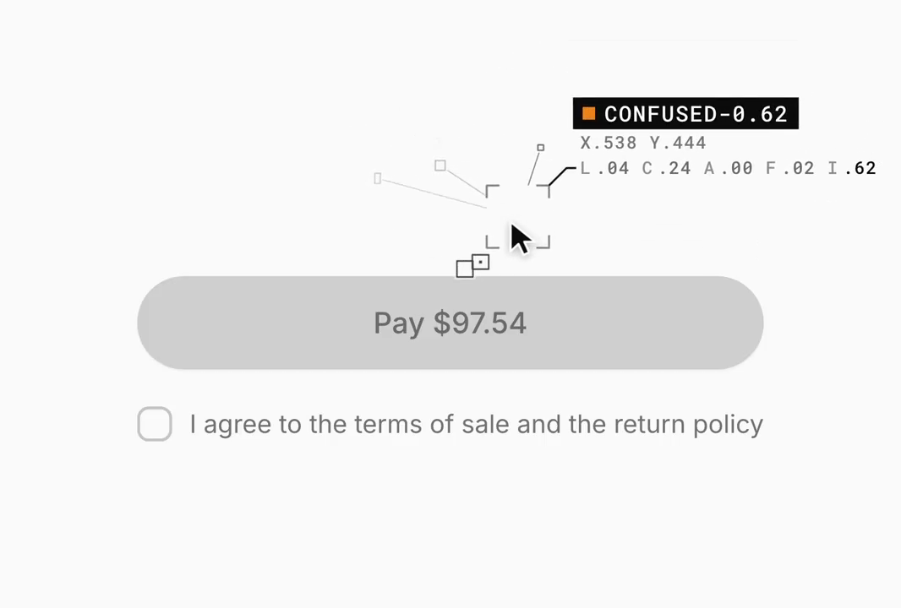
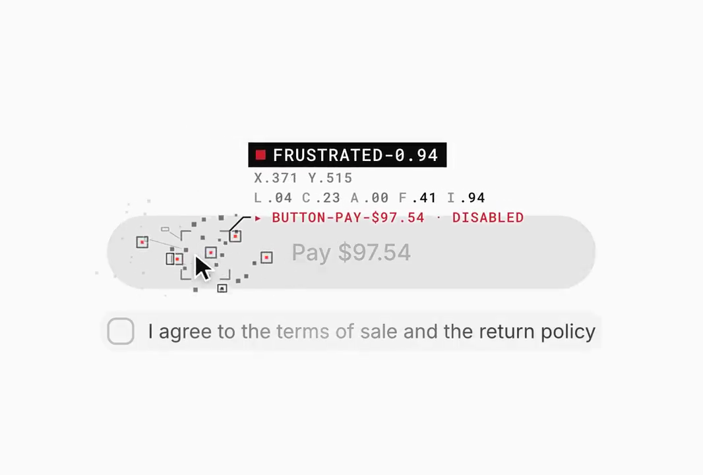
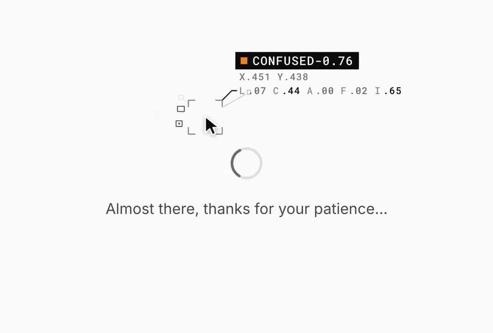

## 問題

使用者反覆嘗試一個不能按的控制時，介面如何把真正阻擋下一步的條件帶到前景？

## 做法

- 影片先呈現灰色Pay按鈕與未勾選條款，游標旁疊加軌跡、座標、分類標籤與數值。
- 游標在禁用按鈕附近移動或重複嘗試後，標籤由CONFUSED變為FRUSTRATED，條款文字的視覺強度提高；示範強調解除阻擋的條件，而不是讓禁用按鈕繼續搶注意。
- 後段處理中仍保留轉圈符號，等待文字改為較完整的安撫句。畫面標籤是模型示範輸出，不能據此證明操作者的真實情緒或因果效果。

*灰色付款按鈕、未勾選條款與CONFUSED示範標籤；金額與數值皆屬示範。*

*FRUSTRATED標籤出現時，條款文字更突出；未執行付款或核對模型判斷。*

*處理中以轉圈和較完整等待文案呈現回饋。*

## 為什麼有效（推論）

凸顯下一步所需條件，可能比只變換禁用按鈕更有幫助；但行為訊號也可能來自探索習慣或輸入裝置，不能替代清楚的基本說明。

## 借鑑要點

- **適合**：可逆的小幅提示強化、等待回饋探索。
- **不適合**：把推測情緒當作事實，依分類隱藏功能、變更價格或替使用者作重要決定。
- **移植時注意**：先修正難理解的禁用原因；提示應穩定、不挪走游標下的控制，提供不用分類也能取得的說明，分別測試滑鼠、觸控與鍵盤。

## 來源與核對範圍

- [Jakub原帖](https://x.com/Jakubantalik/status/2125273238414721460)及[Kubai引用](https://x.com/Kubai087/status/2125407066135445628)：核對官方正文、作者、時間與17.9秒影片；Kubai提出可用於等待文案或按鈕變化，是借鑑想法。
- [作者文件](https://libraries.dev/mood-recognition)：公開頁可讀，將此功能標為beta；其端側處理、測試結果及資料不外傳均為作者聲明，本次未稽核，也未下載模型或安裝套件。
- 保留影片4／7／14秒三幀，沒有真實帳號、憑證或付款執行；完整影片不留庫，來源及雜湊見 `evidence.json`。公開頁僅供閱讀，沒有用真實帳戶或付款測試。
