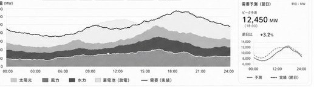

## 問題

同樣稱為儀表板的頁面，可能服務完全不同的操作任務，不能全部套成 KPI 卡片。

## 做法

- 原帖兩張參考圖包含 16 個示例。已檢視圖中可見：商機用階段分欄卡片，訂單用可勾選資料表，排班用日期與時間網格加右側詳情，製造監控用流程節點配底部數據表。
- 配送頁以地圖為中心，左右保留路線和車輛資訊；能源頁以面積圖為主，旁列摘要，下方是事件表。這些是布局參考，不認定為真實上線產品。

### 已檢視的素材

*只保留能源主圖與右側摘要的布局區域；原拼圖中的人物與帳戶標記不入庫。*

## 為什麼有效（推論）

先對應比較、定位、調度或追蹤等任務，可能比直接挑視覺模板更能保住主要工作區。

## 借鑑要點

- **適合**：後台資訊架構初稿。
- **不適合**：在沒有任務分析時照抄所有區塊。
- **移植時注意**：選定主工作物件；摘要、明細與操作按頻率排序，窄屏需重新安排優先順序。

## 來源與核實

- [原帖](https://x.com/dezainaz_ceo/status/2087112163752349841)及其內嵌媒體；已核對原始 ID、正文與關鍵影格，未操作產品驗收。
