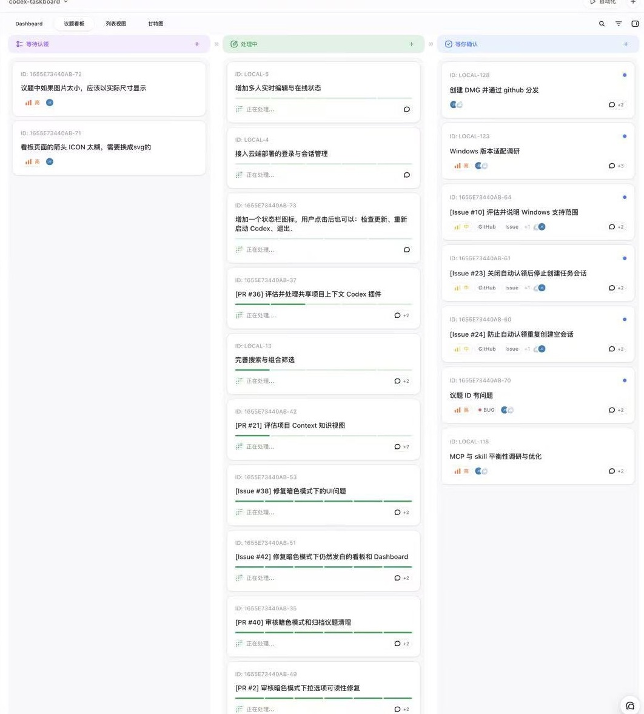

## 問題

同時追蹤多個編碼任務時，如何不打開每段聊天也能掃描工作分布？

## 做法

- 原帖連到 dashi-taskboard，附圖中央是多欄任務看板；欄頭有不同淡色背景，卡片以標題、摘要及小型狀態標記呈現。
- 左側另有會話清單，與中央任務卡並存。本次保存圖只保留看板，排除帳戶與歷史會話內容。
- 看板可見多張卡片集中在中間欄，欄內卡片高度隨內容變化；單張截圖無法驗證拖曳、狀態同步或完成判斷來源。

*任務以多個狀態欄排列，欄頭底色與卡片摘要協助掃讀。*

## 為什麼有效（推論）

狀態欄可能讓人先看到任務堆積與待處理分布，再決定進入哪個任務；前提是狀態有可靠更新來源。

## 借鑑要點

- **適合**：同時執行多個長任務的 Agent 工作台。
- **不適合**：把所有聊天訊息都當成獨立任務的碎片化看板。
- **移植時注意**：給狀態明確定義並顯示最近更新時間；Agent 回答成功與測試通過要分開，避免卡片移到完成就被當成驗收。

## 來源與核對範圍

- [原帖 2087643368591356257](https://x.com/teach_fireworks/status/2087643368591356257)：已核對 X 官方公開 HTML 內嵌的同 ID Tweet／NoteTweet 正文；發佈時間為 2026-08-12T20:52:20+00:00。
- 已下載並檢視原始媒體；影片僅保留關鍵影格，沒有保存原始影片。媒體出處與擷取時間見本目錄 `evidence.json`。
- 本卡只把貼文文字、附圖與錄影可確認的內容列為觀察；未執行產品驗收，效果解讀列為推論。
