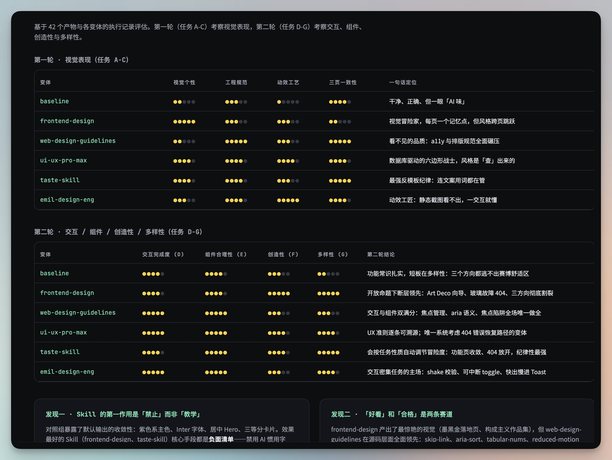
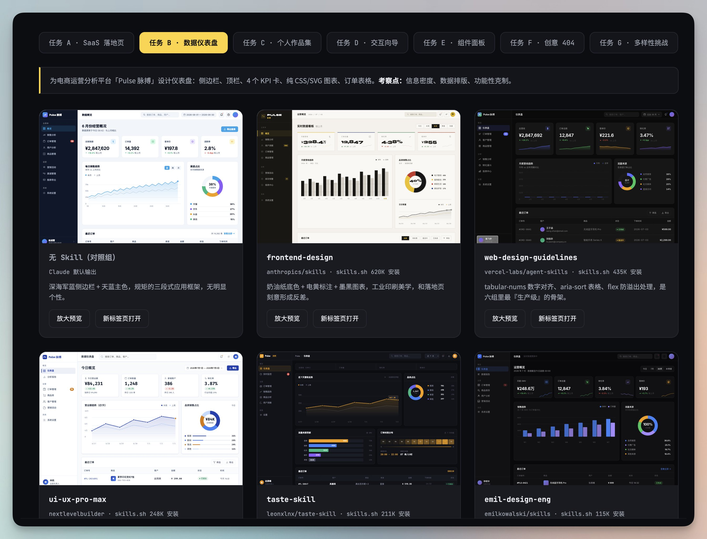

## 問題

比較設計工具或模型時，如果每個結果使用不同任務，觀者很難判斷差異來自工具、提示詞還是產品內容。

## 做法

*作者比較表以面向、星等及短評呈現判斷。*

*同類任務的多個產出以規則卡片網格並排。*

- 第一張原圖把多種前端設計 Skill 排成比較表，按不同面向給星等與短評；這些是作者主觀評測，不是本次重現的測試結果。
- 第二張是深色比較頁，同一行排列多個相似任務的儀表板縮圖，下方各自列出名稱、說明與操作；頁面上方用分類／標籤切換測試案例。
- 可見明暗主題、密度及圖表布局不同；本卡收錄比較頁的呈現方法，不重述某個 Skill 一定最好，也沒有安裝任何 Skill。

## 為什麼有效（推論）

共同任務與並排輸出，有機會把比較從印象拉回具體差異；把評分與截圖分開，則更容易辨識作者判斷與原始產出。

## 借鑑要點

- **適合**：工具評估、設計方向評審與同一需求的多版本比較。
- **不適合**：用單一星等排名代替實際可及性、功能或效能測試。
- **移植時注意**：每個版本記錄同一提示、資料、尺寸與版本；評分標準公開且可逐項回查。提供原尺寸入口，避免只憑縮圖決定。

## 來源與核對範圍

- [vista8 原文](https://x.com/vista8/status/2073100197769646511)（發布：2026-07-03T17:42:58+00:00）。

已核對 X 公開原文的嵌入式 Tweet／NoteTweet 資料及本卡所列原始素材。`kind: concept` 表示本次僅確認公開展示／設計方法，沒有把示範等同正式上線或端到端驗證。
