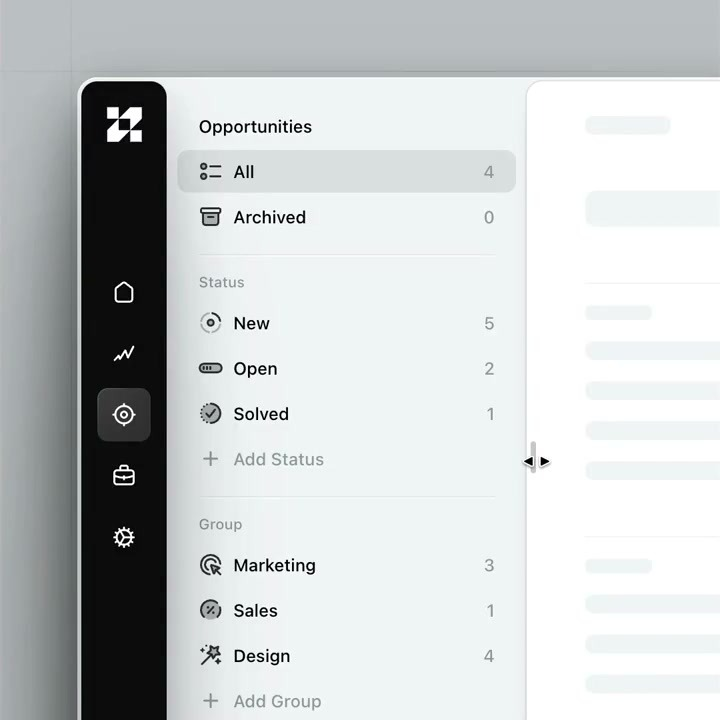
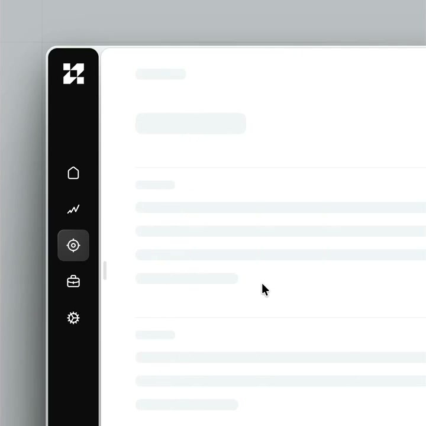
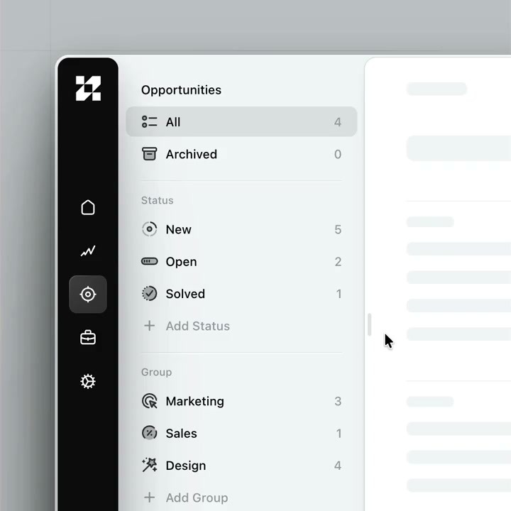
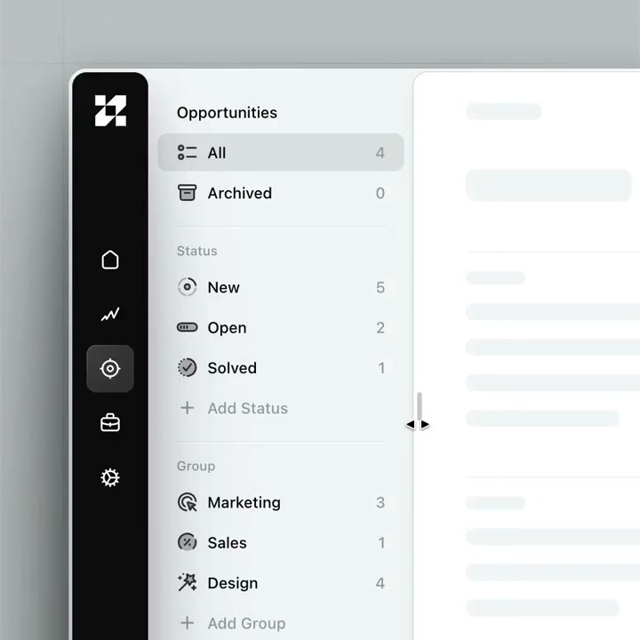

## 問題

使用者需要收起介面區域，但拖曳過程不能每次微移都觸發折疊。

## 做法

- 原帖以簡短文字明確描述：拖曳達到足夠距離才折疊。
- 影片負責展示位移與收起；影格可見左側黑色圖標欄固定，文字導覽收起後主內容向左擴張；精確門檻與回彈參數仍未確認。

### 已檢視的素材

*展開狀態同時保留最左圖標欄與右側文字導覽。*

*折疊狀態移除文字導覽，內容區向左擴張。*

*重新展開後，列表和內容區並排。*

*文字導覽保持原有群組與數量標記。*

## 為什麼有效（推論）

位移門檻可把試探性拖曳與確定操作分開；具體容錯效果仍需實測。

## 借鑑要點

- **適合**：可拖曳面板與可收起區域。
- **不適合**：缺乏替代操作的唯一入口。
- **移植時注意**：提供鍵盤或按鈕替代；門檻需配合可見進度、取消與回彈，不應要求使用者猜距離。

## 來源與核實

- [原帖](https://x.com/guerriero_se/status/2062906242247319896)：已取得 X 公開頁面內嵌原始 Tweet / NoteTweet 資料，按相同 status ID 核對正文。
- 本卡的「做法」依原帖文字與已檢視素材撰寫；沒有執行產品功能驗收，效果解讀列為推論。
