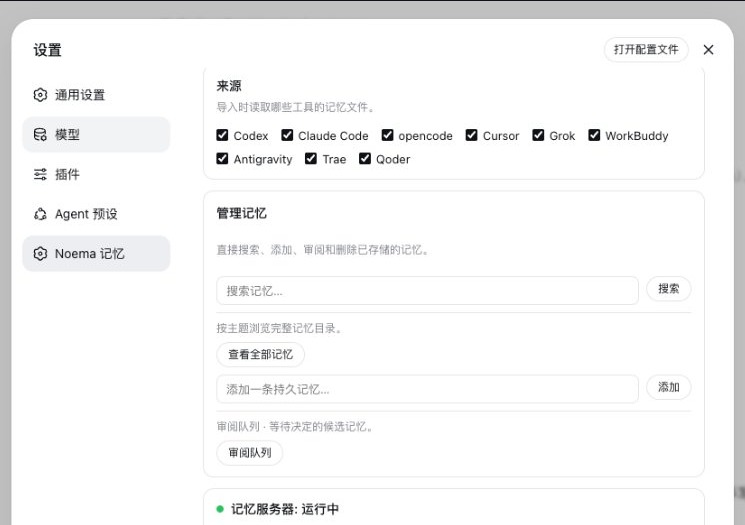

## 問題

Agent 記住背景之後，使用者需要知道保存了什麼，也希望沿用其他工具的既有記憶。

## 做法

- 原帖說明 Agent 可跨會話記住內容並在工作前回憶。
- 設定頁提供查看與管理記憶的入口，並支援從 Codex、Claude Code、Cursor 導入。
- 素材可見來源勾選、搜尋記憶、查看全部記憶、添加持久記憶及審閱隊列；未看見實際刪除流程或衝突合併規則。

### 已檢視的素材

*設定頁把來源勾選、記憶搜尋、查看全部、添加與審閱隊列分成區塊。*

## 為什麼有效（推論）

把背景記憶暴露成可管理資訊，可能減少使用者面對隱藏狀態時的困惑。

## 借鑑要點

- **適合**：具長期上下文的 Agent 工具。
- **不適合**：不能持久保存個人資料的工作環境。
- **移植時注意**：導入需交代來源、重複與覆寫規則；查看入口之外還應驗證修改或清除是否真正生效。

## 來源與核實

- [原帖](https://x.com/FiniYang/status/2088574332448715169)：已取得 X 公開頁面內嵌原始 Tweet / NoteTweet 資料，按相同 status ID 核對正文。
- 本卡的「做法」依原帖文字與已檢視素材撰寫；沒有執行產品功能驗收，效果解讀列為推論。
