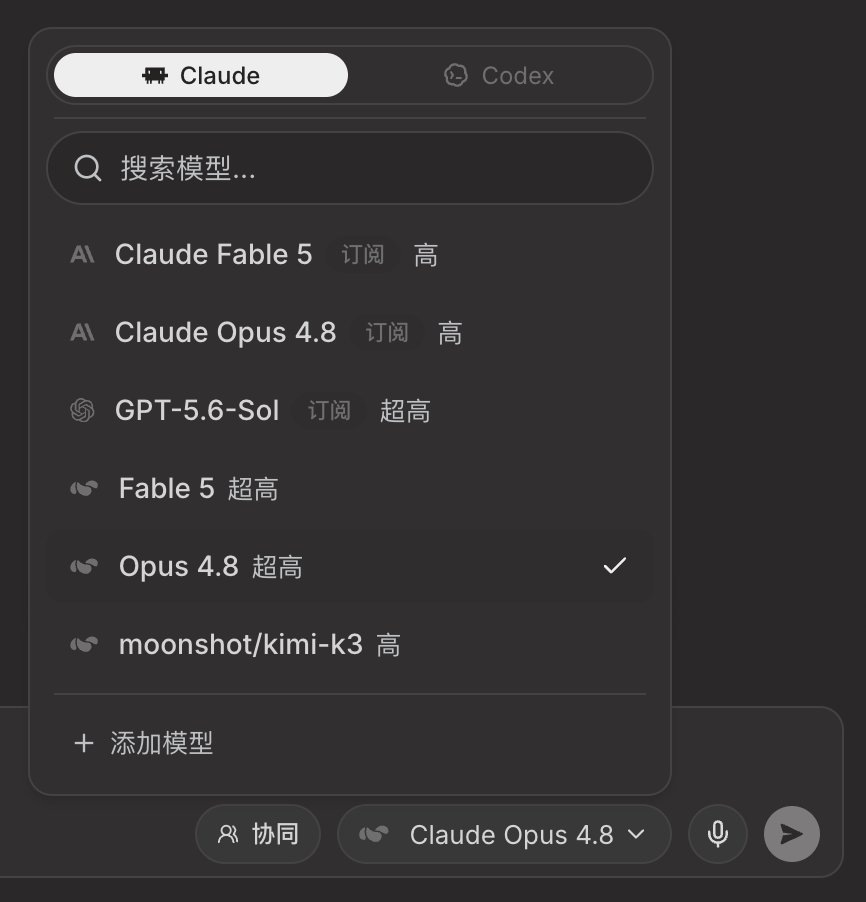

## 問題

同一桌面輸入框支援兩套 Agent 時，模型清單容易把工具來源、模型與推理強度混在一起。

## 做法

- 截圖的浮層頂部有 Claude／Codex 分段選擇，下面是「搜尋模型…」搜尋框，再往下列出模型。
- 每列把模型名與推理強度放在同一列，當前選項右側有勾號；底部的「新增模型」以分隔線和現有模型區分。
- 浮層由底部輸入區的模型按鈕展開。原帖說的是準備開源桌面版，未提供足以證明正式交付的操作錄影。

*模型浮層由工具分段、搜尋欄、帶強度的選項和新增入口組成。*

## 為什麼有效（推論）

先選執行工具再找模型，可能降低跨工具誤選；勾號讓清單與收起後的目前選項可互相核對。

## 借鑑要點

- **適合**：支援多個 Agent 或模型來源的桌面工作台。
- **不適合**：只有一個固定模型、無需切換的輕量輸入框。
- **移植時注意**：明確顯示工具與模型相容性，搜尋需支援鍵盤及空結果；不要將畫面裡的模型名稱視為目前供應商的可用清單。

## 來源與核對範圍

- [原帖 2079492394052120849](https://x.com/DashHuang/status/2079492394052120849)：已核對 X 官方公開 HTML 內嵌的同 ID Tweet／NoteTweet 正文；發佈時間為 2026-07-21T09:03:16+00:00。
- 已下載並檢視原始媒體；影片僅保留關鍵影格，沒有保存原始影片。媒體出處與擷取時間見本目錄 `evidence.json`。
- 本卡只把貼文文字、附圖與錄影可確認的內容列為觀察；未執行產品驗收，效果解讀列為推論。
