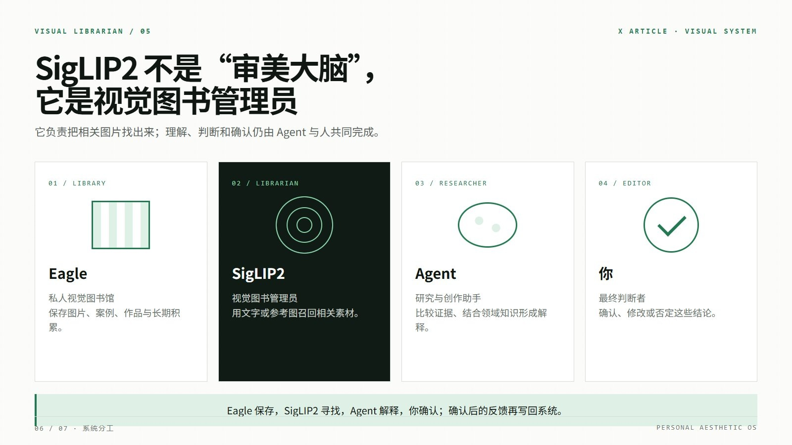
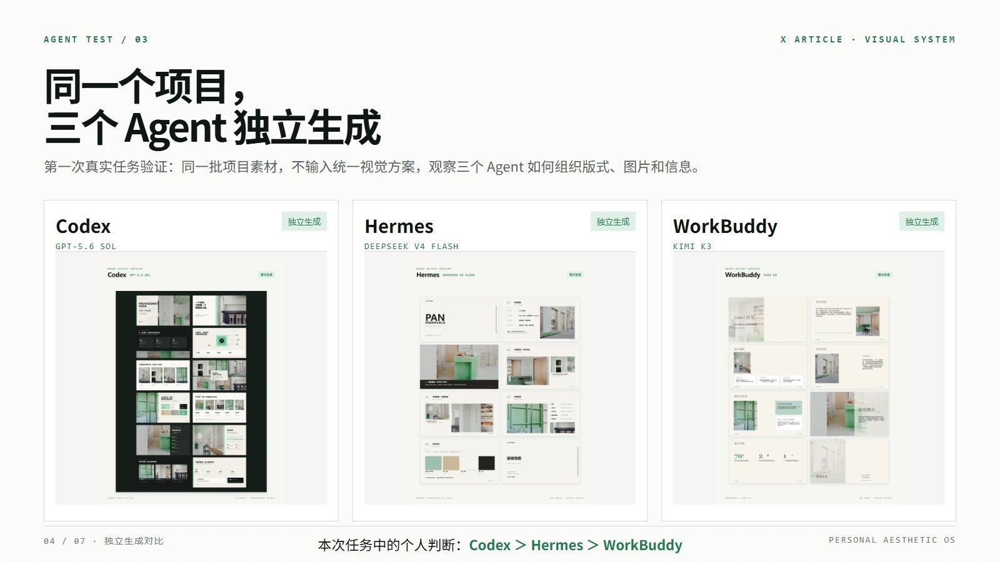
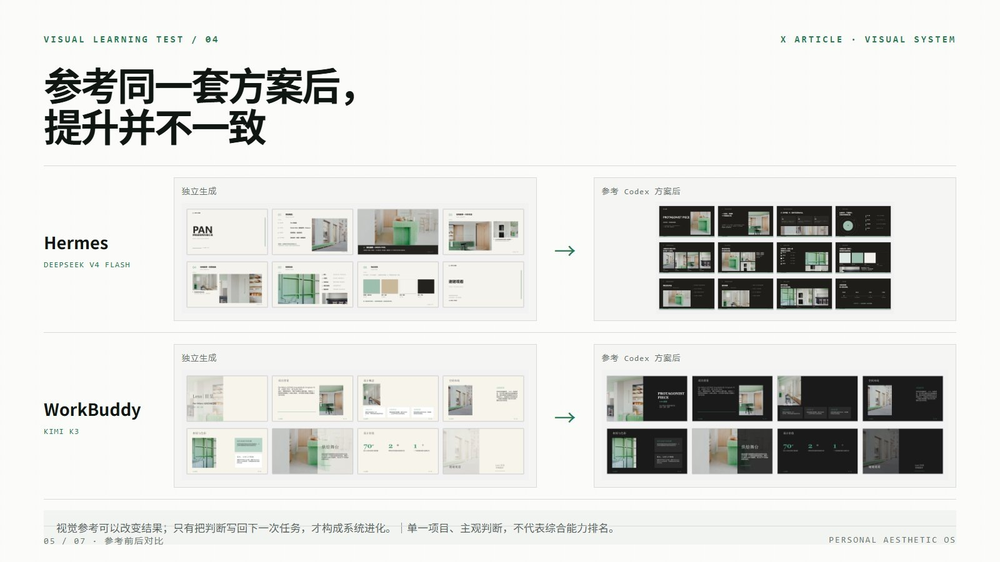
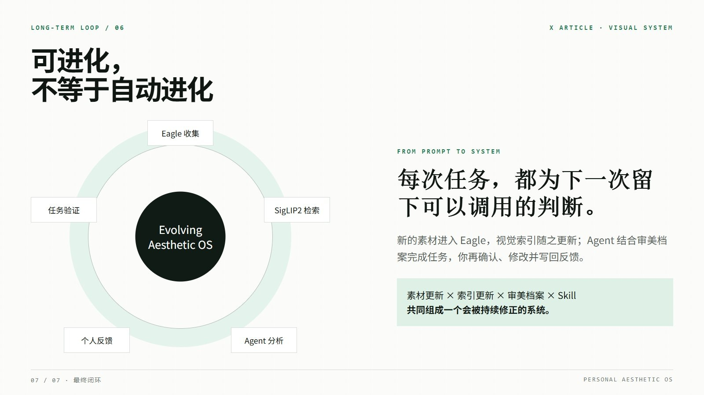

## 問題

只用「克制、留白、有質感」等抽象詞，無法穩定傳遞個人的視覺判斷；收藏增加後，手動找參考也越來越困難。

## 做法

*Eagle、SigLIP2、Agent 與人分別負責保存、檢索、解讀與確認。*

*同一專案由三個 Agent 各自產生提案；圖中的排序是作者單次主觀判斷。*

*再次參考同一方案後，兩個 Agent 的結果改善幅度並不一致。*

*回饋迴圈把每次任務的判斷保留到下一次，而不是自動認定偏好。*

- 作者讓 Agent 讀取 Eagle 素材，除了分類，還記錄「為什麼收藏」「喜歡什麼」「適合什麼任務」「哪些元素不喜歡」，並連回支撐判斷的素材。
- 用本機 SigLIP2 So400m 384 建立視覺索引：可用自然語言找圖、以參考圖找相似素材，再縮小成需要閱讀的完整案例。文章清楚區分「找出證據」與「判斷好壞」，不把相似度當作審美評分。
- 在同一專案中先讓三個 Agent 各做一版 PPT，再讓其中兩個參考作者偏好的完整方案重做；作者比較版式骨架、圖片裁切與資訊層次，而不只是顏色。
- 結論由人確認、修改或否定，穩定後才寫入個人審美檔案；新任務的結果與回饋再寫回。文章明言這是正在嘗試的方法，並非會自動進化的已驗證系統。
- 作者原本研究建築／室內素材，但明確提出 UI 可改為分析版式、字體、資訊密度與視覺層級。此處保留這個移植方向，不宣稱其 UI 成效已被測量。

## 為什麼有效（推論）

- 把偏好連回正例與反例，可以讓下一次任務找到可比較的依據，而不是反覆猜測同一個形容詞。
- 先檢索再解讀，可能減少無關參考對方案的干擾；人工否定與修正則避免把 Agent 的解讀直接當成使用者偏好。
- 作者的排序只來自一個專案、一次任務與個人標準，不能當成模型能力排名或成效數據。

## 借鑑要點

- **適合**：累積很多視覺參考的設計團隊、個人素材庫、需要跨專案保持偏好的協作。
- **不適合**：把圖片相似度直接當成美感、品質或產品適用性的自動評分。
- **移植時注意**：每條偏好保留來源、適用任務與反例；記錄作者明確確認的判斷。UI 任務先固定內容與需求，再比較字級、層次、密度和裁切，避免只學表面配色。圖片庫的存取範圍另行控制，不把私人素材預設公開。

## 來源與核實範圍

- [@Sutao_1324 原帖](https://x.com/Sutao_1324/status/2104539525183570430)；發表時間：2026-09-28T11:51:37+00:00。
- [官方 X 文章](https://x.com/i/article/2104474102056542209)：〈当语言说不清审美，我给 Agent 搭了一套“视觉记忆系统”〉。
- 已從 X 官方 SSR 取得完整 `plain_text`、`content_state` 與 `media_entities`，全文 2,702 字；六張原圖均已下載檢視，卡內保留四張方法與比較圖。
- 未安裝模型、技能或操作作者系統；圖與文字證明方法描述，不能證明實際檢索品質或設計成效。
