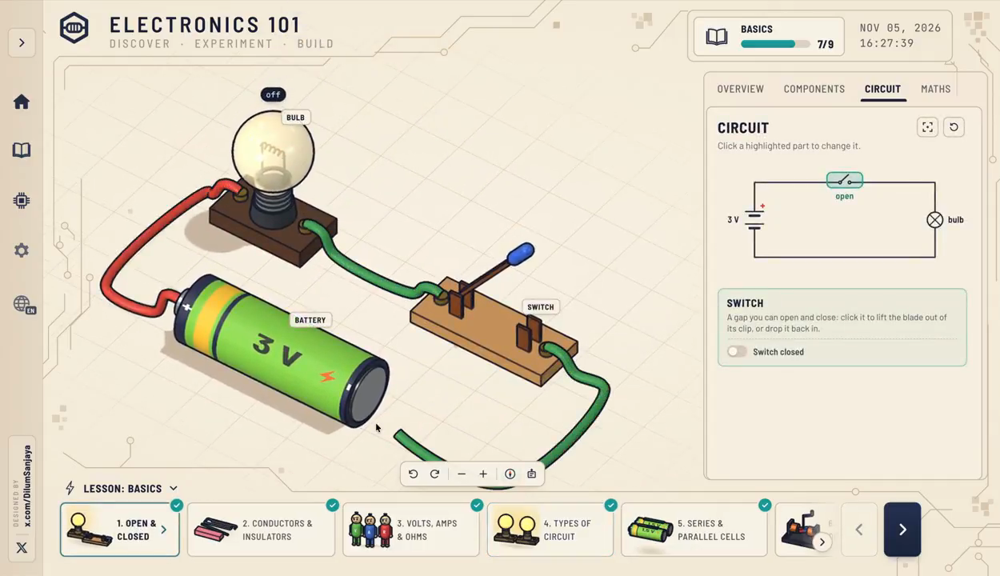
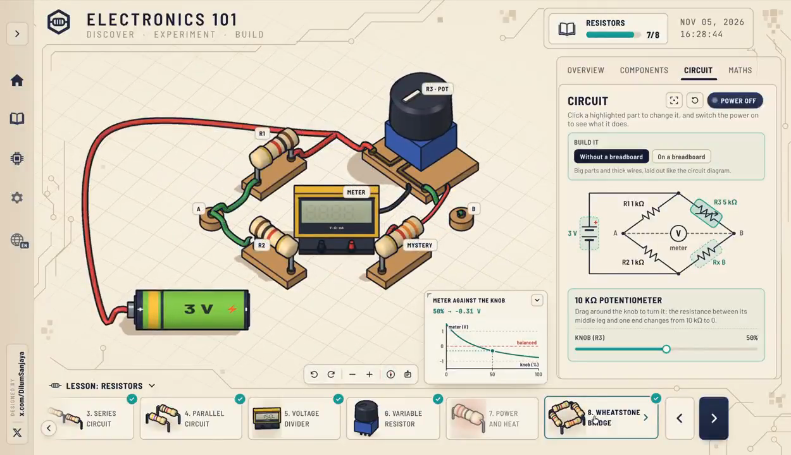
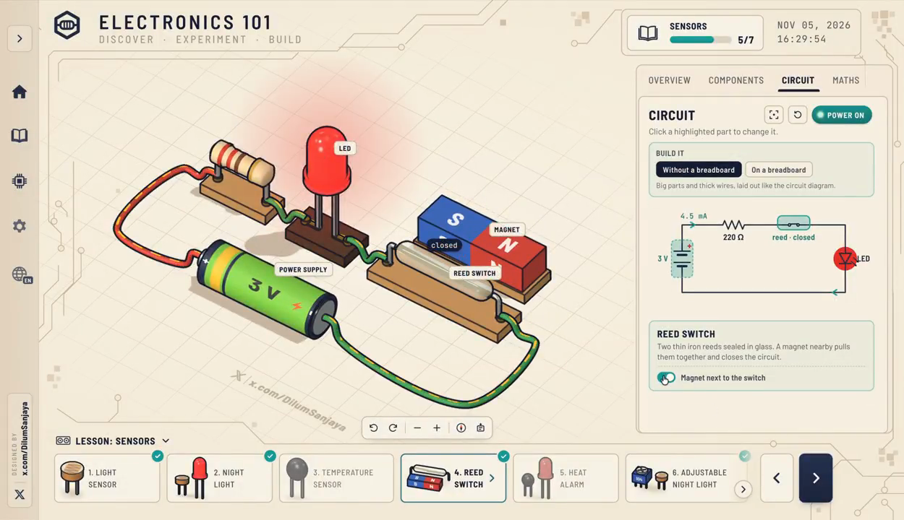

## 問題

學習者要把實物接線、電路符號與量測讀值對上，分頁閱讀容易丟失目前元件的脈絡。

## 做法

*5 秒：中央為電池、燈泡和開關的 3D 電路，右側同步提供線路圖，底部保留課程縮圖。*

*70 秒：切到電阻課程，中央出現儀表與旋鈕，右下以圖表對照數值關係。*

*140 秒：感測器課程顯示磁鐵、開關與發亮 LED，右側同時解說對應元件。*

影片由開關電路進入電阻與感測器課程；中央模型、右側 Overview／Components／Circuit／Math 分頁及底部課程列保持同一骨架。亮起的 LED 與右側示意圖提供不同抽象層次的對照；取樣不證明每次數值或操作均正確。

## 為什麼有效（推論）

同屏對照可能減少在實物與符號之間反覆尋找；底部縮圖有助保留課程位置。

## 借鑑要點

- **適合**：需要操作模型並對照原理的教學。
- **不適合**：僅需閱讀文字、裝置無法負擔 3D 的情境。
- **移植時注意**：提供 2D／文字替代，讓鍵盤與觸控也能選元件；同步標明模型、數值及說明目前對象。

## 來源與核對範圍

[Dilum Sanjaya；宝玉（轉介） 原帖](https://x.com/dotey/status/2126157234144989236)，發布：`2026-11-27T03:32:41+00:00`。2026-11-27 核對官方 X 頁內嵌完整文字及媒體；各影片保留三張影格，未保存原始影片。
影片來自轉介帖所引用的 [Dilum Sanjaya 原帖](https://x.com/DilumSanjaya/status/2118386789169938562)（ID `2118386789169938562`，發布 `2026-11-05T16:55:42+00:00`）；[產品入口](https://electronics-101-six.vercel.app)。本卡依原作者較早影片觀察，不把轉介所述 68 課與中文支援當成本次逐項實測。
