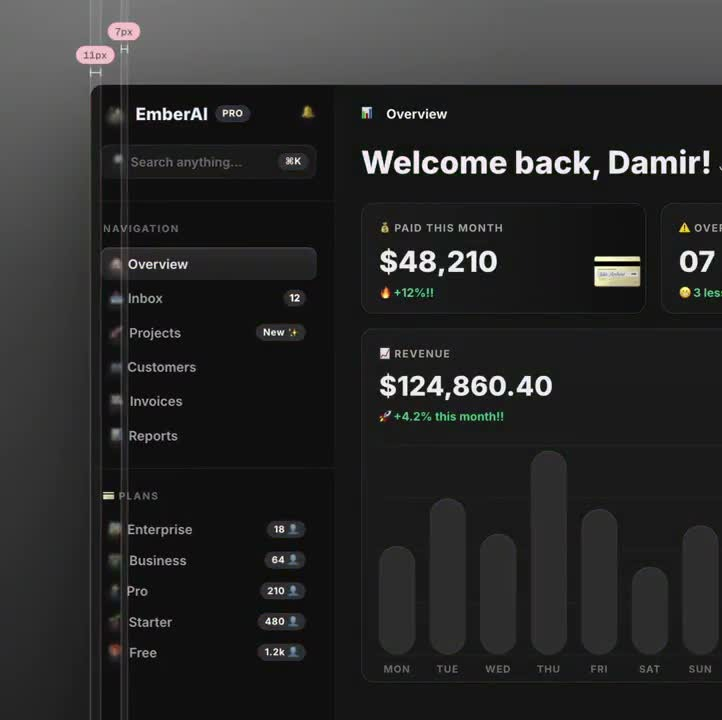
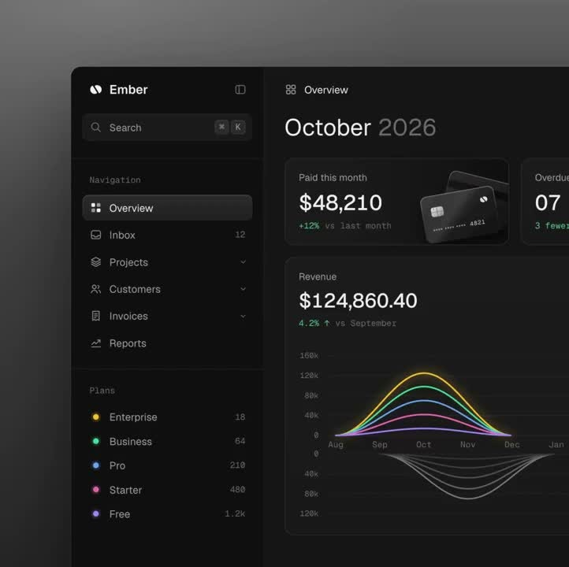

## 問題

財務儀表板同時用紫色發光、漸層、徽章與粗柱狀圖吸引注意，主要數字不容易建立層次。

## 做法

*原版以紫色漸層、發光側欄與粗柱狀圖呈現財務資料。*

*中段降低飽和度，畫面仍保留相同的資料區塊。*

*結尾用深色底、較克制的狀態色與細線圖重新分配注意力。*

- 影片由紫色介面開始，在相同側欄與數據卡位置標出間距，再切到低彩度的深色版本。
- 後段把大面積紫色裝飾收斂，保留 $48,210 與 $124,860.40 等主要數字；圖表改為多條細線，顏色集中在資料與狀態。
- 這是改版過程的視覺演示：呈現原版 → 間距與色彩調整 → 收斂後的結果；未展示可點擊產品。

## 為什麼有效（推論）

- 先保留資訊位置再減少視覺噪音，可能讓評審分清楚結構與風格兩種變更。

## 借鑑要點

- **適合**：資訊已完整但強調色過量的後台。
- **不適合**：需要高對比警示卻把所有顏色一併淡化的情境。
- **移植時注意**：先保留錯誤與選取狀態的對比；不能從這段影片推定細線圖比柱狀圖更適合所有資料。

## 來源與核實範圍

- [@sundyme 原帖](https://x.com/sundyme/status/2115106690836435400)；發表時間：2026-10-27T15:41:46+00:00。
- [影片原始作者 @heydamir](https://x.com/heydamir/status/2115063463063998736)。
- 依原帖文字與本次實際檢視的素材整理；未操作產品驗證功能。`date` 為收錄日期；原帖發表日期另記於 `published_at`。
