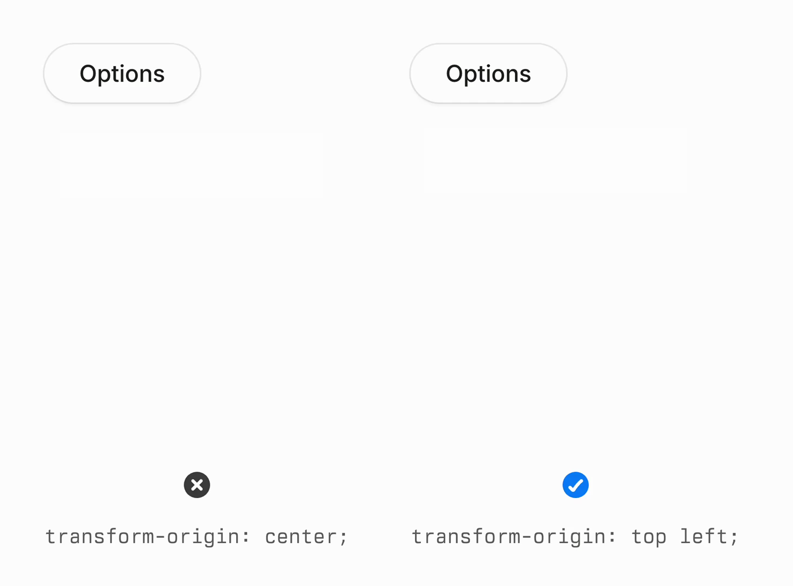
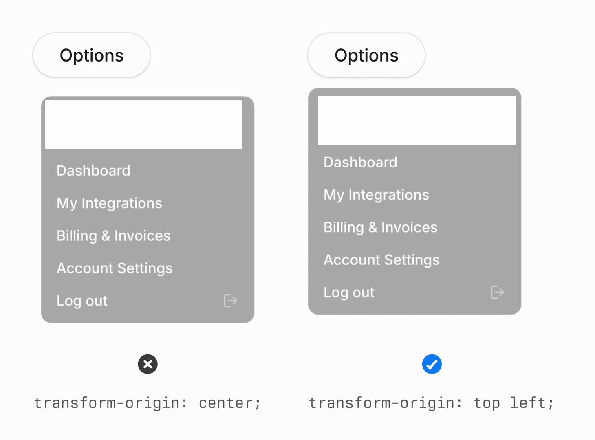
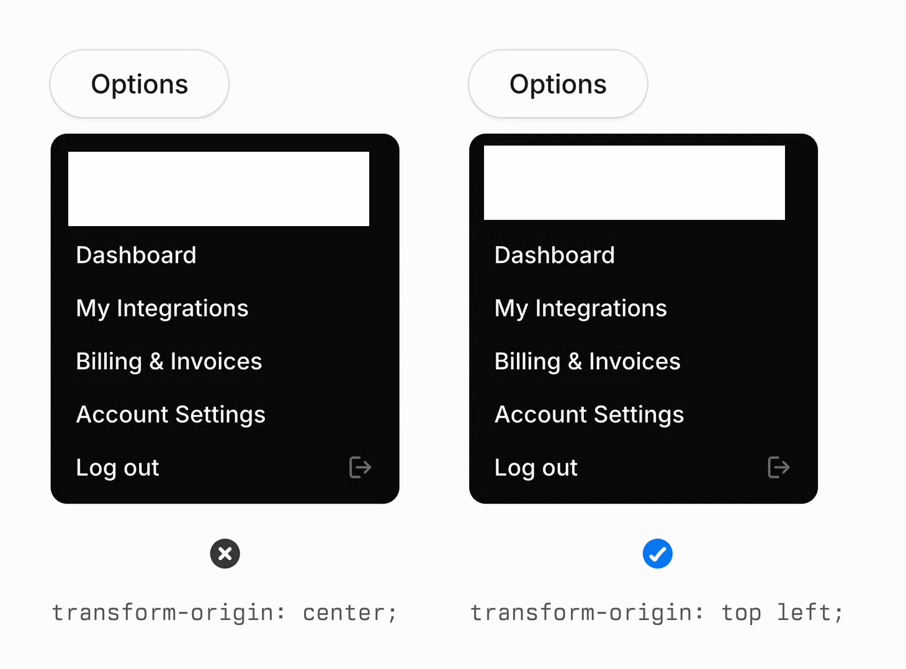
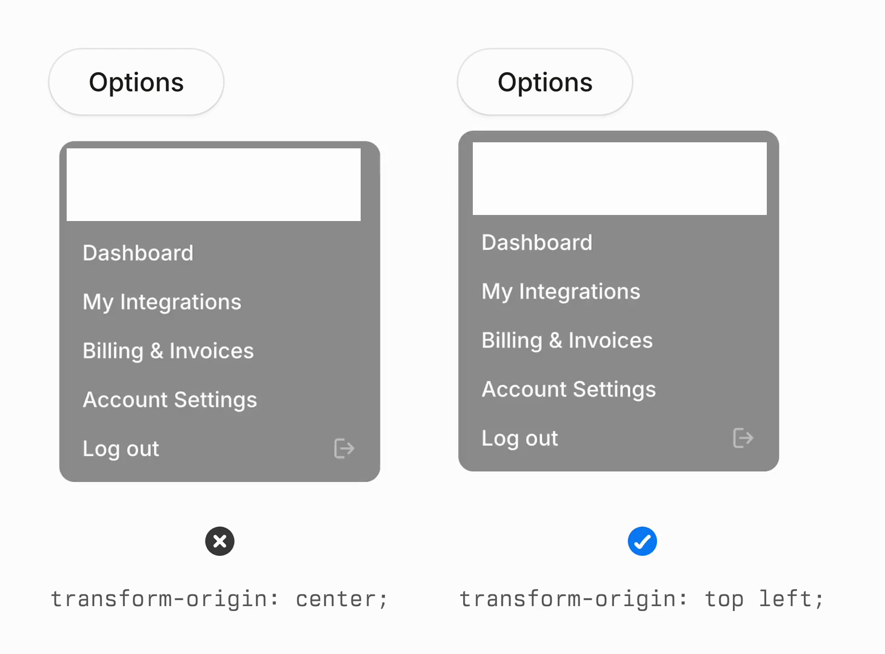

## 問題

按鈕叫出的下拉選單若從自身中心縮放，展開時靠近按鈕的邊緣也會移動。如何讓開啟和收合的空間方向對應觸發位置？

## 做法

來源與日期：[Emil 原帖](https://x.com/emilkowalski/status/2123029498694410401)實際發布於 **2026-11-18 12:24:11 UTC**；[Kubai 評論與引用](https://x.com/Kubai087/status/2123076115464098210)發布於 **2026-11-18 15:29:25 UTC**。收錄日期另記為 2026-11-18。官方逐帖資料的媒體來源 ID 指向 Emil 原帖，不能把 Kubai 當成影片作者。

以下是原帖官方媒體的五張影格，時間相對於影片起點，不是量測出的動畫時長。畫面僅保留設計示範，選單標頭的示例姓名與郵箱已以白色遮罩去除；遮罩不是原介面元素。

*0.00 秒：左右各有一個白底膠囊形 Options 按鈕；下方分別以叉號和勾號標示 center 與 top left 原點。*

*0.20 秒：兩個灰色半透明選單同步出現；左側選單左上角向內偏移，右側左上角維持在完整選單的定位處。*

*0.60 秒：兩側皆成為黑底圓角選單，按鈕與選單左邊緣對齊，內容由 Dashboard 排列到 Log out。*

*1.25 秒：選單縮小並淡出；左側向中心收縮，右側保留左上角位置而讓右邊與下邊向內收。*

*1.50 秒：兩個選單都已消失，Options 按鈕與下方比較標示仍在原位。*

- **佈局**：兩欄使用相同按鈕和選單內容；選單在按鈕下方，寬度大於按鈕，底部 Log out 右側附離開圖示。相同的最終畫面讓比較集中在過渡狀態。
- **觸發 → 變化 → 結束**：影片演示叫出選單後的縮放及淡入，停留於完整黑色面板，再縮小淡出回到只剩按鈕。未看到滑鼠點擊或鍵盤事件，因此不指定實際觸發手勢。
- **可見設定**：左欄明寫 `transform-origin: center;`，右欄明寫 `transform-origin: top left;`。右欄的左上角位於按鈕左側下方，所以此例把縮放基準設在面板左上角，並非把整個面板移進按鈕內。
- **作者主張**：Emil 建議 Dropdown、Popover、Menu 等由觸發元件叫出的介面從觸發處縮放；Kubai 的評論同樣指出應依開啟處選錨點。這是作者建議，未附可用性測試或成效數據。

## 為什麼有效（推論）

- 靠近按鈕的角保持定位，可能讓使用者把浮層理解為由該按鈕展開的內容，減少懸浮面板自行放大的感覺。
- 左右最終狀態相同，差異只在縮放時的邊緣位移；這提醒實作審查要看中間影格，單看完成截圖無法確認錨點是否合適。

## 借鑑要點

- **適合**：有明確觸發按鈕的工具選單、帳號選單與小型 Popover，尤其是面板比按鈕寬、開啟方向固定的情境。
- **不適合**：沒有局部觸發來源的全頁切換或置中對話框；本例不能證明它們都應採左上角。
- **移植時注意**：先確認面板實際位於按鈕哪一側，再設定靠近觸發處的縮放原點。向上開啟、右邊緣對齊或碰撞後翻向時，要重新計算；這是移植建議，原影片只展示向下、左對齊的版本。另行驗證快速開關、鍵盤焦點與減少動態效果偏好，不從影片推定已支援。

## 驗證與缺漏

已比對目前個人頁對照資料、兩個官方逐帖頁面的 ID／作者／發布時間，以及媒體的原始來源 ID；已檢視官方影片抽出的開啟與收合影格。先前一次逐帖抓取遇到代理 503，重試成功；最高解析度媒體回應 403，改取同一官方媒體所列的 1460×1080 版本成功。未以轉貼時間取代原作日期。

原帖沒有提供可執行原始碼或動畫參數；本卡是設計參考，未實作元件，也未執行瀏覽器功能測試。影片及抽樣聯絡表不留在案例目錄，只保存上述五張去識別影格。
