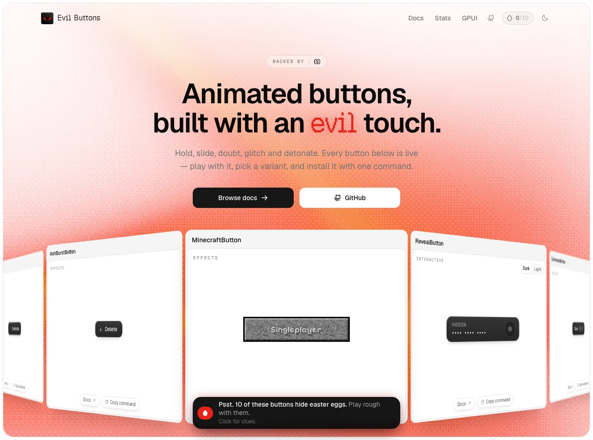

## 問題

設計師挑選按鈕時，需要同時理解外觀、互動用途與如何帶回專案。

## 做法

*按鈕展示卡將名稱、分類、實例及 Docs／Copy command 放在一起。*

- 來源連至 Evil Buttons 官網；實際頁面以一組展示卡片呈現 AshBurstButton、MinecraftButton 與 RevealButton 等按鈕。
- 每卡保留元件名稱、Effects／Interactive 等分類、中央示範，以及底部 Docs 與 Copy command。
- 頁面文字說明按鈕可以現場操作；本次只擷取頁面與讀取可見標籤，未測試按鈕完整互動或安裝任何技能。

## 為什麼有效（推論）

- 把展示、解說與取用入口相鄰安排，可能減少從靈感到實作的查找步驟。

## 借鑑要點

- **適合**：元件圖庫與互動資源索引。
- **不適合**：把破壞性操作做成玩笑卻不交代後果的正式業務流程。
- **移植時注意**：選取效果時仍保留可讀標籤、焦點狀態與減少動態效果選項；圖庫不是可及性驗收證據。

## 來源與核實範圍

- [@Kubai087 原帖](https://x.com/Kubai087/status/2114657951864791143)；發表時間：2026-10-26T09:58:38+00:00。
- [元件官網](https://www.evilbuttons.com/)。
- 依原帖文字與本次實際檢視的素材整理；未操作產品驗證功能。`date` 為收錄日期；原帖發表日期另記於 `published_at`。
